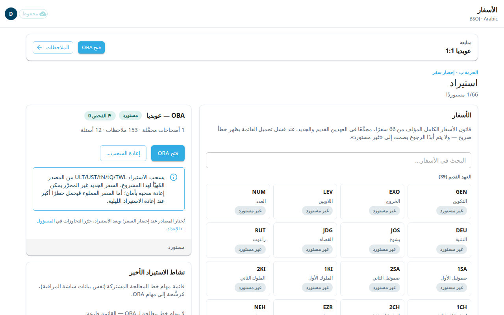

BPtranslate تطبيق ويب يترجم فيه فريقك النص الكتابي ومواد المساعدة على الترجمة. تسجّل الدخول بحسابك على Door43. تشرح هذه الصفحة تسجيل الدخول والشريط العلوي والإعدادات التي تصل إليها من زر حسابك.

## تسجيل الدخول
1. افتح التطبيق. إذا لم تكن مسجَّلًا للدخول فستظهر لك عبارة **سجّل الدخول للمتابعة**.
2. اختر **تسجيل الدخول عبر Door43**.
3. يطلب منك Door43 الموافقة على تسجيل الدخول. بعد الموافقة تعود إلى التطبيق. الشاشة الأولى هي **الأسفار**.

إذا سجّلت الخروج من قبل، تظهر العبارة **لقد سجّلت الخروج**. تبقى التعديلات المصطفّة في متصفحك حتى تعود إلى تسجيل الدخول.

## إذا لم يُسمح لك بالدخول
بعد تسجيل الدخول قد تظهر لك الرسالة **غير مُصرَّح**. تقول إن حسابك على Door43 ليس ضمن قائمة المحرِّرين المسموح لهم في هذا التطبيق (أو في مساحة عمل المؤسسة). اطلب من مسؤول إضافتك. ثم اختر **تسجيل الدخول بحساب Door43 آخر** إن كنت قد استخدمت الحساب الخطأ. قد يتذكّر Door43 الحساب القديم، فسجّل الخروج من Door43 نفسه أولًا.

بعض الأشخاص يمكنهم القراءة فقط. في هذه الحالة يظهر شريط في الأعلى يقول إنك مسجَّل الدخول بصلاحية عرض فقط وإن التعديلات لن تُحفظ. اطلب من مسؤول إضافتك محرِّرًا إن كنت بحاجة إلى التحرير.

## الشريط العلوي
في كل شاشة شريط واحد في الأعلى. اسم الشاشة وسهم الرجوع في جهة البداية. وفي جهة النهاية ترى:

- حالة الحفظ: **محفوظ** أو **جارٍ الحفظ** أو **غير متصل** أو **N غير محفوظ**. انظر [الحفظ والعمل دون اتصال](#help:save-and-sync).
- زرًّا دائريًّا فيه الحرف الأول من اسم المستخدم. هذه قائمة حسابك.
- زر **؟** يفتح هذا الدليل.

إذا توفّر إصدار أحدث من التطبيق يظهر زر **يتوفر تحديث للتطبيق — قم بالتحديث**. احفظ عملك أولًا ثم اخترْه.

## قائمة حسابك
اختر الزر الدائري. تعرض القائمة اسم المستخدم والمؤسسة، وهذه البنود:

- **المؤسسة**: لتبديل المؤسسة. تظهر فقط إذا كنت تنتمي إلى أكثر من مؤسسة. يعيد التبديل تحميل التطبيق، ويُمنع ما دامت هناك تعديلات غير محفوظة قيد المزامنة.
- **التبديل إلى الوضع الداكن**.
- **لغة الواجهة**: اختر لغة القوائم والأزرار. تحوّل العربية والفارسية والأردية الشاشة إلى اتجاه اليمين إلى اليسار. هذا لا يغيّر النص الذي تترجمه.
- **حجم نص القراءة**: لتصغير النص أو تكبيره.
- **المحرر الكلاسيكي**: انظر [المحرر الكلاسيكي](#help:classic-editor).
- **المسؤول**: للمسؤولين فقط.
- **تسجيل الخروج**.

إذا كان حسابك على Door43 ينتمي إلى عدة مؤسسات، فقد تفتح نافذة **اختر مؤسستك** بعد تسجيل الدخول. اختر مؤسسة، أو اختر **متابعة** لتبقى حيث أنت.

## التالي
انتقل إلى [الأسفار](#help:books) لفتح سفر.
