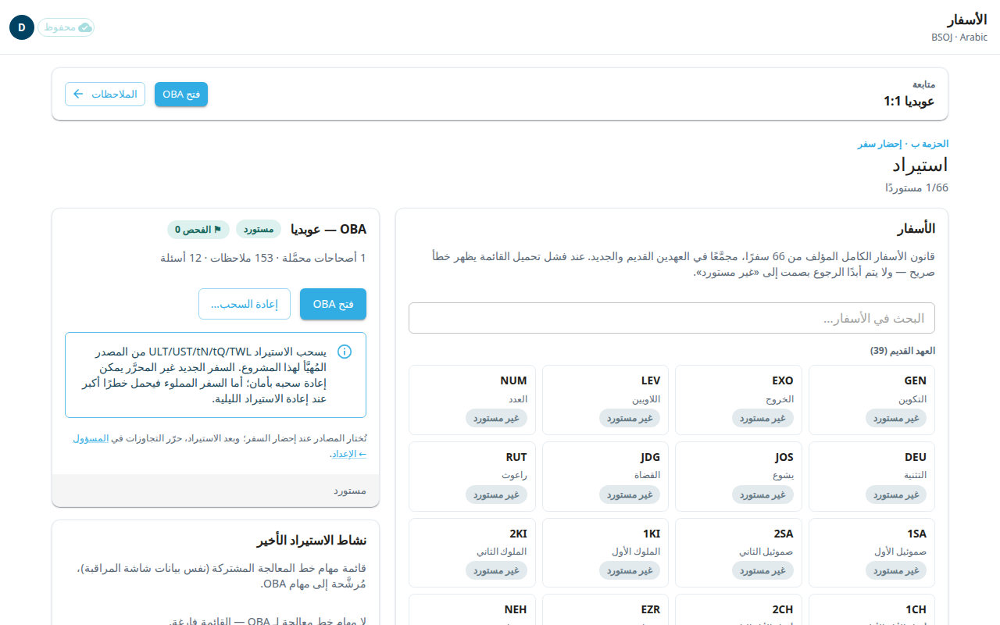
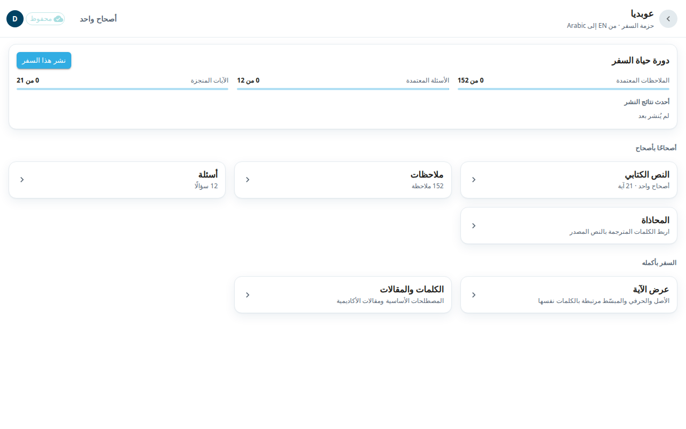

شاشة **الأسفار** هي أول شاشة في التطبيق. تعرض الأسفار الـ66 كلها. اختر سفرًا لتفتح حزمته، وهي المكان الذي يقودك إلى كل أنواع العمل في هذا السفر.

## افتح سفرًا
1. ابحث عن السفر. يمكنك تمرير قائمتي العهد القديم والعهد الجديد، أو الكتابة في **البحث في الأسفار…**.
2. يظهر على كل سفر **مستورد** أو **غير مستورد**. لا يُفتح إلا السفر المستورد.
3. اختر السفر. تظهر التفاصيل بجانب القائمة (وتحتها في الهاتف). وتبيّن عدد الأصحاحات والملاحظات والأسئلة المحمَّلة.
4. اختر **فتح OBA** (برمز سفرك). يفتح هذا حزمة السفر.

إذا كان السفر غير مستورد فسترى **لا شيء لفتحه بعد — المسؤول هو من يُحضر الأسفار إلى المحرر.**

## تابع من حيث توقفت
إذا كنت قد عملت من قبل، فإن بطاقة **متابعة** في الأعلى تعرض آخر مكان كنت فيه، مثل عوبديا 1:1. اختر **فتح OBA** للانتقال إلى حزمة ذلك السفر. واختر **الملاحظات** للانتقال إلى ملاحظات تلك الآية.

## إحضار سفر (للمسؤولين)
يرى المسؤولون عنوان **استيراد** ولوحة إضافية لكل سفر.
1. اختر سفرًا حالته **غير مستورد**.
2. اختر **إحضار OBA…**.
3. تحت **الغرض** اختر **ترجمة سفر جديد** (يحمّل النص المصدر الإنجليزي والملاحظات والأسئلة لتترجمها) أو **تحميل عملي الحالي** (يحمّل السفر من مستودع مؤسستك الخاص).
4. في معظم الأسفار اترك المصادر على الوضع الافتراضي ثم اختر **إحضار OBA**.

قد يستغرق السفر الكبير حتى دقيقة. إذا غادرت الشاشة يستمر الاستيراد. وفي سفر مستورد من قبل، يجلب **إعادة السحب…** محتوى جديدًا من Door43 دون أن يستبدل الصفوف التي حرّرها المترجمون. وإعادة الاستيراد القسرية التي تتخلص من التعديلات تطلب منك التأكيد أولًا.

## حزمة السفر
بعد **الفتح** ترى حزمة السفر. يعيدك سهم الرجوع إلى **الأسفار**.

- **دورة حياة السفر** تعرض التقدّم: **الملاحظات المعتمدة** و**الأسئلة المعتمدة** و**الآيات المنجزة**. ويرى المسؤولون أيضًا **نشر هذا السفر** و**أحدث نتائج النشر**. النشر يرسل المحتوى المعتمد إلى Door43. أما الصفوف التي لا تزال تنتظر المراجعة فتُحجب.
- **أصحاحًا بأصحاح**: **النص الكتابي** و**ملاحظات** و**أسئلة** و**المحاذاة**. اختر صفًّا لتفتح قائمة أصحاحاته ثم اختر أصحاحًا. الصف الذي لا شيء فيه (مثلًا لا ملاحظات) يظهر باهتًا.
- **السفر بأكمله**: **عرض الآية** و**الكلمات والمقالات**.

انظر أيضًا: [النص الكتابي](#help:scripture)، [الملاحظات](#help:notes)، [الأسئلة](#help:questions)، [المحاذاة](#help:alignment)، [عرض الآية](#help:verse-view)، [الكلمات والمقالات](#help:words).
