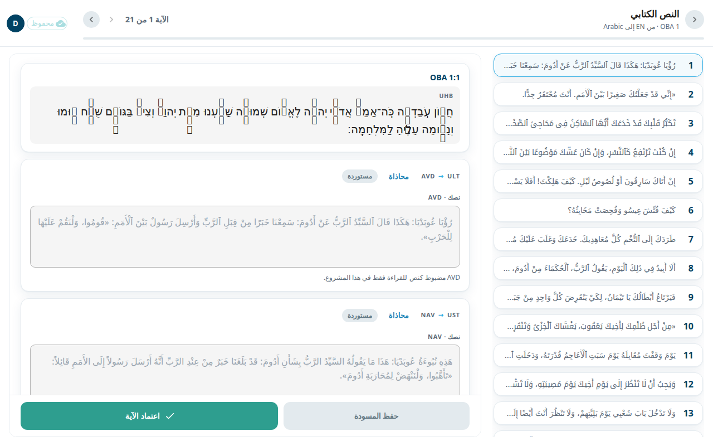
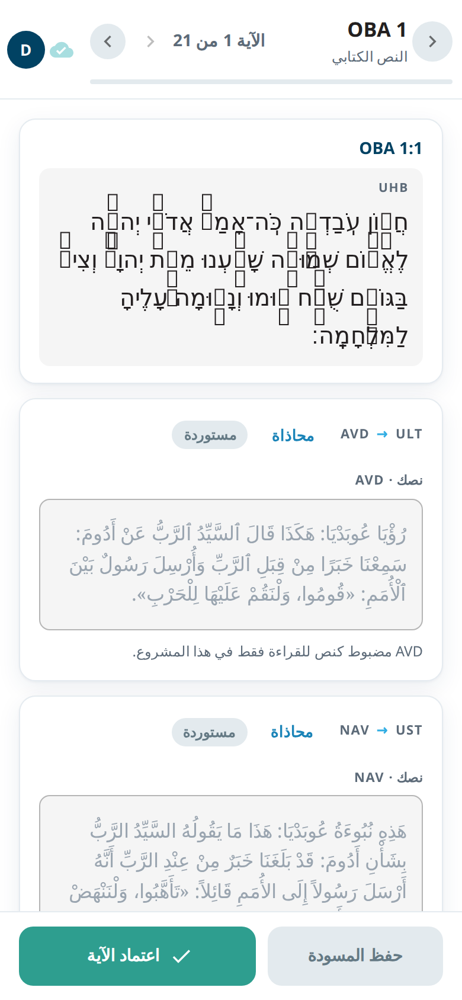

شاشة **النص الكتابي** هي المكان الذي تكتب فيه آيات أصحاح واحد وتعتمدها، آيةً بعد آية. لكل آية مربعان: **ULT** (النص الحرفي الذي يتبع كلمات الأصل عن قرب) و**UST** (النص المبسّط الذي يقول المعنى بكلمات واضحة). في مشروع الترجمة يحمل المربعان لغتك أنت.

## افتح الشاشة
1. افتح سفرًا من [الأسفار](#help:books).
2. في الحزمة اختر **النص الكتابي** ثم اختر أصحاحًا.

يعرض العنوان السفر والأصحاح، مثل `OBA 1`. وبجانبه ترى **الآية 1 من 21** والسهمين **الآية السابقة** و**الآية التالية**. ويبيّن شريط رفيع مقدار ما أنجزته.

في الشاشة العريضة تظهر قائمة الآيات في جهة البداية. وقد تحمل كل آية شارة: **معتمدة** أو **مسودة محفوظة**. وفي الهاتف ترى آية واحدة في كل مرة. ويمكنك أيضًا السحب جانبًا للانتقال إلى الآية التالية أو السابقة (لا يعمل ذلك إذا بدأت السحب داخل مربع نص).

## اكتب آية
1. اقرأ بطاقة المرجع. تعرض الآية ونص اللغة الأصلية.
2. انقر داخل المربع **نصك · ULT** واكتب الآية أو صحّحها. افعل الشيء نفسه في **نصك · UST**.
3. اختر **حفظ المسودة** لحفظ المربعين دون اعتماد. تظهر رسالة **مسودة محفوظة**.
4. عندما تنتهي الآية اختر **اعتماد الآية**. يحفظ ذلك المربعين ويضع علامة الإنجاز على الآية.
5. اختر **التالي** للانتقال إلى الآية التالية.

على كل مربع شارة: **مستوردة** (لم يغيّرها أحد) أو **محرَّرة** أو **معتمدة**.

## عند إنهاء أصحاح
بعد آخر آية ترى **اكتمل نص OBA 1** مع عدد الآيات المعتمدة. اختر **المتابعة إلى OBA 2** أو **مراجعة مرة أخرى**.

## المحاذاة
المحاذاة تربط كلماتك بكلمات الأصل. تحرير آية يُبقي محاذاة الكلمات التي لم تمسّها. وإذا كان الحفظ سيزيل محاذاة كلمات لم تغيّرها، تظهر نافذة **هذا الحفظ سيلغي محاذاة كلمات لم يمسّها** تذكرها. اختر **إلغاء** للرجوع، أو **الحفظ على أي حال**. يبقى ما كتبته في الحالتين. أصلح الكلمات غير المحاذاة بعد ذلك.

في الشاشة العريضة يحمل كل مربع زر **محاذاة**. ويفتح **محاذاة المسارين** النصين جنبًا إلى جنب. وكلاهما يفتح شاشة [المحاذاة](#help:alignment).

## من المفيد أن تعرف
- إذا كانت لديك صلاحية عرض فقط، ترى إشعارًا وتكون المربعات للقراءة فقط.
- عندما تعيد عملية ذكاء اصطناعي كتابة الأصحاح، قد يُرفض الحفظ ويُسقط بدلًا من الكتابة فوق العمل. عندها تخبرك الشاشة بأن الآية لم تُعتمد.
- إذا غيّر شخص آخر الآية، تطلب منك رسالة حل التعارض من شريط الحالة. انظر [الحفظ والعمل دون اتصال](#help:save-and-sync).
