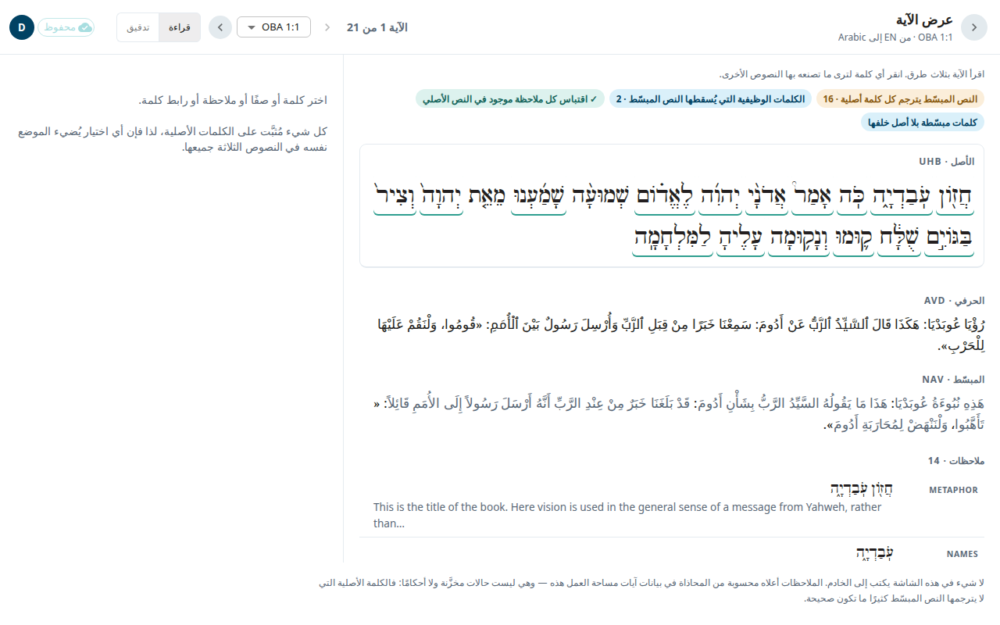

يساعدك **عرض الآية** على فحص آية واحدة. يعرض النص الأصلي (العبري أو اليوناني) والنص الحرفي (ULT) والنص المبسّط (UST) مرتبطة بالكلمات نفسها. إذا نقرت كلمة في أحد النصوص يُضاء المكان نفسه في النصين الآخرين. **لا شيء في هذه الشاشة يغيّر عملك.** هي للقراءة والفحص.

## افتحه
1. افتح سفرًا من [الأسفار](#help:books).
2. في الحزمة، تحت **السفر بأكمله**، اختر **عرض الآية**. يفتح عند آخر آية عملت عليها في ذلك السفر، أو عند 1:1.

يعيدك سهم الرجوع إلى الحزمة.

## التنقل بين الآيات
- اختر **الآية السابقة** أو **الآية التالية**. ومفاتيح الأسهم (← →) تفعل الشيء نفسه.
- استخدم **الانتقال إلى آية** للقفز إلى آية في الأصحاح نفسه.
- يبيّن العدد، مثل **الآية 1 من 21**، موضعك.

## وضع القراءة ووضع التدقيق
في الأعلى اختر **قراءة** أو **تدقيق**.

- **قراءة** تعرض الآية بثلاث طرق: **الأصل** و**الحرفي** و**المبسّط**. انقر أي كلمة لترى ما تصنعه بها النصوص الأخرى.
- **تدقيق** تعرض صفًّا لكل كلمة أصلية. يبيّن كل صف ما صنعه بالكلمة النص الحرفي وما صنعه بها النص المبسّط. الكلمة التي لا يترجمها نص ما تظهر **غير مُترجَمة**. وهذا صحيح في كثير من الأحيان، فتعامل معه كسؤال لا كخطأ. أما الكلمات المضافة التي لا كلمة أصلية وراءها فتُذكر تحت الصفوف.

## لوحة التفاصيل
اختر كلمة أو صفًّا أو ملاحظة أو رابط كلمة. تعرض اللوحة (تحت النص في الشاشة الضيقة):

- الكلمة الأصلية مع قواعدها ومدخلها في المعجم؛
- النص الحرفي والنص المبسّط لتلك الكلمة؛
- الملاحظات وروابط الكلمات المرتبطة بها.

تُسرد موارد الآية في مجموعات: **ملاحظات** و**روابط الكلمات** و**أسئلة**، لكل منها عدد. اختر واحدًا لتراه في اللوحة. والملاحظة التي لا يتطابق اقتباسها مع النص الأصلي لهذه الآية تحمل علامة **الاقتباس غير مُثبَّت**.

## اقرأ مقالة من مواد المساعدة
عندما تختار ملاحظة أو رابط كلمة قد تعرض اللوحة **اقرأ مقال أكاديمية الترجمة ←** أو **اقرأ مقال كلمات الترجمة ←**. يفتح المقال في مكانه. اختر **العودة إلى القائمة** للرجوع، أو **افتح في محرّر المقالات** للانتقال إلى المقال الكامل. انظر [الكلمات والمقالات](#help:words).

إذا لم يكن لسفر ما نص أصلي محمَّل، تقول الشاشة ذلك وتبقى تسرد الموارد.
