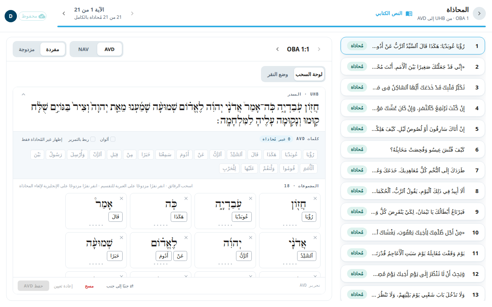
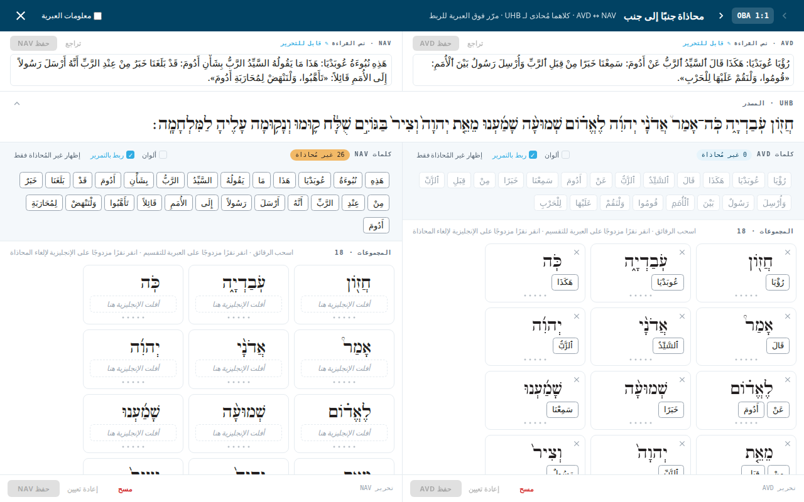

**ما محاذاة الكلمات؟** المحاذاة تربط كل كلمة في ترجمتك بالكلمة أو الكلمات في العبرية أو اليونانية الأصلية التي تترجمها. تتيح هذه الروابط للأدوات الأخرى أن تعرض أي ملاحظة تخص أي كلمات، وتتيح للقارئ أن يرى من أين جاءت الكلمة. والكلمة التي لا رابط لها **غير مُحاذاة**. تُحفظ المحاذاة مع الآية.

## افتح الشاشة
- من الحزمة اختر **المحاذاة** ثم اختر أصحاحًا. أو:
- في شاشة [النص الكتابي](#help:scripture) اختر **محاذاة** (نص واحد) أو **محاذاة المسارين** (النصين معًا).

العنوان هو **المحاذاة**. وتحته ترى السفر والأصحاح وسهمًا من النص الأصلي إلى النص الذي تحاذيه، مثل `OBA 1 · UHB → ULT`. ويبيّن العدد **N من M مُحاذاة بالكامل** تقدّم الأصحاح. وفي قائمة الآيات شارة لكل آية: **مُحاذاة** أو **N غير مُحاذاة** أو **فجوات في المصدر** (كلمات أصلية لا شيء مرتبط بها) أو **غير مُصاغة**.

## مفردة أو مزدوجة
يختار زرّان العرض:

- **مفردة** تحاذي نصًّا واحدًا في كل مرة. اختر النص من أداة الاختيار المجاورة (ULT أو UST).
- **مزدوجة** تضع ULT وUST جنبًا إلى جنب في نافذة بملء الشاشة. كلاهما مُحاذى إلى كلمات الأصل نفسها، فتستطيع المقارنة بينهما. يكون الزر باهتًا إذا لم يكن في الآية نص للمقارنة.

في الوضع المزدوج يمكنك أيضًا تصحيح نص الآية. احفظ المحاذاة أولًا ثم حرّر. وعندما تُغلق وفيها عمل غير محفوظ، تعرض نافذة **تغييرات غير محفوظة** الأزرار **إلغاء** و**تجاهل** و**حفظ**.

## حاذِ الكلمات (مفردة)
تقدّم الشاشة طريقتين للعمل. في الشاشة الكبيرة يمكنك التبديل بين **لوحة السحب** و**وضع النقر**. وفي الهاتف يتوفر وضع النقر فقط.

لوحة السحب:
1. اسحب رقاقة كلمة من بنك الكلمات إلى بطاقة من الكلمات الأصلية (**أفلت الإنجليزية هنا**).
2. لتقسيم مجموعة أصلية مدموجة انقر نقرًا مزدوجًا على الكلمة الأصلية. ولإلغاء محاذاة كلمة انقر عليها نقرًا مزدوجًا أو اسحبها عائدةً إلى بنك الكلمات.
3. اختر **حفظ ULT** (يحمل الزر اسم النص الذي تحاذيه). وتعيدك **إعادة تعيين** إلى آخر نسخة محفوظة.

وضع النقر:
1. انقر بطاقة من الكلمات الأصلية ثم انقر كلمات الهدف التي تنتمي إليها. (أو انقر كلمات الهدف أولًا ثم البطاقة.)
2. إذا ظهرت اقتراحات فاختر **✓ قبول** أو **✗ تخطٍّ** لكل منها.
3. استخدم **إلغاء المحاذاة** أو **⧉ دمج** أو **تقسيم** لإصلاح اقتران.
4. اختر **حفظ المحاذاة**. ترى **N من M كلمة مُحاذاة** ويمكنك استخدام **الانتقال إلى غير المُحاذاة ↓** لتجد ما بقي.

## من المفيد أن تعرف
- إذا كانت لديك صلاحية عرض فقط فالمحاذاة للقراءة فقط.
- قبل تبديل النص أو الوضع احفظ المحاذاة غير المحفوظة أو أعد تعيينها. يُمنع التبديل حتى ذلك.
- إذا كان الحفظ سيلغي محاذاة كلمات لم تمسّها، تطلب منك نافذة التأكيد.
