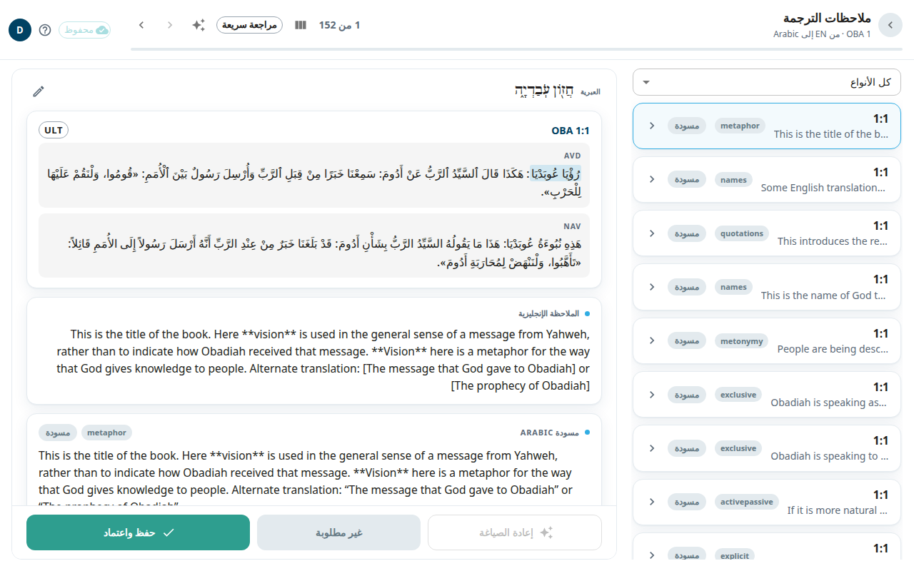
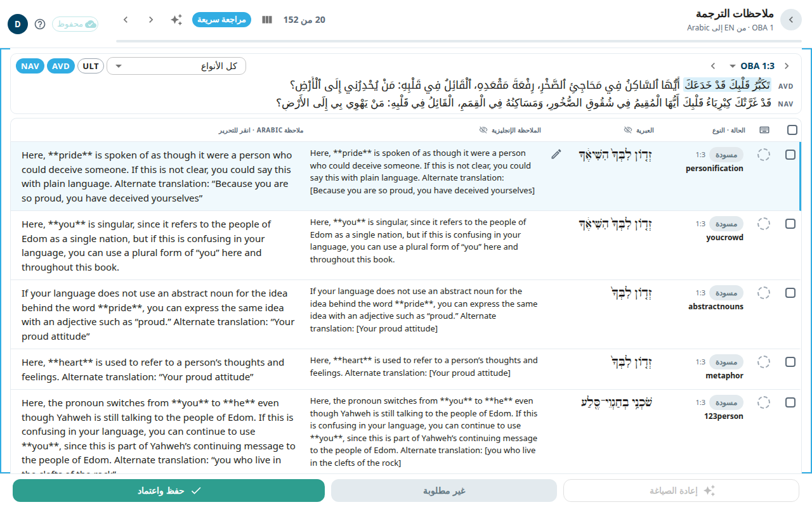

شاشة **ملاحظات الترجمة** هي المكان الذي تترجم فيه ملاحظات (tN) أصحاح واحد. ملاحظة الترجمة تشرح موضعًا صعبًا في آية. لكل ملاحظة اقتباس من النص الأصلي، ورابط إلى مقال في أكاديمية الترجمة (tA)، ونص الملاحظة. ترى الملاحظة الإنجليزية وتكتب نسختك بجانبها.

## افتح الشاشة
1. افتح سفرًا من [الأسفار](#help:books).
2. في الحزمة اختر **ملاحظات** ثم اختر أصحاحًا. أو اختر **الملاحظات** في بطاقة **متابعة** للانتقال إلى الملاحظة عند آخر آية لك.

تعرض الترويسة السفر والأصحاح. ويبيّن عدد مثل **1 من 5** موضعك. استخدم الأسهم أو **التالي** و**السابق** للتنقل. في الشاشة العريضة تظهر قائمة الملاحظات في جهة البداية. وفي كل صف آية ومعاينة وشارة حالة: **مسودة** أو **محرَّر** أو **بانتظار الاعتماد** أو **غير محفوظ** أو **معتمد**. وإذا كان في الأصحاح أنواع كثيرة من الملاحظات فإن قائمة **كل الأنواع** ترشّح حسب نوع مقال tA.

## ترجم ملاحظة واحدة
تظهر الملاحظة في صورة بطاقات متراصّة:
1. اقتباس اللغة الأصلية الذي تتناوله الملاحظة.
2. بطاقة النص الكتابي مع الآية. تظهر كلمات الاقتباس مظلّلة. وعندما يتوفر ذلك، تتيح لك شارات فوق الآية إظهار نص ULT الإنجليزي ومحاذاته.
3. **الملاحظة الإنجليزية** (للقراءة فقط).
4. مسودتك، وعنوانها بلغتك، مثل **مسودة** أو **مسودة · ذكاء اصطناعي** إذا كتبها الذكاء الاصطناعي.

لكتابة ملاحظتك:
1. انقر على نص مسودتك. يُفتح مربع.
2. اكتب الملاحظة أو صحّحها.
3. اختر **حفظ** لتحتفظ بنصك دون اعتماد.
4. عندما تصبح صحيحة اختر **حفظ واعتماد** في الأسفل. يحفظ هذا الزر الملاحظة ويضع عليها علامة الاعتماد.

الزرّان الآخران في الأسفل:
- **إعادة الصياغة** تطلب من الذكاء الاصطناعي مسودة جديدة. تعمل في الخلفية وتظهر المسودة الجديدة عند اكتمالها. وتحتاج إلى اقتباس ومرجع دعم في الملاحظة.
- **غير مطلوبة** تضع الملاحظة جانبًا حين لا تحتاج إلى ترجمة. تذهب الملاحظة إلى المهملات. ويمكنك إعادتها من [قائمة المراجعة](#help:review-queue) حتى النشر الليلي. بعد ذلك تُحذف نهائيًا.

ويفتح رمز بجانب الآية عرض الآية. انظر [عرض الآية](#help:verse-view).

## المراجعة السريعة
على شاشة لا يقل عرضها عن 1200 بكسل، مثل معظم الحواسيب المحمولة، ينقلك زر **مراجعة سريعة** في الشريط العلوي إلى قائمة مضغوطة لمراجعة ملاحظات كثيرة بسرعة. اختره مرة أخرى للعودة إلى البطاقات. ويتذكر التطبيق اختيارك في هذا المتصفح. أما على شاشة أصغر أو في نافذة ضيقة فترى البطاقات دائمًا، ويختفي الزر.

تبقى الآية في الأعلى أثناء التمرير. وتحتها تظهر كل ملاحظة من ملاحظات الآية في صف واحد: حالتها، ونوعها في tA، واقتباس اللغة الأصلية، و**الملاحظة الإنجليزية**، وملاحظتك. اختر نوعًا من **كل الأنواع** لتعرض بدلًا من ذلك كل ملاحظات هذا النوع في الأصحاح، مجمّعة حسب الآية.

- انقر على ملاحظتك في أي صف لتحريرها. اختر **حفظ** لتحتفظ بها، أو **حفظ واعتماد** في الأسفل لحفظها واعتمادها.
- الدائرة في بداية الصف تعتمد تلك الملاحظة. وتمتلئ عندما تُعتمد الملاحظة. أما الملاحظة التي فيها كتابة غير محفوظة فيجب فتحها وحفظها أولًا.
- يُظهر زر **الملاحظة الإنجليزية** فوق القائمة عمود الإنجليزية أو يخفيه.

تعمل المفاتيح بعد أن تنقر على جزء فارغ من القائمة أو على نوع ملاحظة:
- **J** و**K** (أو مفاتيح الأسهم) تنقلك إلى الملاحظة التالية والسابقة.
- **Enter** يفتح المحرر. وداخله **Ctrl+Enter** يحفظ ويعتمد، و**Esc** يغلقه مع الاحتفاظ بما كتبته.
- **A** يعتمد الملاحظة الحالية، ويحفظها أولًا إن غيّرتها، ثم ينتقل إلى التالية.
- **E** يُظهر عمود الإنجليزية أو يخفيه. و**U** يُظهر نص ULT الإنجليزي أو يخفيه، حين تتيحه الشاشة.

### حدّد عدة ملاحظات معًا
يبدأ كل صف بمربع تحديد. وعند تحديد ملاحظات يظهر شريط في الأسفل بدلًا من الأزرار المعتادة:
- انقر على مربع لتحديد ملاحظة واحدة. واضغط **Shift** مع النقر على مربع آخر لتحديد كل الملاحظات بينهما. والمربع فوق القائمة يحدد كل الملاحظات المعروضة أو يلغي تحديدها.
- من لوحة المفاتيح، **Space** أو **X** يحدد الملاحظة الحالية، و**Shift+J** أو **Shift+K** يحدد الملاحظة التالية أو السابقة أيضًا.
- **اعتماد** يعتمد الملاحظات المحددة. وإذا كانت الملاحظة المفتوحة محددة وفيها تغيير فإنه يُحفظ أولًا.
- **إعادة الصياغة بالذكاء الاصطناعي** تطلب من الذكاء الاصطناعي مسودات جديدة للملاحظات المحددة في تشغيل واحد. وتبقى تلك الملاحظات للقراءة فقط حتى ينتهي.
- **غير مطلوبة** تضع الملاحظات المحددة جانبًا. اختر **تراجع** في الرسالة التي تظهر، أو اضغط **Ctrl+Z**، لإعادتها.

يتخطى التطبيق الملاحظة، ويخبرك بعدد ما تخطاه وسببه، إذا كانت فيها كتابة غير محفوظة أو تغيير لا يزال قيد الحفظ. ويتخطى **اعتماد** أيضًا الملاحظة التي غيّرها شخص آخر بعد تحميلها، وتتخطى **إعادة الصياغة بالذكاء الاصطناعي** الملاحظات المعتمدة. وتبقى الملاحظات المتخطاة محددة. ولا يوجد تراجع عن الاعتماد.

## عند إنهاء أصحاح
ترى **اكتملت ملاحظات OBA 1** مع عدد الملاحظات المعتمدة والمحرَّرة وغير المطلوبة. اختر **المتابعة إلى الأصحاح 2** أو **المراجعة مرة أخرى**.

## بدء تشغيل بالذكاء الاصطناعي
للمحرِّرين والمسؤولين أيقونة إضافية في الشريط العلوي.

في مشروع ترجمة هي أيقونة النجوم اللامعة، **بدء تشغيل بالذكاء الاصطناعي**. وتفتح قائمة فيها:
- **ترجمة الأصحاح**: يكتب الذكاء الاصطناعي مسودات ملاحظات الترجمة للأصحاح.
- **ترجمة الأسئلة**: يكتب الذكاء الاصطناعي مسودات أسئلة الترجمة للأصحاح.
- **استيراد من Door43**: يفتح نافذته الخاصة. اكتب أصحاحًا أو نطاقًا في **أصحاح أو نطاق**، وحدّد ما تريد جلبه تحت **ما الذي تريد استيراده:**، واضغط **استيراد**. تُتخطّى الصفوف التي حرّرها المترجمون بالفعل.
- **جلب مسودات Aquifer** (للمسؤولين فقط): يبدأ فورًا للسفر كله، دون نافذة تأكيد. يضيف ملاحظات ترجمة Aquifer كمسودات للمراجعة، ويَسِم الملاحظات المترجمة من قبل بأنها معتمدة.
- **إعادة جلب الملاحظات من الإنجليزية** (للمسؤولين فقط): يعيد تنزيل السفر كله من Door43: النص الكتابي من نص الكتاب المقدس الخاص بمشروعك (أو من المصدر الإنجليزي إن لم يكن لمشروعك نص لهذا السفر)، والملاحظات والأسئلة وروابط الكلمات من المصدر الإنجليزي. وتُفقد التعديلات المحلية على السفر. اضغط **إعادة الجلب** للتأكيد. وإذا كانت في السفر تعديلات محلية، تعرض نافذة ثانية عددها وتطلب التأكيد مرة أخرى: **تجاهل وإعادة الجلب**.

بعد **ترجمة الأصحاح** أو **ترجمة الأسئلة** تفتح نافذة تأكيد: اكتب أصحاحًا أو نطاقًا في **أصحاح أو نطاق** واضغط **بدء**.

في مشروع مصدر، أي مشروع لا يترجم من لغة أخرى (مثل المشروع الإنجليزي من unfoldingWord)، تكون الأيقونة أيقونة التنزيل، **استيراد من Door43**. وتفتح نافذة الاستيراد مباشرة، دون قائمة.

على الهاتف لا تظهر الأيقونة في الشريط العلوي. بل تجدها أول عنصر في قائمة حسابك، بالاسم نفسه.

ما دام تشغيل **ترجمة الأصحاح** في مرحلة البدء أو جاريًا أو متوقفًا مؤقتًا على أصحاح، لا يمكن حفظ ملاحظات ذلك الأصحاح. وفي أثناء تشغيل **ترجمة الأسئلة** يمكنك تحرير الملاحظات الموجودة وإزالتها، لكن لا يمكنك إضافة ملاحظة. أما التشغيل الذي لا يزال ينتظر في الطابور فلا يقفل شيئًا. ويتابع المسؤولون التشغيلات في [استوديو الذكاء الاصطناعي](#help:admin-ai).

## من المفيد أن تعرف
- يُحفظ نصك في متصفحك أثناء الكتابة. ويعرض الشريط العلوي **N غير محفوظ** إلى أن تحفظ. انظر [الحفظ والعمل دون اتصال](#help:save-and-sync).
- إذا حفظ محرر آخر الملاحظة نفسها قبلك، يقول شريط إن نسختك لم تُحفظ. اختر **إعادة تحميل الملاحظة** لترى نسخته.
- لا ينشر Door43 إلا الملاحظات المعتمدة. أما الملاحظات المسودة والمحرَّرة فتحتفظ بآخر نص نُشر لها.
- إذا كانت لديك صلاحية عرض فقط فيمكنك القراءة دون التحرير.
