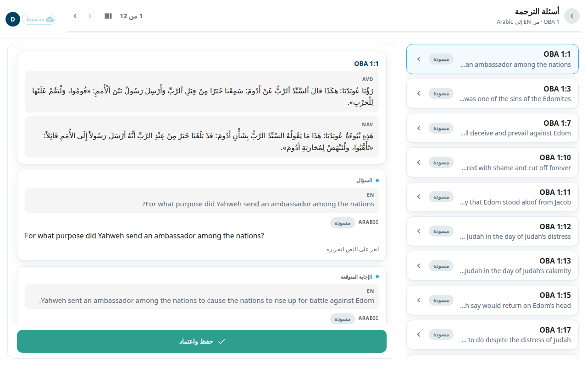

شاشة **أسئلة الترجمة** هي المكان الذي تترجم فيه أسئلة (tQ) أصحاح واحد. سؤال الترجمة يتحقق من أن القارئ فهم آية. لكل سؤال **السؤال** و**الإجابة المتوقعة**. ترى النص الإنجليزي وتكتب الشيء نفسه بلغتك.

## افتح الشاشة
1. افتح سفرًا من [الأسفار](#help:books).
2. في الحزمة اختر **أسئلة** ثم اختر أصحاحًا. يظهر الصف باهتًا إذا لم يكن في السفر أسئلة.

تعرض الترويسة السفر والأصحاح وعددًا مثل **1 من 5**. استخدم الأسهم أو **التالي** و**السابق** للتنقل. في الشاشة العريضة تظهر قائمة الأسئلة في جهة البداية، وفي كل صف آية ومعاينة وشارة حالة.

## ترجم سؤالًا واحدًا
كل سؤال عبارة عن بطاقات متراصّة:
1. المرجع والآية في ULT وUST (النص الحرفي والنص المبسّط).
2. **السؤال**: السؤال الإنجليزي ثم مربعك.
3. **الإجابة المتوقعة**: الإجابة الإنجليزية ثم مربعك.

للكتابة:
1. انقر على نص سؤالك. يُفتح مربع. اكتب أو صحّح.
2. افعل الشيء نفسه في **الإجابة المتوقعة**.
3. اختر **حفظ** لتحتفظ بنصك دون اعتماد.
4. عندما يصبح الاثنان صحيحين اختر **حفظ واعتماد** في الأسفل.

لا يوجد هنا إلا قرار واحد: **حفظ واعتماد**. الأسئلة تُعدَّل ولا تُتخطّى. فإن لم يعجبك سؤال فحرّره واعتمد نسختك. ولا يوجد أيضًا زر **إعادة الصياغة** في هذه الشاشة. وتبيّن شارة حالة الصف: **مسودة** أو **محرَّر** أو **معتمد** أو **غير محفوظ**.

إذا لم يكن المصدر الإنجليزي لسؤال ما متوفرًا فإن الشاشة تقول ذلك. قد يحدث هذا لسؤال أُضيف في هذا المشروع ولم يُترجم من الأسئلة المنشورة.

## عند إنهاء أصحاح
ترى **تمت مراجعة أسئلة OBA 1** مع عدد الأسئلة **اعتُمدت كما هي** و**محرَّرة** و**الإجمالي**. اختر **المتابعة إلى الأصحاح 2** أو **المراجعة مرة أخرى**.

## بدء تشغيل بالذكاء الاصطناعي
للمحرِّرين والمسؤولين أيقونة إضافية في الشريط العلوي.

في مشروع ترجمة هي أيقونة النجوم اللامعة، **بدء تشغيل بالذكاء الاصطناعي**. وتفتح قائمة فيها:
- **ترجمة الأصحاح**: يكتب الذكاء الاصطناعي مسودات ملاحظات الترجمة للأصحاح.
- **ترجمة الأسئلة**: يكتب الذكاء الاصطناعي مسودات أسئلة الترجمة للأصحاح.
- **استيراد من Door43**: يفتح نافذته الخاصة. اكتب أصحاحًا أو نطاقًا في **أصحاح أو نطاق**، وحدّد ما تريد جلبه تحت **ما الذي تريد استيراده:**، واضغط **استيراد**. تُتخطّى الصفوف التي حرّرها المترجمون بالفعل.
- **جلب مسودات Aquifer** (للمسؤولين فقط): يبدأ فورًا للسفر كله، دون نافذة تأكيد. يضيف ملاحظات ترجمة Aquifer كمسودات للمراجعة، ويَسِم الملاحظات المترجمة من قبل بأنها معتمدة.
- **إعادة جلب الملاحظات من الإنجليزية** (للمسؤولين فقط): يعيد تنزيل السفر كله من Door43: النص الكتابي من نص الكتاب المقدس الخاص بمشروعك (أو من المصدر الإنجليزي إن لم يكن لمشروعك نص لهذا السفر)، والملاحظات والأسئلة وروابط الكلمات من المصدر الإنجليزي. وتُفقد التعديلات المحلية على السفر. اضغط **إعادة الجلب** للتأكيد. وإذا كانت في السفر تعديلات محلية، تعرض نافذة ثانية عددها وتطلب التأكيد مرة أخرى: **تجاهل وإعادة الجلب**.

بعد **ترجمة الأصحاح** أو **ترجمة الأسئلة** تفتح نافذة تأكيد: اكتب أصحاحًا أو نطاقًا في **أصحاح أو نطاق** واضغط **بدء**.

لا يعيد تشغيل **ترجمة الأسئلة** صياغة الأسئلة المعتمدة. بل يبقيها كما هي، وعندما ينتهي التشغيل تعرضها لافتة. لتحصل على مسودة جديدة بالذكاء الاصطناعي لسؤال معتمد، شغّل الذكاء الاصطناعي على ذلك السؤال وحده.

في مشروع مصدر، أي مشروع لا يترجم من لغة أخرى (مثل المشروع الإنجليزي من unfoldingWord)، تكون الأيقونة أيقونة التنزيل، **استيراد من Door43**. وتفتح نافذة الاستيراد مباشرة، دون قائمة.

على الهاتف لا تظهر الأيقونة في الشريط العلوي. بل تجدها أول عنصر في قائمة حسابك، بالاسم نفسه.

ما دام أي تشغيل للذكاء الاصطناعي في مرحلة البدء أو جاريًا أو متوقفًا مؤقتًا على أصحاح، لا يمكن حفظ أسئلة ذلك الأصحاح ولا اعتمادها. أما التشغيل الذي لا يزال ينتظر في الطابور فلا يقفل شيئًا. ويتابع المسؤولون التشغيلات في [استوديو الذكاء الاصطناعي](#help:admin-ai).

## من المفيد أن تعرف
- يُحفظ ما تكتبه في متصفحك إلى أن تختار **حفظ**. ويعرض الشريط العلوي **N غير محفوظ**. انظر [الحفظ والعمل دون اتصال](#help:save-and-sync).
- إذا كانت عملية ذكاء اصطناعي تعيد كتابة الأصحاح فإن الحفظ يُرفض. وتقول الشاشة إن تعديلك أُسقط. ويُرفض **حفظ واعتماد** أيضًا، وتقول الشاشة إن الأسئلة لا يمكن اعتمادها بعد. حاول مرة أخرى عند انتهاء العملية.
- إذا حفظ محرر آخر السؤال قبلك، يقول شريط إن نسختك لم تُحفظ. اختر **إعادة تحميل السؤال**.
- إذا كانت لديك صلاحية عرض فقط فيمكنك قراءة الأسئلة دون تحريرها.
