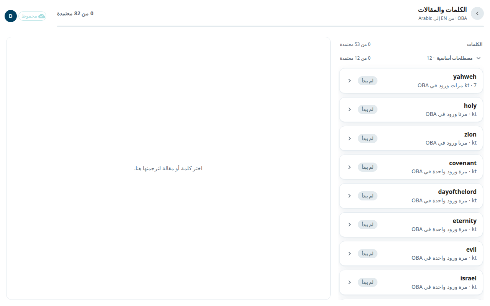
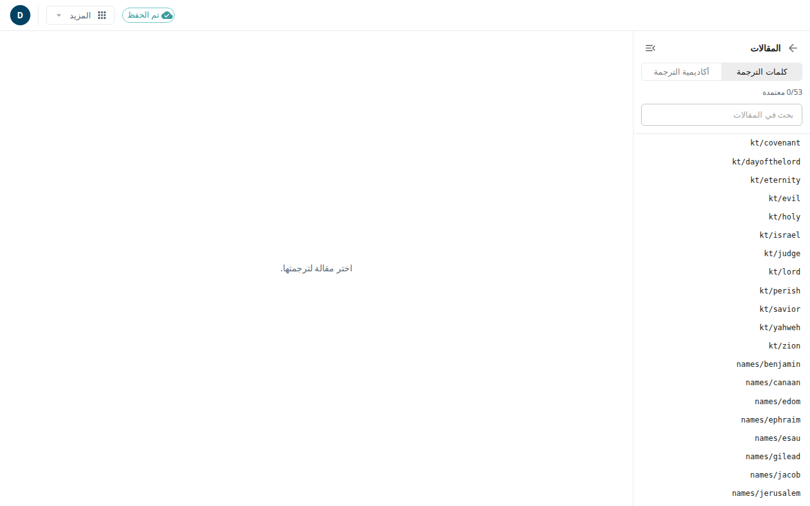

يرافق كل سفر نوعان من مقالات المساعدة. **كلمات الترجمة (tW)** تشرح المصطلحات الأساسية والأسماء، مثل «العهد». و**أكاديمية الترجمة (tA)** تعلّم مبادئ الترجمة، مثل كيفية التعامل مع الاستعارة. يشرح هذا الدليل شاشتين: **الكلمات والمقالات**، حيث تترجم المقالات التي يستخدمها السفر، وشاشة **المقالات**، حيث يمكنك قراءة أي مقالة وتحريرها.

ترجمة المقالات متاحة فقط للمشاريع التي تترجم من لغة بوابة. أما المشاريع الأخرى فترى رسالة تقول إنها لا تنطبق.

## الكلمات والمقالات
1. افتح سفرًا من [الأسفار](#help:books).
2. في الحزمة، تحت **السفر بأكمله**، اختر **الكلمات والمقالات**.

تتألف القائمة من قسمين: **الكلمات** و**مقالات الأكاديمية**. والكلمات في مجموعات: **مصطلحات أساسية** و**أسماء** و**أخرى**. تبيّن كل مجموعة عدد المقالات المعتمدة، مثل **3 من 10 معتمدة**. وداخل المجموعة تأتي أولًا المقالات الأكثر استخدامًا في هذا السفر. ويبيّن كل صف عدد مرات استخدامه (**N مرة ورود في OBA** أو **مرتبط من N ملاحظة في OBA**) وشارة: **لم يبدأ** أو **مسودة ذكاء اصطناعي** أو **محرَّر** أو **معتمد**.

المقالة التي تقول **المصدر غير مُعبأ في مساحة العمل هذه** ليس فيها نص لتترجمه بعد. يستطيع المسؤول ملأها من شاشة المقالات.

## ترجم مقالة
1. اختر مقالة. في الشاشة العريضة تفتح بجانب القائمة. وفي الهاتف تعيدك **العودة إلى القائمة**.
2. اختر طريقة القراءة: **المصدر** أو **الهدف** أو **كلاهما**.
3. انقر على نص الهدف لتحريره. مقالة tA لها ثلاثة أجزاء: **العنوان** و**العنوان الفرعي** و**المقالة**. تُعرض الأقسام في أزواج للقراءة، لكن النقر على قسم يحرّر ذلك الجزء كله، وتُحفظ الأجزاء معًا.
4. اختر **تم** عندما تنتهي من الكتابة. ثم اختر **حفظ**.
5. اختر **اعتماد** للحفظ والاعتماد. يلزم وجود مسودة أولًا. و**إعادة الصياغة** تطلب من الذكاء الاصطناعي مسودة جديدة تصل في الخلفية.

إذا حفظ شخص آخر جزءًا قبلك، تقول رسالة إن نصك ما زال موجودًا وإن الحفظ مرة أخرى سينجح.

## شاشة المقالات
تعرض هذه الشاشة مقالة واحدة في كل مرة مع قائمة في جهة البداية. تصل إليها من رابط في ملاحظة (مرجع الدعم)، أو من **افتح في محرّر المقالات** في [عرض الآية](#help:verse-view)، أو من قائمة **المزيد** في المحرر الكلاسيكي، تحت **المقالات**.

- اختر **كلمات الترجمة** أو **أكاديمية الترجمة**. اكتب في **بحث في المقالات** لتجد مقالة. وتعرض القائمة **N/M معتمدة**.
- اختر مقالة. استخدم **تحرير** و**معاينة** للتبديل بين الكتابة والعرض المنسَّق. واختر **عرض المصدر** لقراءة النص الإنجليزي.
- **حفظ** يحتفظ بنصك. و**اعتماد** يعتمده (و**إلغاء الاعتماد** يتراجع عنه). و**ترجمة** أو **إعادة الترجمة** تطلب مسودة من الذكاء الاصطناعي.
- علامة على عنصر في القائمة تعني تغييرات غير محفوظة.
- إذا كانت القائمة فارغة فإن **التعبئة من الكتب المستوردة** تملؤها بالمقالات التي تستخدمها كتبك.
- **العودة إلى النص الكتابي** تعيدك إلى حيث كنت.

يُحفظ ما تكتبه في المتصفح إلى أن تحفظ. انظر [الحفظ والعمل دون اتصال](#help:save-and-sync).
