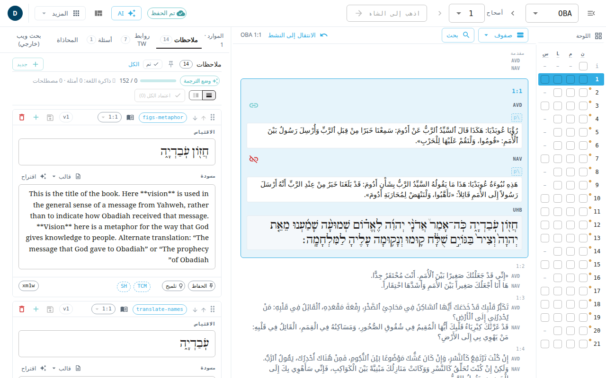

يعرض **المحرر الكلاسيكي** أصحاحًا كاملًا دفعة واحدة: الآيات وكل مواد المساعدة للآية النشطة، في ثلاثة أعمدة. استخدمه عندما تريد أن ترى النص الكتابي والملاحظات وروابط الكلمات والأسئلة معًا، أو لتحرير روابط الكلمات (روابط TW) التي تُحرَّر في هذا المحرر. أما لترجمة ملاحظة واحدة أو سؤال واحد في كل مرة فشاشتا [الملاحظات](#help:notes) و[الأسئلة](#help:questions) أبسط.

## افتحه
- افتح قائمة حسابك (الزر الدائري في الشريط العلوي) واختر **المحرر الكلاسيكي**. يفتح السفر الذي كنت فيه، عند آخر آية لك.
- أو اكتب العنوان `#/ZEC/6/1` (السفر والأصحاح والآية) بعد عنوان التطبيق.

## الأعمدة الثلاثة
1. **شريط الآيات** (في جهة البداية). بلاطة لكل آية. اختر بلاطة لتجعل تلك الآية نشطة. وتخفي **إخفاء قائمة الآيات** و**إظهار قائمة الآيات** في الشريط العلوي هذا الشريط وتُظهره. وتحمل البلاطات علامة لكل نوع من العمل (النص والملاحظات وروابط TW والأسئلة). ويفتح الزر **اللوحة** فوقها لوحة إنجاز الأصحاح، حيث تضع علامة على أجزاء كل آية التي راجعتها.
2. **النص الكتابي** (في الوسط). نص الأصحاح في كل نسخة. يبدّل عنصر وضع عرض النص الكتابي بين **صفوف** (آية بآية، وهو الافتراضي) و**أعمدة** (عرض متجاور للأصحاح) و**سفر** (السفر كله، ويُحمَّل أثناء التمرير). استخدم **بحث** (Ctrl+F) للبحث والاستبدال في الأصحاح. و**الانتقال إلى النشط** يعيدك إلى الآية النشطة.
3. **الموارد** (في جهة النهاية). تبويبات **ملاحظات** و**أسئلة** و**روابط TW** و**المحاذاة** و**بحث ويب (خارجي)**. والبحث على الويب أداة طرف ثالث، وما تكتبه فيها يغادر التطبيق.

في الشاشة الضيقة تُعرض الأعمدة واحدًا في كل مرة.

## حرّر آية
1. انقر داخل نص الآية واكتب.
2. اختر **حفظ التعديلات**. لا يُحفظ شيء حتى تفعل ذلك. و**التراجع عن تعديلات هذه الآية** يرجع عن تغييرك غير المحفوظ.
3. استخدم زر سجل الإصدارات لعرض حفظ سابق أو استعادته.

الملاحظات تعمل بالطريقة نفسها: حرّر الملاحظة ثم احفظها. ولبطاقة الملاحظة أيضًا زر لتجاهل التعديلات غير المحفوظة. يُحفظ ما تكتبه في المتصفح إلى أن تحفظ. انظر [الحفظ والعمل دون اتصال](#help:save-and-sync).

## الشريط العلوي
- أداة اختيار السفر وأسهم الأصحاح (**الأصحاح السابق** و**الأصحاح التالي**) وحقل **اذهب إلى الشاهد**. اكتب `5` أو `5:5` أو `zec 5:5` أو `ps 1:4` ثم اضغط Enter.
- حالة الحفظ وقائمة تشغيل الذكاء الاصطناعي و**التخطيطات** التي تبدّل بين ترتيبات الأعمدة الثلاثة.
- **المزيد**: **استيراد من Door43** و**تصدير USFM** تحت **المحتوى**؛ و**المقالات** و**قوالب الملاحظات** تحت **الموارد**؛ وحجم النص ولغة الواجهة تحت **العرض**.
- قائمة حسابك.
