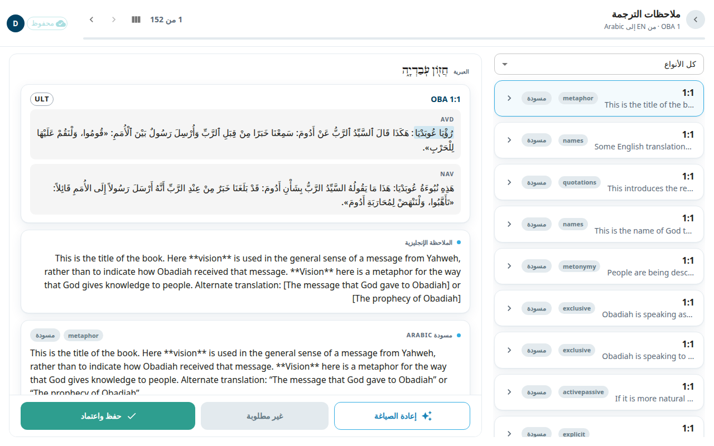

عملك في أمان إن اتبعت قاعدة واحدة: **الملاحظات والأسئلة والمقالات لا تُحفظ إلا عندما تختار حفظ** (أو **حفظ واعتماد**). وأثناء الكتابة يُحفظ النص أيضًا في متصفحك كمسودة. تشرح هذه الصفحة أين يذهب عملك وماذا تعني علامات الحالة في الشريط العلوي.

## أين يذهب عملك
1. تكتب. يُحفظ النص في متصفحك فورًا.
2. تختار **حفظ**. يدخل التعديل في قائمة انتظار في متصفحك ثم يصل إلى قاعدة بيانات التطبيق. هذا لا يمسّ Door43.
3. مرة كل ليلة ينشر التطبيق المحتوى المعتمد على Door43. وإذا فشلت هذه الخطوة تبقى تعديلاتك آمنة في قاعدة بيانات التطبيق وتلحق بها الليلة التالية.

## علامات الحالة في الشريط العلوي
- **محفوظ**: كل شيء على الخادم.
- **جارٍ الحفظ N**: يجري إرسال N من التعديلات.
- **N غير محفوظ**: لديك نص كتبته ولم تحفظه. اختر العلامة لترى القائمة وتنتقل إلى كل عنصر. ويمكنك أيضًا تجاهل عنصر من هناك.
- **غير متصل** أو **جارٍ إعادة الاتصال…** مع **N في قائمة الانتظار**: لا يوجد اتصال. انظر أدناه.
- **N تعارض** أو **N فشل**: شيء يحتاج إلى انتباهك. انظر أدناه.

إذا حاولت إغلاق التبويب أو إعادة التحميل وفيه نص غير محفوظ يحذّرك المتصفح. ويعود النص غير المحفوظ عندما ترجع إلى الملاحظة أو السؤال أو المقالة نفسها.

## اعمل دون اتصال
يمكنك متابعة العمل عندما ينقطع الاتصال. في كل مرة تختار **حفظ** يُضاف التعديل إلى قائمة الانتظار وتعرض العلامة **N في قائمة الانتظار — غير متصل**. وعندما يعود الاتصال تُرسل القائمة بالترتيب، ولا يضيع شيء إن أغلقت التبويب في الأثناء.

إذا انتهت صلاحية تسجيل دخولك فإن رسالة تقول **انتهت جلستك — سجّل الدخول لمتابعة الحفظ**. اختر **تسجيل الدخول**. تُرسل التعديلات المصطفّة بعد تسجيل الدخول. لا تمسح بيانات المتصفح ما دامت هناك تعديلات في قائمة الانتظار.

## عندما يحرّر شخصان الشيء نفسه
إذا حفظ شخص آخر الملاحظة أو السؤال نفسه قبلك يرفض الخادم تعديلك، حتى لا تكتب فوق عمله.
- في شاشتي [الملاحظات](#help:notes) و[الأسئلة](#help:questions) يقول شريط إن نسختك لم تُحفظ. اختر **إعادة تحميل الملاحظة** (أو **إعادة تحميل السؤال**) لتحميل نسخته، ثم أعد تغييرك.
- في الشريط العلوي يظهر التعارض بصيغة **N تعارض**. وفي اللوحة بالزاوية السفلية زر **حل N تعارض**. يعيد إرسال تعديلك فوق نسخة الخادم الحالية، فيفوز تعديلك. استخدمه فقط عندما تكون متأكدًا.
- في [قائمة المراجعة](#help:review-queue) تتيح لك نافذة **حفظ شخص آخر هذه الملاحظة قبلك** أن تختار **الاحتفاظ بنسختي** أو **الاحتفاظ بنسختهم**.

## عندما يفشل حفظ
**N فشل** يعني أن تعديلًا لم يُقبل. تسرده اللوحة في الزاوية السفلية. اختر **إعادة محاولة هذا التعديل**. إذا استمر الفشل فاختر **تجاهل هذا التعديل**. تحتوي نافذة التأكيد على **نسخ التعديل** لتنسخ النص أولًا. التجاهل يحذف التعديل من جهازك نهائيًا.

## النشر على Door43
ينشر النشر الليلي الملاحظات والأسئلة **المعتمدة**. أما الصفوف التي لا تزال مسودات أو محرَّرة ولم تُعتمد فتُحجب، ويحتفظ Door43 بآخر نص نُشر لها. ويستطيع المسؤول أيضًا نشر سفر واحد في أي وقت من حزمته. انظر [الأسفار](#help:books).
