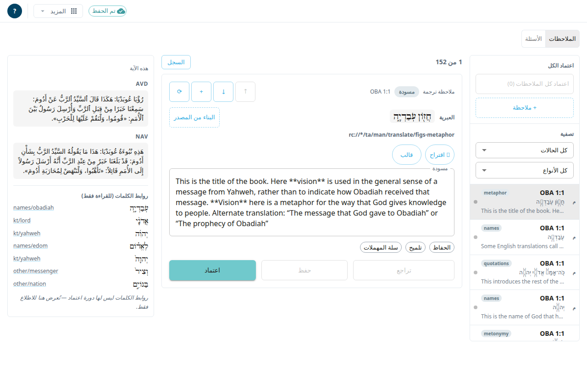

**قائمة المراجعة** شاشة عمل لملاحظات أصحاح واحد وأسئلته. تقرأ كل عنصر وتصلحه وتعتمده. وهي أيضًا المكان الذي تضيف فيه الملاحظات وتحرّكها وتنقلها إلى سلة المهملات وتستعيدها وترى سجل أي عنصر. لا ينشر Door43 إلا العناصر المعتمدة.

## افتحها
ليس لهذه الشاشة زر في القوائم حتى الآن. افتحها بعنوانها: أضف `#/review/ZEC/6` (السفر والأصحاح) بعد عنوان التطبيق.

ليس في الشريط العلوي لهذه الشاشة أدوات للسفر أو الأصحاح. للمغادرة استخدم قائمة **المزيد** (يقودك **استيراد من Door43** إلى الأسفار) أو غيّر العنوان.

## ابحث عن عنصر
1. اختر **الملاحظات** أو **الأسئلة** في أعلى القائمة.
2. استخدم منطقة **تصفية**: **كل الحالات** أو **بانتظار المراجعة** أو **معتمد** أو (للملاحظات) **في المهملات**. وللملاحظات يمكنك أيضًا التصفية حسب النوع (**كل الأنواع**).
3. اختر عنصرًا في الشريط. وفي الهاتف استخدم الأسهم والعدد للانتقال من بطاقة إلى أخرى.

لكل عنصر شارة تبيّن حالته.

## راجع ملاحظة واحدة واعتمدها
1. حرّر **الاقتباس** ومرجع الدعم ونص الملاحظة في بطاقة العمل.
2. اختر **حفظ** لتحتفظ بتغييراتك. واختر **اعتماد** لاعتماد العنصر. الملاحظة التي لم تحصل على مسودة ذكاء اصطناعي من قبل لا يمكن اعتمادها بعد.
3. لاعتماد عدد كبير دفعة واحدة اختر **اعتماد كل الملاحظات (N)** (أو **اعتماد كل الأسئلة (N)**) فوق القائمة. وإذا فشل بعضها تخبرك الرسالة بأول ما فشل.

أدوات أخرى في بطاقة الملاحظة:
- **✨ اقتراح** يطلب مسودة من الذكاء الاصطناعي. تدخل المسودة في المحرر. اختر **حفظ** للاحتفاظ بها. يحتاج إلى اقتباس ومرجع دعم.
- **قالب** يدرج قالبًا منسَّقًا لمرجع دعم الملاحظة.
- **الحفاظ** يضع علامة على الملاحظة لتبقى بعد تشغيلات الذكاء الاصطناعي القادمة. و**تلميح** يرسلها إلى التشغيل التالي كتلميح.
- **سلة المهملات** تنقل الملاحظة إلى السلة. و**استعادة** تعيدها. والملاحظة التي وضعتها جانبًا بـ**غير مطلوبة** في شاشة الملاحظات تكون في السلة أيضًا.
- **السجل** يعرض النسخ السابقة للعنصر ويتيح لك استعادة إحداها.
- **إعادة التوجيه** تنقل الملاحظة إلى آية أخرى من الأصحاح.
- **تحريك لأعلى** و**تحريك لأسفل** و**إدراج ملاحظة بعد هذه** تغيّر الترتيب. و**+ ملاحظة** و**+ سؤال** تضيفان عناصر جديدة.

يمكن عرض الأسئلة بطاقات (**عرض البطاقات**) أو في جدول (**عرض الجدول**). ويُحذف السؤال نهائيًا بزر **حذف**. ولا توجد سلة مهملات للأسئلة.

## انظر إلى الآية
اللوحة **هذه الآية** سياق للقراءة فقط: نص الآية وروابط الكلمات. وفي الهاتف تُفتح كورقة سفلية.

## من المفيد أن تعرف
- إذا حفظ شخص آخر العنصر قبلك تعرض نافذة **الاحتفاظ بنسختي** أو **الاحتفاظ بنسختهم**. انظر [الحفظ والعمل دون اتصال](#help:save-and-sync).
- عندما تحتجز عملية ذكاء اصطناعي الأصحاح تُرفض بعض التغييرات. وتخبرك الشاشة بأيها.
