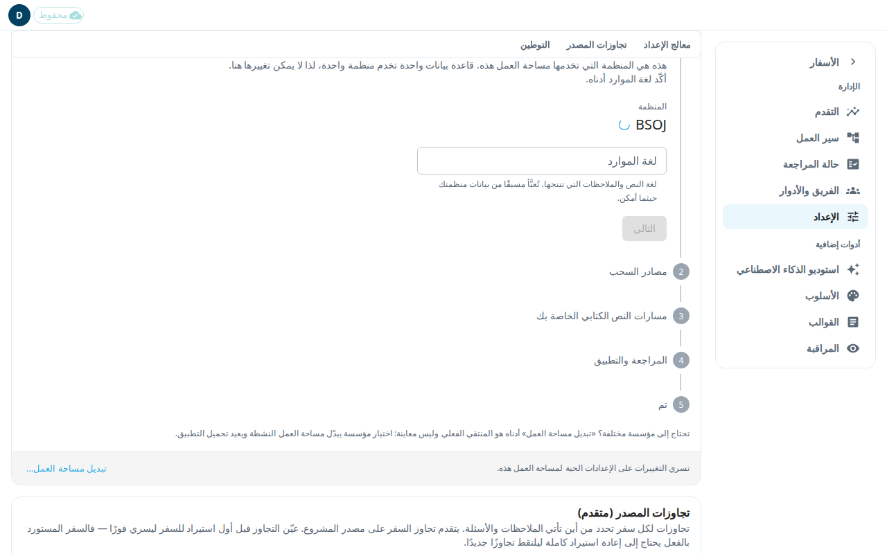

يخبر الإعداد التطبيق من أين يأتي نص مشروعك وأين يُحفظ عمل فريقك. يستطيع المسؤول فقط فتحه. له ثلاثة أجزاء: **معالج الإعداد**، و**تجاوزات المصدر (متقدم)**، و**التوطين**. Door43 هو خادم git الذي تُنشر عليه موارد unfoldingWord.

قاعدة بيانات واحدة تخدم منظمة واحدة. لا يمكنك تغيير المنظمة من هنا. لاستخدام منظمة مختلفة، اضغط **تبديل مساحة العمل…** أسفل لوحة المعالج. يبدّل هذا مساحة العمل ويعيد تحميل التطبيق.

## تشغيل معالج الإعداد
1. افتح **الإعداد** من قائمة الإدارة.
2. **منظمتك:** تحقق من المنظمة و**لغة الموارد**. هذه لغة النص والملاحظات التي تنتجها. تُعبَّأ من ملفات منظمتك عند الإمكان. اضغط **التالي**.
3. **مصادر السحب:** حدّد **المنظمة الأعلى الافتراضية**. هذه هي المنظمة التي تترجم منها، والافتراضي unfoldingWord. كل مورد محدد افتراضيًا: **النص الحرفي (GLT)** و**النص المبسّط (GST)** وtranslationNotes وtranslationQuestions وtranslationWords Links وtranslationWords وtranslationAcademy. ألغِ تحديد مورد لتختار **اتركه فارغًا** أو **استخدام مصدر مختلف**. للمصدر المختلف، الصق **عنوان URL لمصدر Door43**. اضغط **التالي** بعد التحقق من المصادر.
4. **مسارات النص الكتابي الخاصة بك:** المسار هو أحد نصيّك الكتابيين، الحرفي أو المبسّط. لكل مسار، أكّد **المستودع الهدف**. هذا هو مستودع منظمتك، وفيه يحفظ المحرر عملك. ثم أجب عن **ما الذي يفعله المترجمون في هذا المسار؟** اختر **تحرير النص** أو **المحاذاة فقط**. راجع **المصدر الأعلى لهذا المسار**. اضغط **التالي**.
5. **المراجعة والتطبيق:** اقرأ الملخص الذي يبيّن من أين يسحب التطبيق وأين يحفظ. عالج أي تحذير يظهر. اضغط **تطبيق التكوين**.
6. **تم:** اضغط **الانتقال إلى الاستيراد** لإحضار سفرك الأول (انظر [الأسفار](#help:books))، أو **افتح المحرر**.

## إذا كان المشروع يحتوي على نص بالفعل
يُقفل المستودع الهدف للمسار بمجرد أن يحتوي المشروع على نص. لتغيير مصدر النص الكتابي لمسار كهذا، استخدم **تغيير مصدر النص الكتابي** في التفضيلات (انظر [التفضيلات](#help:preferences)). لا يستطيع المعالج فعل ذلك.

## تجاوزات المصدر (متقدم)
يجعل التجاوز سفرًا واحدًا يأخذ ملاحظاته أو أسئلته من مستودع Door43 مختلف. يتقدم تجاوز السفر على مصدر المشروع.
1. اختر **السفر**.
2. تحت **إضافة تجاوز**، اختر **المورد**: **الملاحظات (tN)** أو **الأسئلة (tQ)**.
3. اختر المصدر، أو اختر **مستودع Door43 آخر…** والصق **رابط مستودع Door43**.
4. لحصر التجاوز في بعض الأصحاحات، املأ **من أصحاح** و**إلى أصحاح**. اتركهما فارغين للسفر بأكمله.
5. اضغط **إضافة تجاوز**. استخدم **إزالة** لحذف تجاوز.

عيّن التجاوز قبل أول استيراد للسفر ليسري فورًا. السفر المستورد بالفعل يحتاج إلى إعادة استيراد كاملة ليلتقط تجاوزًا جديدًا.

## التوطين
يحرّر هذا القسم نصوص واجهة مساحة عملك.
