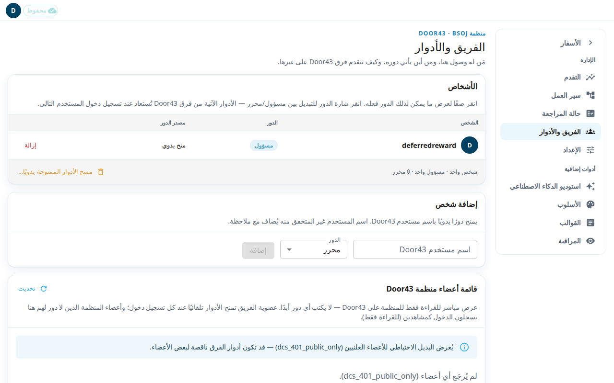

تعرض شاشة **الفريق والأدوار** من يستطيع استخدام مساحة العمل وما يحق لكل شخص فعله. يستطيع المسؤول فقط فتحها.

للوصول ثلاثة أنواع:
- **المسؤول** يستطيع كل ما يستطيعه المحرر. ويستطيع أيضًا فتح الإعداد وإدارة الأشخاص.
- **المحرر** يستطيع كتابة المحتوى في مساحة العمل كلها: النص الكتابي والملاحظات والكلمات والأسئلة. ولا يستطيع فتح الإعداد أو إدارة الأشخاص.
- **المشاهد** يقرأ فقط. أعضاء منظمتك على Door43 الذين لا دور لهم هنا يسجلون الدخول كمشاهدين.

Door43 هو خادم git الذي تعيش عليه موارد منظمتك. تحدد فرقه معظم الأدوار: فريق الشخص على Door43 يضبط دوره عند كل تسجيل دخول.

## معرفة من لديه وصول
1. افتح **الفريق والأدوار** من قائمة الإدارة.
2. اقرأ جدول **الأشخاص**. الأعمدة هي **الشخص** و**الدور** و**مصدر الدور** و**إجراءات**.
3. **مصدر الدور** إما **فريق Door43** أو **منح يدوي**.
4. انقر صفًا لترى ما يمكن لذلك الدور فعله.

## إضافة شخص
1. في **إضافة شخص**، اكتب **اسم مستخدم Door43**.
2. اختر **الدور**.
3. اضغط **إضافة**. إذا تعذّر التحقق من اسم المستخدم على Door43، يُضاف الشخص مع ملاحظة.

## تغيير دور أو إزالة شخص
1. انقر شارة **الدور** لشخص للتبديل بين مسؤول ومحرر.
2. اضغط **إزالة** لسحب دور ممنوح يدويًا.
3. التغيير على شخص يأتي دوره من فريق Door43 يدوم حتى تسجيل دخوله التالي فقط. بعدها يضبط الفريق الدور من جديد. لجعله دائمًا، غيّر فريقه على Door43.
4. لا يمكن تخفيض رتبة المسؤول الأخير ولا إزالته. يجب أن يبقى أحدهم مسؤولًا.

## مسح كل الأدوار اليدوية
اضغط **مسح الأدوار الممنوحة يدويًا…** وأكّد بـ **مسح**. يزيل هذا كل دور مُنح يدويًا. تبقى الأدوار القادمة من فريق Door43، ويبقى دائمًا مسؤول واحد على الأقل.

## المقارنة مع Door43
**قائمة أعضاء منظمة Door43** عرض مباشر للقراءة فقط للمنظمة على Door43. لا تغيّر أي دور أبدًا. يبيّن عمود **الوصول هنا** ما يناله كل عضو في هذا التطبيق. إذا تعذّرت قراءة Door43، تقول الصفحة إن القائمة قد تكون ناقصة. وعندها لا تعني القائمة الفارغة أن المنظمة بلا أعضاء.
