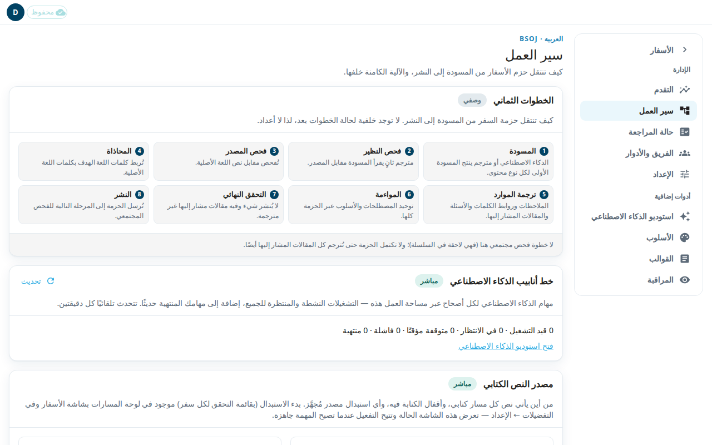

تبيّن شاشة **سير العمل** كيف ينتقل السفر من المسودة إلى النشر، وتعطيك أدوات للتحكم في النص الكتابي وفي النشر. يستطيع المسؤول فقط فتحها.

للصفحة أربع لوحات.

## الخطوات الثماني
هذه اللوحة وصف فقط، وعليها شارة **وصفي**. تسرد الخطوات: **المسودة** و**فحص النظير** و**فحص المصدر** و**المحاذاة** و**ترجمة الموارد** و**المواءمة** و**التحقق النهائي** و**النشر**. لا يتتبع التطبيق الخطوة التي بلغها كل سفر، لذلك لا توجد أعداد.

## خط أنابيب الذكاء الاصطناعي
مهمة خط الأنابيب هي تشغيل واحد للذكاء الاصطناعي على أصحاح واحد. تعدّ هذه اللوحة مهام مساحة العمل كلها: قيد التشغيل وفي الانتظار ومتوقفة مؤقتًا وفاشلة ومنتهية. تتحدث تلقائيًا كل دقيقتين. اضغط **تحديث** للتحديث الآن. اضغط **فتح استوديو الذكاء الاصطناعي** لبدء التشغيلات أو إدارتها (انظر [استوديو الذكاء الاصطناعي](#help:admin-ai)).

## مصدر النص الكتابي
توجد بطاقة للمسار الحرفي وأخرى للمسار المبسّط. تعرض كل بطاقة **المصدر الحالي** و**هدف التصدير**. وفيها مفتاحان:
- **النص للقراءة فقط** يمنع التعديلات الجديدة على النص الكتابي للمسار.
- **المحاذاة قابلة للكتابة** يتيح للمترجمين مواصلة محاذاة الكلمات بينما النص مقفل.

انقر مفتاحًا لتشغيله أو إيقافه. يطلب التطبيق منك التأكيد. تُقفل المفاتيح أثناء وجود استبدال للمصدر قيد التنفيذ.

### تفعيل مصدر مُجهَّز
يبدأ الاستبدال من لوحة المسارات في شاشة الأسفار ومن التفضيلات (انظر [التفضيلات](#help:preferences)). عندما يصبح استبدال مُجهَّز جاهزًا، تقول بطاقته ذلك.
1. اضغط **تفعيل…**.
2. اقرأ التحذير. بعد ذلك يقرأ المسار من المصدر الجديد، والتراجع يعني استبدالًا آخر.
3. حدّد **أفهم أن المترجمين سيبدؤون قراءة المصدر الجديد.**
4. اضغط **تفعيل**.

## النشر
يكتب التصدير الليلي قاعدة البيانات إلى ملفات ويودعها في فرع على Door43. إذا لم تكن التصديرات التلقائية مفعلة في هذا النشر، تقول اللوحة ذلك. يسرد الجدول التصديرات السابقة مع **الحالة** و**الصفوف** و**الفرع** و**تاريخ الإيداع**.

### تشغيل تصدير الآن
1. اضغط **تشغيل التصدير الآن…**.
2. اختر **نطاق التصدير**: **كل الأسفار** أو سفرًا واحدًا. اختر **المورد**. يمكنك إدخال **الإصحاحات (اختياري)**، مثل 13-14، عندما تختار سفرًا واحدًا ومورد tn أو tq أو twl.
3. اختر **وضع الكتابة على Door43**. **الدمج مع Door43** يسحب أولًا حالة Door43 الحالية ويُبقي التعديلات اليدوية على Door43 في الصفوف التي لم تلمسها. **استبدال Door43** يتخطى ذلك السحب ويتطلب نطاق إصحاحات.
4. اضغط **تشغيل التصدير**. في وضع الاستبدال يكون نص هذا الزر **استبدال Door43**.
5. اضغط **فحص الحالة** لمتابعة التشغيل.

يستغرق التصدير اليدوي عدة دقائق ويودع ملفات حقيقية.
