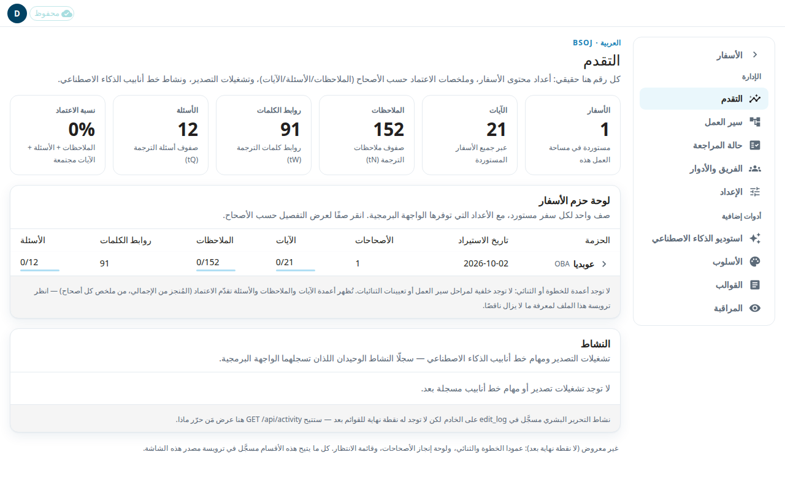
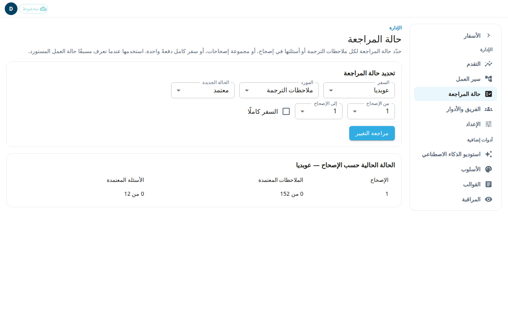

تعرض أربع صفحات للمسؤول مدى ما بلغته المراجعة وتضبطه. **التقدم** يعرض الأرقام. و**حالة المراجعة** تغيّر حالة المراجعة لعدد كبير من الملاحظات أو الأسئلة دفعةً واحدة. و**جودة المسودات** تعرض مدى جودة مسودات الذكاء الاصطناعي للملاحظات المعتمدة. و**صندوق الاقتراحات** يعرض التصحيحات التي يكررها المحررون في تلك المسودات. يستطيع المسؤول فقط فتحها.

## قراءة صفحة التقدم
1. افتح **التقدم** من قائمة الإدارة.
2. تعدّ البلاطات في الأعلى **الأسفار** و**الآيات** و**الملاحظات** و**روابط الكلمات** و**الأسئلة** المستوردة. وتعرض **نسبة الاعتماد** حصة الملاحظات والأسئلة والآيات المعتمدة معًا.
3. في **لوحة حزم الأسفار**، كل صف سفر مستورد. انقر صفًا لترى الأرقام نفسها لكل أصحاح.
4. يسرد **النشاط** أحدث تشغيلات التصدير ومهام الذكاء الاصطناعي.

تحمّل الصفحة الأسفار واحدًا تلو الآخر، لذلك قد تقول البلاطات إنها ما زالت تُحمَّل.

## تحديد حالة المراجعة لعدة صفوف
استخدم هذا عندما تعرف مسبقًا حالة العمل المستورد. مثلًا، فُحص سفر قبل دخوله التطبيق، فينبغي أن تُحتسب ملاحظاته معتمدة. للمراجعة المعتادة، انظر [قائمة المراجعة](#help:review-queue).

1. افتح **حالة المراجعة** من قائمة الإدارة.
2. تحت **تحديد حالة المراجعة**، اختر **السفر** و**المورد**: **ملاحظات الترجمة** أو **أسئلة الترجمة**.
3. اختر **الحالة الجديدة**: **معتمد** أو **يحتاج إلى مراجعة**. **يحتاج إلى مراجعة** يعيد الصفوف إلى قائمة المراجعة.
4. اختر **من الإصحاح** و**إلى الإصحاح**. حدّد **السفر كاملًا** لاستخدام كل الأصحاحات.
5. اضغط **مراجعة التغيير**. لا يُحفظ شيء بعد. يعدّ التطبيق الصفوف التي سيغيّرها.
6. في **تأكيد تغيير حالة المراجعة**، تحقق من السفر والإصحاحات والمورد والحالة الجديدة و**الصفوف التي ستُحدَّث**.
7. اضغط **تطبيق**، أو **إلغاء** للتوقف.

تخبرك الرسالة بعد الحفظ بعدد الصفوف التي تغيّرت. ويبيّن جدول **الحالة الحالية حسب الإصحاح** عدد الملاحظات والأسئلة المعتمدة في كل إصحاح.

أمور مهمة:
- يتغير كل صف في النطاق، بما فيه الصفوف التي لا يزال المترجم يعمل عليها.
- لا يتغير نص الملاحظات. يُسجَّل التغيير في السجل على أنه إجراء من المسؤول.
- لا تُستخدم هذه الصفوف أمثلةً للذكاء الاصطناعي.
- إذا قال التطبيق إن التغيير لم يمكن تأكيده، فربما طُبِّق جزئيًا أو كليًا. راجع الأعداد في الجدول قبل أن تحاول مرة أخرى.

## فحص جودة مسودات الذكاء الاصطناعي
تقارن **جودة المسودات** كل ملاحظة ترجمة معتمدة بآخر مسودة كتبها الذكاء الاصطناعي لها، إصحاحًا بإصحاح. استخدمها لترى هل يحسّن تغييرٌ في إرشادات الذكاء الاصطناعي المسودات. لا تغيّر شيئًا.

1. افتح **جودة المسودات** من قائمة الإدارة.
2. اختر **السفر**. يعرض الجدول صفًا لكل إصحاح، و**السفر كاملًا** في الأسفل.
3. اقرأ الأعمدة:
   - **الملاحظات المعتمدة**: ملاحظات الترجمة المعتمدة في الإصحاح.
   - **لا مسودة مسجَّلة**: ملاحظات لا توجد لها مسودة ذكاء اصطناعي محفوظة. قد يُمسح سجل التعديلات الأقدم من 180 يومًا.
   - **المسودة بالإنجليزية**: كانت مسودة الذكاء الاصطناعي هي الملاحظة الإنجليزية دون ترجمة. تُستبعَد هذه الملاحظات من الأعمدة التي تليها. وتُحتسب هنا أيضًا الملاحظة المطابقة للإنجليزية لسبب وجيه، مثل ملاحظة لا تحوي إلا روابط.
   - **المقارَنة**: الملاحظات التي تتحدث عنها الأعمدة الأخرى.
   - **اعتُمدت دون تغيير**: نسبة ما اعتُمد كما كتبه الذكاء الاصطناعي تمامًا.
   - **وسيط التشابه**: مقدار ما بقي من المسودة، من 0 (أُعيدت كتابتها كلها) إلى 1 (دون تغيير). وإذا كان الجزء المتغيّر من الملاحظة أطول من 2,000 حرف، تُقارَن أول 2,000 حرف منه فقط، فيكون تشابه تلك الملاحظة تقريبيًا ويُعلَّم وسيط الإصحاح بـ ≈. مرّر المؤشر فوق ≈ لترى عدد الملاحظات المعنية.
   - **نقطة أُضيفت بعد ]**: من المسودات التي تنتهي بـ ] دون نقطة، نسبة ما اضطر فيه المحرر إلى إضافة النقطة.
   - **حزمة السياق**: إصدار الإرشادات التي أُعطيت للذكاء الاصطناعي، مع عدد الملاحظات التي استخدمته. مرّر المؤشر فوقها لترى الاسم الكامل. **غير مثبَّتة (أحدث حزمة وقت التشغيل، إن وُجدت)** تعني أن التشغيل لم يُربط بإصدار واحد: استخدم أحدث إرشادات وقت تشغيله، أو لا إرشادات إن لم تكن قد صُدِّرت بعد. **التشغيل غير محفوظ** يعني أن تشغيل الذكاء الاصطناعي قد مُسح. تُربط كل مسودة بتشغيل الذكاء الاصطناعي حسب الوقت، لذلك قد تُنسب مسودة في حالات نادرة تتداخل فيها التشغيلات إلى تشغيل خاطئ.

إذا تعذّرت قراءة الملاحظات الإنجليزية لبعض الإصحاحات، تذكر رسالةٌ هذه الإصحاحات وسبب كل منها. لا تُستبعَد أي مسودة فيها على أنها إنجليزية، وتُعلَّم أعدادها بـ *. وفي صف **السفر كاملًا** تعني * أن جزءًا فقط من السفر فُحص.

## تحويل التصحيحات المتكررة إلى إرشادات
يجد **صندوق الاقتراحات** التصحيحات التي أجراها المحررون مرة بعد مرة على مسودات ملاحظات الترجمة التي يكتبها الذكاء الاصطناعي، حتى تصلحها مرة واحدة. مثلًا، قد يضيف المحررون نقطة بعد ] الأخير في كل ملاحظة تقريبًا، أو يحذفون وسمًا يضيفه الذكاء الاصطناعي باستمرار.

1. افتح **صندوق الاقتراحات** من قائمة المسؤول.
2. اختر **السفر**. يحسب التطبيق البطاقات الآن من الملاحظات المعتمدة في ذلك السفر. لا يوجد تشغيل ليلي، لذلك قد يستغرق السفر الكبير بضع ثوانٍ.
3. تبيّن كل بطاقة:
   - التغيير: كلمات الذكاء الاصطناعي، ثم الكلمات المعتمدة (**محذوف** إذا أزالها المحررون). و**في آخر الملاحظة** تعني أن التغيير أُجري في آخر الملاحظة فقط.
   - **أُجري في س من ص مسودة كان فيها**: س ملاحظة أُجري فيها هذا التغيير. وص مسودة كانت تحتوي على الكلمات التي يغيّرها، ومنها تلك الـس.
   - **الأصحاحات**: حيث أُجري التغيير.
   - **المكان المقترح**: حيث ينتمي التصحيح. **قاعدة أسلوب** تُقترح فقط لثلاثة أنواع من التغيير آمنة في كل ملاحظة: النقطة بعد ] الأخير، وحذف وسم بين قوسين أو معقوفين مثل (مُكيَّف)، وتغيير الحركات فقط (التشكيل والتنوين) في كلمة واحدة. وتُجرَّب القاعدة على كل مسودات السفر: تقول البطاقة «ستغيّر القاعدة N مسودة في هذا السفر؛ وتطابق تغيير المحرر في M منها (P%)». ولا تُقترح إلا إذا غيّرت 10 مسودات على الأقل وأعطت النص المعتمد بالضبط في 8 من كل 10 على الأقل (9 من 10 للحركات). ويجب أيضًا أن تعطي النص المعتمد بالضبط في كل مثال من أمثلة البطاقة؛ وإن لم تفعل تقول البطاقة «لا تعيد القاعدة تغيير المحرر في كل مثال». وفي السفر الكبير قد يطول فحص بعض المسودات. عندئذٍ تذكر البطاقة عدد المسودات التي لم يمكن فحصها، وإن كانت المسودات التي فُحصت تكفي للنجاح تقول إن القاعدة «لم يمكن فحصها كاملًا في الوقت المتاح». ولا تُقترح القاعدة ما دامت هناك مسودة لم تُفحص. وتذكر البطاقة أيضًا نوع القاعدة التي ستنشأ. **قالب ملاحظة** لكلمات تأتي من قالب. **مصطلح** لتغيير من كلمة إلى ثلاث كلمات. وكل ما عدا ذلك **سطر في المشكلات الشائعة**.
   - ثلاثة أمثلة: مسودة الذكاء الاصطناعي والملاحظة المعتمدة حول التغيير.
4. اختر ما تفعله:
   - **الموافقة** على بطاقة قاعدة أسلوب تطلب منك التأكيد، ثم تضيف القاعدة إلى [الأسلوب: قواعد الأسلوب](#help:admin-style) مُفعّلة. وهي تغيّر كل مسودة يكتبها الذكاء الاصطناعي تصل بعد ذلك، في كل الأسفار، للملاحظات وللأسئلة وأجوبتها. وأمثلتها هناك أسطر حقيقية من المسودات.
   - **الموافقة** على أي بطاقة أخرى تنسخ لك سطرًا. لا يمكن ملء محررات المصطلحات والقوالب والمشكلات الشائعة من هنا، فافتح المحرر بالزر والصق السطر.
   - **الرفض** يخفي البطاقة نهائيًا، في كل الأسفار.

لا تظهر البطاقة إلا إذا تكرر التغيير نفسه في 10 ملاحظات على الأقل موزعة على 3 أصحاحات على الأقل. تُتجاهل المسافات وفواصل الأسطر، وتُستبعد التغييرات داخل اقتباس من الكتاب المقدس بخط عريض وإعادة الكتابة الأطول من بضع كلمات. ولا يظهر التغيير إذا كانت قاعدة أسلوب تجريه أصلًا (حتى لو كانت متوقفة)، أو كان مصطلح يعطي الكلمات المعتمدة، أو كان قالب يحتويها، أو كان نص المشكلات الشائعة يذكرها. والبطاقة التي أرسلتها إلى محرر آخر تختفي متى غطّاها نص ذلك المحرر. وإن بقيت ظاهرة بعد تعديلك فارفضها.
