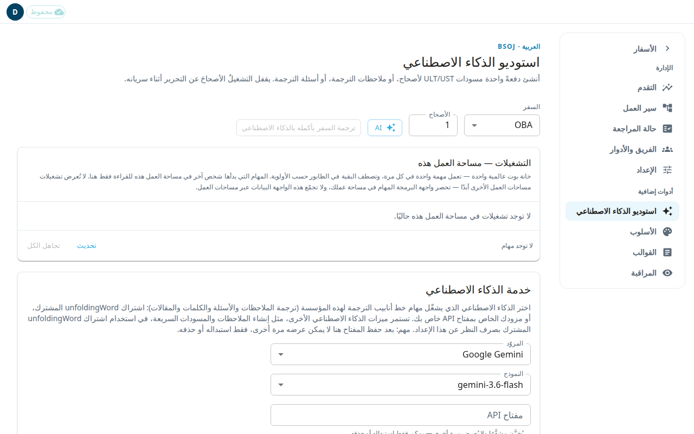

**استوديو الذكاء الاصطناعي** هو المكان الذي تترجم فيه بالذكاء الاصطناعي ملاحظات الترجمة أو أسئلة الترجمة لأصحاح، وتحفظ فيه مفتاح مزوّد الذكاء الاصطناعي الخاص بمنظمتك. يقفل تشغيل **ترجمة الأصحاح** أو **ترجمة الأسئلة** أجزاءً من أصحاحه ما دام في مرحلة البدء أو جاريًا أو متوقفًا مؤقتًا، أما التشغيل الذي لا يزال ينتظر في الطابور فلا يقفل شيئًا، ولا يقفل **استيراد من Door43** و**جلب مسودات Aquifer** و**إعادة جلب الملاحظات من الإنجليزية** شيئًا كذلك. وتبيّن مقالات [ترجمة النص الكتابي](#help:scripture) و[ترجمة الملاحظات](#help:notes) و[ترجمة الأسئلة](#help:questions) بالضبط ما يُقفل في كل شاشة.

## بدء تشغيل للذكاء الاصطناعي
1. افتح **استوديو الذكاء الاصطناعي** من قائمة الإدارة.
2. اختر **السفر** واكتب **الأصحاح**.
3. اضغط **AI** واختر **ترجمة الأصحاح** (ملاحظات الترجمة للأصحاح) أو **ترجمة الأسئلة** (أسئلة الترجمة له). لا يظهر هذان الخياران إلا في مشروع ترجمة، أي مشروع يترجم من لغة مصدر.
4. في نافذة التأكيد، اختر أصحاحًا أو نطاقًا واضغط **بدء**.

تعمل مهمة واحدة فقط في كل مرة. وتنتظر بقية المهام في الطابور. عندما تصبح مسودات الذكاء الاصطناعي جاهزة، تنبّهك لافتة في الصفحة إلى مراجعتها.

تحتوي قائمة **AI** نفسها أيضًا على **استيراد من Door43**. ويرى المسؤولون في مشروع ترجمة أيضًا **جلب مسودات Aquifer** و**إعادة جلب الملاحظات من الإنجليزية**. إعادة الجلب تستبدل السفر من Door43 وتتجاهل التعديلات المحلية، لذلك يطلب التطبيق التأكيد.

تشغيلات الذكاء الاصطناعي مخصصة لمشاريع الترجمة فقط. في مشروع مصدر، أي مشروع لا يترجم من لغة أخرى (مثل المشروع الإنجليزي من unfoldingWord)، تقول الصفحة ذلك تحت عنوانها، ويصبح اسم الزر **استيراد** بدلًا من **AI**. اختر **السفر** ثم اضغط **استيراد**: يفتح **استيراد من Door43** مباشرة، دون قائمة. لا تضم قائمة **السفر** إلا الأسفار الموجودة في المشروع، وهذا الاستيراد يحدّث أصحاحات ذلك السفر من Door43. أما لإحضار سفر جديد فاستخدم **إحضار OBA…** (برمز سفرك) في شاشة **الأسفار**؛ انظر [الأسفار وحزمة السفر](#help:books). ويوجد الاستيراد نفسه في حزمة السفر وفي شاشات النص الكتابي والملاحظات والأسئلة، على شكل أيقونة التنزيل في شريطها العلوي. وعلى الهاتف تنقله هذه الشاشات إلى قائمة حسابك، باسم العنصر **استيراد من Door43**.

## متابعة التشغيلات
يعرض جدول **التشغيلات — مساحة العمل هذه** الأعمدة **النوع** و**النطاق** و**الحالة** و**التقدّم** و**وقت البدء** و**بطلب من**. تشغيلات الآخرين للقراءة فقط. في تشغيلاتك أنت، يمكنك الضغط على **إلغاء** ما دام التشغيل في الطابور، وعلى **إعادة المحاولة** بعد الفشل. لا يمكن هنا إعادة محاولة تشغيل **ترجمة** فاشل. اضغط **تجاهل** لإخفاء تشغيل فاشل أو ملغى أو منتهٍ، أو **تجاهل الكل** لإخفائها كلها. **تحديث** يحدّث القائمة.

إذا قالت الصفحة **الذكاء الاصطناعي غير مُهيأ**، فاتصال الذكاء الاصطناعي غير مضبوط لمساحة العمل هذه. يجب أن يعيّن مسؤول تقني إعداد BT_API_TOKEN على الخادم. وحتى ذلك الحين لا تتوفر إعادة المحاولة.

## حفظ مفتاحك الخاص للذكاء الاصطناعي
يحدد قسم **خدمة الذكاء الاصطناعي** أي مزوّد يشغّل مهام خط الأنابيب لديك.
1. اختر **المزوّد**: Google Gemini أو xAI Grok أو Claude (واجهة برمجية) أو OpenAI.
2. اختر **النموذج**.
3. اكتب **مفتاح API**.
4. اضغط **حفظ**.

بعد الحفظ يُخزَّن المفتاح مشفَّرًا ولا يُعرض مرة أخرى. ترى **مُهيَّأ** مع آخر أحرف المفتاح. اضغط **استبدال** لإدخال مفتاح جديد، أو **حذف** لإزالته. إذا ظهر تنبيه بأن إحضار مفتاحك الخاص غير مفعّل في هذا النشر، فيجب أن يفعّله مسؤول تقني أولًا.

## السماح للفريق بسؤال مساعد الذكاء الاصطناعي
تحت إعدادات المفتاح، يفعّل المفتاح **السماح لأعضاء الفريق بسؤال مساعد المساعدة بالذكاء الاصطناعي** منطقة **اسأل الذكاء الاصطناعي** في لوحة المساعدة لكل أفراد مؤسستك. يكون مغلقًا حتى تفعّله. يستخدم المساعد مفتاح الذكاء الاصطناعي الخاص بمؤسستك، فلا يجيب إلا بعد حفظ مفتاح API. لكل شخص حدّ يومي بالدولار يظهر تحت المفتاح. أغلق المفتاح في أي وقت لإخفاء **اسأل الذكاء الاصطناعي** من جديد.
