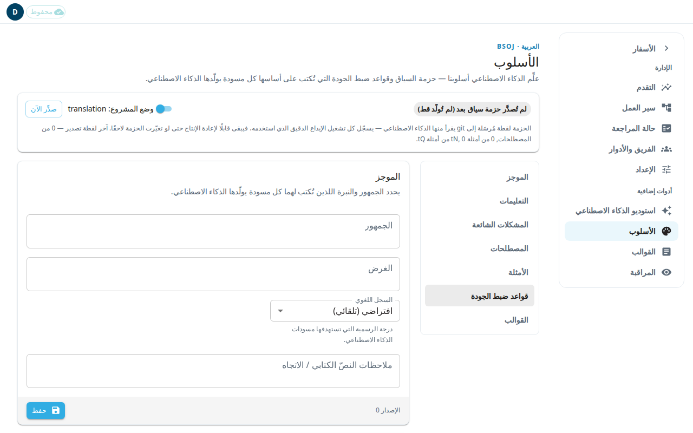

تحتوي شاشة **الأسلوب** على ما يُقال للذكاء الاصطناعي قبل أن يصوغ أي شيء لمشروعك: من هم القراء، وكيف يكتب، وأي مصطلحات يستخدم. هذا كله معًا هو حزمة السياق. تُكتب كل مسودة ذكاء اصطناعي على أساسها. يستطيع المسؤول فقط حفظ التغييرات.

يعرض الشريط في الأعلى حالة حزمة السياق، مثل **حزمة السياق جاهزة**، مع أعداد المصطلحات والأمثلة. **صدِّر الآن** يبني حزمة جديدة. ويبيّن مفتاح **وضع المشروع** إن كان المشروع في وضع الترجمة أم التأليف. الأقسام أدناه تنطبق على مشاريع الترجمة فقط. وفي المشاريع الأخرى تقول الصفحة ذلك.

## تعبئة الأقسام
استخدم القائمة على الجانب للانتقال إلى قسم. بعد تغيير قسم، اضغط **حفظ**.

- **الموجز:** املأ **الجمهور** و**الغرض** و**السجل اللغوي** و**ملاحظات النصّ الكتابي / الاتجاه**. السجل اللغوي هو درجة رسمية المسودات: **افتراضي (تلقائي)** أو **رسمي** أو **غير رسمي**.
- **التعليمات:** نص حر (Markdown) يُضاف إلى كل طلب صياغة وفحص بالذكاء الاصطناعي. استخدم **معاينة** لترى شكله.
- **المشكلات الشائعة:** نص حر عن المشكلات التي يشير إليها المراجعون مرارًا.
- **المصطلحات:** قراراتك بشأن المصطلحات. يمكنك إعطاء ترجمة مفضّلة، أو وسم مصطلح بأنه ممنوع مع ذكر البديل، أو وسمه بأنه لا يُترجَم. ويمكن لهذا القسم أيضًا استيراد ملف CSV وتصديره. عند حذف مصطلح تظهر لثوانٍ رسالة **تم حذف المصطلح** مع زر **تراجع**؛ اضغط **تراجع** لإعادة المصطلح نفسه. إذا صار في المشروع المصطلح نفسه منذ الحذف، أو غيّره شخص آخر، يبقى المصطلح محذوفًا وتشرح رسالة السبب. وإذا تعذّر الوصول إلى الخادم، تطلب الرسالة **حاول مرة أخرى** ويبقى زر **تراجع** متاحًا.
- **الأمثلة:** ملاحظات وأسئلة اعتُمدت في المحرر واحدةً واحدة، أو حُدّدت واعتُمدت في **المراجعة السريعة**. يراها الذكاء الاصطناعي نماذج للعمل الجيد. أما مسودات الذكاء الاصطناعي التي لم يغيّرها أحد واعتُمدت بزر **اعتماد كل الملاحظات** أو **اعتماد كل الأسئلة**، والعناصر المعتمدة بتغيير المسؤول لحالة المراجعة، فليست أمثلة. والاعتمادات التي تمت بزر اعتماد الكل قبل هذا التغيير تبقى محسوبة. بدّل بين **الملاحظات** و**الأسئلة**. اضغط **إلغاء الاعتماد** لإزالة مثال. إلغاء الاعتماد يعيد العنصر إلى حالة التحرير.
- **قواعد ضبط الجودة** و**القوالب:** قواعد ضبط الجودة مدرجة وعليها **قريبًا**. أما **القوالب** فتبيّن كم قالب ملاحظات مترجم. اضغط **افتح تنسيق القوالب ←** للعمل عليها (انظر [قوالب الملاحظات](#help:admin-templates)).

## قواعد الأسلوب: تصحيحات على مسودات الذكاء الاصطناعي
يعرض قسم **قواعد الأسلوب** تصحيحات صغيرة يجريها التطبيق على كل مسودة ترجمة يكتبها الذكاء الاصطناعي عند وصولها، حتى لا يضطر المحررون إلى إجراء التصحيح نفسه في كل ملاحظة. وهي تنطبق على الملاحظات وعلى الأسئلة وأجوبتها. مثلًا، يمكن لقاعدة أن تضيف النقطة بعد الترجمة البديلة التي بين قوسين، أو أن تحذف وسمًا يضيفه الذكاء الاصطناعي باستمرار.

- تبيّن كل قاعدة ما تصحّحه (**قبل** و**بعد**) وما تتركه كما هو.
- كل قاعدة يضيفها فريق التطوير تكون **متوقفة** حتى يجعلها مسؤول **مُفعّلة**. لا تشغّل القاعدة إلا بعد أن يؤكدها محرر اللغة. أما القاعدة التي تنشأ من الموافقة على بطاقة في [صندوق الاقتراحات](#help:admin-progress) فتبدأ **مُفعّلة**.
- تغيّر القاعدة المسودات التي تصل بعد تشغيلها. أما المسودات الموجودة في المشروع فتبقى كما هي.
- لا تتغير أبدًا اقتباسات الكتاب المقدس المكتوبة بخط عريض ولا عمود الاقتباس.
- لا تضيف قاعدة النقطة شيئًا إذا كان الكلام داخل القوسين الأخيرين ينتهي أصلًا بعلامة ترقيم (… أو ؟ أو . أو ! أو ? أو ؛، ومنها ...)، فلا تضيف القاعدة علامة ثانية.
- يُحفظ النص الأصلي الذي كتبه الذكاء الاصطناعي في سجل كل مسودة، حتى يمكن مراجعة التصحيحات لاحقًا.
- إذا بقيت في المسودة العبارة الإنجليزية "If it would be helpful in your language"، يسجّل التطبيق ذلك في سجل المسودة لمراجعته لاحقًا. ولا يعيد كتابة العبارة، ولا يظهر هذا التسجيل على الشاشة حتى الآن.

لا يمكنك إضافة قواعد أو تعديلها في هذه الصفحة. يضيف فريق التطوير القواعد الجديدة، أو تنشأ من الموافقة على بطاقة في صندوق الاقتراحات.

## معرفة من غيّر التفضيلات، والتراجع عن تغيير
يُحفظ كل حفظ لـ**الموجز** و**التعليمات** و**المشكلات الشائعة**، سواء تم هنا أو بواسطة مساعد الدردشة. اضغط **سجل التغييرات** فوق قسم الموجز لترى القائمة، الأحدث أولًا.
- تبيّن كل نسخة من حفظها ومتى، وهل جاءت من **تطبيق الويب** أم من **مساعد الدردشة**.
- تحت كل نسخة ترى كل حقل تغيّر، مع نصه **قبل** و**بعد**.
- اضغط **تحميل تغييرات أقدم** لترى ما هو أبعد.

لإعادة نسخة سابقة:
1. اضغط **سجل التغييرات**.
2. ابحث عن النسخة التي تريدها واضغط **استعادة**.
3. اقرأ الرسالة واضغط **استعادة** مرة أخرى. يُستبدل النص الذي كتبته في الصفحة ولم تحفظه.

تُحفظ الاستعادة كنسخة جديدة، فيمكنك التراجع عنها بالطريقة نفسها. تبدأ القائمة من يوم تشغيل هذا السجل. عمليات الحفظ التي سبقته غير مدرجة. وإذا كانت التفضيلات قد حُفظت قبل ذلك اليوم، فإن نهاية القائمة (بعد تحميلها كلها) تعرض النسخة **كما كانت قبل أقدم تغيير مسجّل**.

## تحديث حزمة السياق
يقرأ الذكاء الاصطناعي آخر حزمة مُصدَّرة، لا نصك الحي. بعد تغيير المصطلحات أو التعليمات:
1. اضغط **حفظ** في كل قسم غيّرته.
2. اضغط **صدِّر الآن** في الشريط العلوي.
3. انتظر حتى يقول الشريط **حزمة السياق جاهزة**.

إذا رُفض التصدير لأنه سيزيل محتوى، يظهر زر **تصدير (إجباري)**. لا تستخدمه إلا إذا كنت متأكدًا.

إذا ظهرت رسالة **فشل الحفظ**، تحقق من اتصالك وحاول مرة أخرى. وإذا ظهرت **حفظ شخص آخر أولًا**، فنصك محفوظ لديك. اضغط **حفظ** مرة أخرى.
