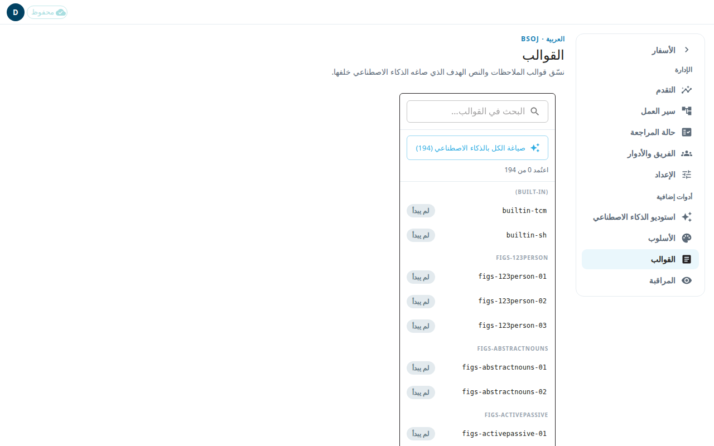

قالب الملاحظة هو الصياغة المعيارية لنوع واحد من ملاحظات الترجمة (tN، translationNotes). يعيد المترجمون استخدامه عندما يكتبون ملاحظات من هذا النوع. تترجم كل قالب إنجليزي إلى لغتك ثم تعتمده.

توجد القوالب في مكانين. صفحة الإدارة **القوالب** (`#/admin/curate`) هي الأساسية. أما مساحة **قوالب الملاحظات** الأقدم (`#/templates`) فتؤدي العمل نفسه بتخطيط أبسط. كلتاهما تعملان في مشاريع اللغة البوابة فقط. اللغات البوابة هي اللغات الكبرى التي تترجم منها لغات أصغر.

## تنسيق القوالب في صفحة الإدارة
1. افتح **القوالب** من قائمة الإدارة، تحت **أدوات إضافية**.
2. استخدم **البحث في القوالب…** للعثور على قالب. تعرض القائمة حالة كل قالب: **لم يبدأ** أو **مسودة ذكاء اصطناعي** أو **محرَّر** أو **معتمَد**. وسطر **اعتُمد N من M** يبيّن تقدمك.
3. انقر قالبًا. يعرض المحرر **المصدر (إنجليزي، للقراءة فقط)** و**الهدف (القالب المترجم)**.
4. اكتب الترجمة في خانة الهدف. استخدم **معاينة** لرؤية النص المنسّق و**تحرير** للعودة.
5. اضغط **حفظ**.
6. عندما تصبح الترجمة صحيحة، اضغط **اعتماد**. يتطلب الاعتماد ترجمة محفوظة. إذا كانت لديك تغييرات غير محفوظة، فاحفظ أولًا.

للتراجع عن اعتماد، اضغط **إلغاء الاعتماد**. لا يمكن إعادة صياغة قالب معتمد حتى تلغي اعتماده.

## جعل الذكاء الاصطناعي يكتب مسودة أولى
- **صياغة بالذكاء الاصطناعي** تصوغ القالب المفتوح. راجع المسودة مقابل المصدر الإنجليزي قبل أن تعتمدها.
- **صياغة الكل بالذكاء الاصطناعي (N)** تصوغ كل قالب يمكن صياغته. يبيّن عدّاد التقدم، و**إلغاء** يوقفها. وتتوقف العملية من تلقاء نفسها بعد إخفاقات متكررة.
- إذا قالت الصفحة إن الذكاء الاصطناعي غير مُهيأ، فالصياغة غير متاحة. أما التحرير والاعتماد فيعملان.

## أمور أخرى مهمة
- القالب الموسوم **مصدر قديم** تغيّر مصدره الإنجليزي بعد المسودة. راجع ترجمته من جديد.
- **تعديل غير محفوظ** يعلّم قالبًا فيه تغييرات لم تحفظها. يبقى النص غير المحفوظ على هذا الجهاز إذا غادرت.
- **سجل الإصدارات** يعرض الإصدارات السابقة للقالب.
- إذا حفظ شخص آخر القالب نفسه قبلك، يُبقي التطبيق نصك. اضغط **حفظ** مرة أخرى لتطبيقه فوقه.

## المساحة الأقدم
عنوان المساحة الأقدم **قوالب الملاحظات**. افتحها من قائمة **المزيد** في المحرر الكلاسيكي (انظر [المحرر الكلاسيكي](#help:classic-editor)). فيها الإجراءات نفسها: خانة بحث، و**معاينة** و**تحرير**، و**حفظ**، و**اعتماد**، و**السجل**، و**صياغة بالذكاء الاصطناعي**، و**صياغة الكل بالذكاء الاصطناعي**. استخدم **العودة إلى النص الكتابي** لمغادرتها.
