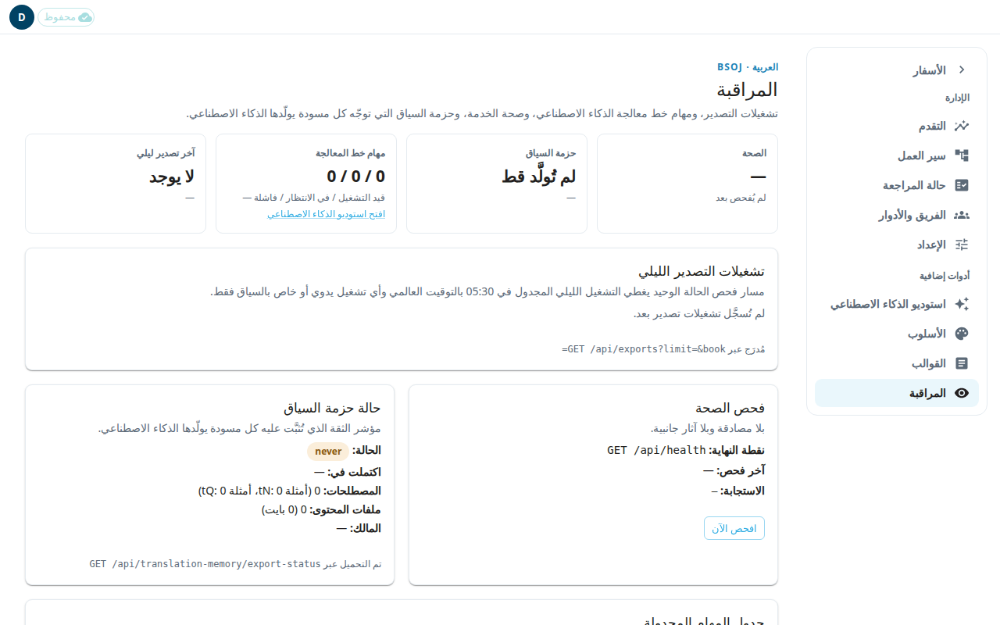

**المراقبة** لوحة للقراءة فقط عن الجانب التقني من المشروع: التصديرات الليلية ومهام الذكاء الاصطناعي وصحة الخدمة وحزمة السياق. يستطيع المسؤول فقط فتحها. استخدمها للتأكد من أن الأمور تعمل. وهي لا تغيّر ترجمتك.

## البلاطات في الأعلى
- **الصحة** تعرض **سليم** أو **متوقف** بعد أن تفحص، أو **لم يُفحص بعد**.
- **حزمة السياق** تبيّن إن كانت الحزمة التي يقرأ منها الذكاء الاصطناعي جاهزة.
- **مهام خط المعالجة** تعدّ مهام الذكاء الاصطناعي قيد التشغيل وفي الانتظار والفاشلة. اضغط **افتح استوديو الذكاء الاصطناعي** لإدارتها (انظر [استوديو الذكاء الاصطناعي](#help:admin-ai)).
- **آخر تصدير ليلي** يعرض أحدث تصدير وعدد الصفوف التي كتبها.

## التأكد من أن الخدمة تعمل
1. ابحث عن لوحة **فحص الصحة**.
2. اضغط **افحص الآن**.
3. اقرأ **الاستجابة** و**آخر فحص**. لا يحتاج الفحص إلى تسجيل دخول ولا يغيّر شيئًا.

## التأكد من التصديرات
يسرد **تشغيلات التصدير الليلي** التصديرات الأخيرة. الصف الموسوم **يحتاج إلى انتباه** فشل. والصف الموسوم **تم الإرسال** وصل إلى Door43، وهو خادم git الذي تُنشر عليه ملفاتك. يعرض كل صف عدد الصفوف المصدَّرة والفرع. لبدء تصدير بنفسك، استخدم **تشغيل التصدير الآن…** في صفحة سير العمل (انظر [سير العمل](#help:admin-workflow)).

## قراءة حالة حزمة السياق
تبيّن **حالة حزمة السياق** هل الحزمة جاهزة، ومتى انتهت، وكم مصطلحًا ومثالًا تحتوي. إذا قالت **فشل آخر تشغيل** أو **لم تُولَّد قط**، فافتح الأسلوب وصدّرها من جديد (انظر [الأسلوب](#help:admin-style)).

## جدول المهام المجدولة
يسرد **جدول المهام المجدولة** المهام التلقائية، مثل التصدير الليلي وفحص مهام الذكاء الاصطناعي. لا تستطيع تشغيلها أو إيقافها من هنا. وهي معروضة للاطلاع، من إعدادات الخادم.

إذا لم يكن التصدير الليلي التلقائي مفعّلًا في هذا النشر، تقول الصفحة ذلك. عندها استخدم **تشغيل التصدير الآن** للنشر.

## مجموعة مساحات العمل الاحتياطية
هذه اللوحة للمسؤول الأعلى فقط. يرى بقية المسؤولين ملاحظة بأن البيانات غير مرئية لهم.
