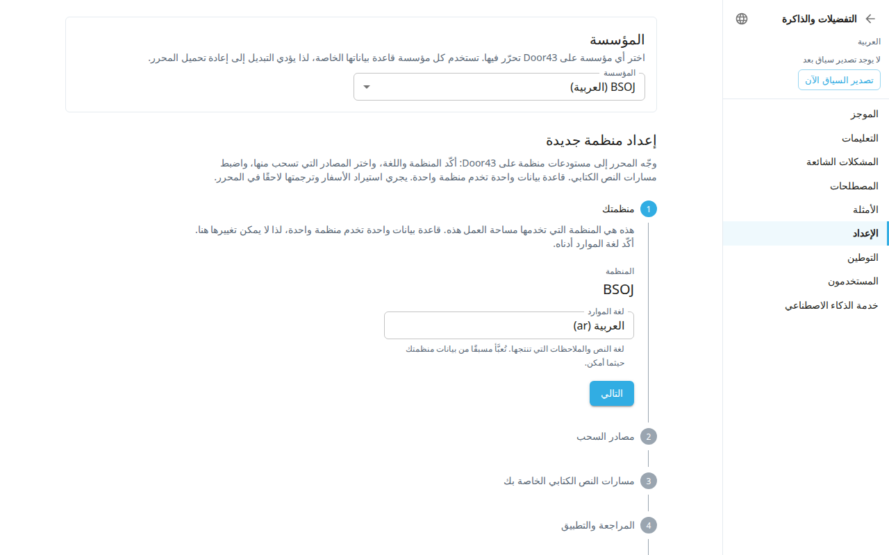

**التفضيلات والذاكرة** (`#/preferences`) هي صفحة الإعدادات الكلاسيكية. ومعظمها موجود أيضًا في مكتب الإدارة، وهو المكان الأحدث لهذه الإعدادات. استخدم ما تفضّله.

افتحها من قائمة الحساب في الشريط العلوي عبر **التفضيلات والذاكرة**. للمغادرة، استخدم سهم الرجوع أعلى القائمة الجانبية (تلميحه **العودة إلى النص**). تظهر الأقسام في القائمة الجانبية. وتظهر أقسام الإدارة للمسؤولين فقط.

| القسم في التفضيلات | مكانه في مكتب الإدارة |
|---|---|
| **الموجز** و**التعليمات** و**المشكلات الشائعة** و**المصطلحات** و**الأمثلة** | [الأسلوب](#help:admin-style) |
| **الإعداد** (معالج الإعداد) | [الإعداد](#help:admin-setup) |
| **التوطين** | [الإعداد](#help:admin-setup) |
| **المستخدمون** | [الفريق والأدوار](#help:admin-team) |
| **خدمة الذكاء الاصطناعي** | [استوديو الذكاء الاصطناعي](#help:admin-ai) |
| **قواعد الأسلوب** (تصحيحات على مسودات الذكاء الاصطناعي) | [الأسلوب](#help:admin-style) |
| **الدروس** (ما يتعلّمه الذكاء الاصطناعي من تصحيحات المحررين) | [الأسلوب](#help:admin-style) |

تحتاج أقسام الأسلوب الخمسة في الصف الأول (**الموجز** و**التعليمات** و**المشكلات الشائعة** و**المصطلحات** و**الأمثلة**) إلى مشروع ترجمة وحساب ليس للقراءة فقط. وإلا تقول الصفحة إنك تحتاج إلى صلاحية محرر أو مسؤول، أو إن اللوحة لمشاريع الترجمة فقط. أما **قواعد الأسلوب** و**الدروس** فلا تظهر إلا للمسؤولين.

## تغيير مصدر النص الكتابي
هذه المهمة موجودة هنا وفي لوحة المسارات بشاشة الأسفار فقط. استخدمها عندما يحتوي المشروع على نص بالفعل وتريد أن يقرأ مسار من مستودع Door43 مختلف. لا يستطيع معالج الإعداد فعل ذلك.
1. افتح **التفضيلات والذاكرة** واختر **الإعداد**. مرّر إلى **تغيير مصدر النص**.
2. في بطاقة المسار، الصق **عنوان URL للمصدر الجديد (Door43)** واضغط **تغيير المصدر**. يتحقق التطبيق من وجود المستودع ومن احتوائه على ملفات أسفار.
3. في النافذة **استبدال مصدر النص لمسار …**، اختر الأسفار التي تريد استبدالها. الأسفار التي تتركها غير محددة تبقى بنصها الحالي. والأسفار التي عدّلتها تبدأ غير محددة حفاظًا على عملك. **استبدال الكل** و**الاحتفاظ بالكل** يحددان كل الأسفار أو لا شيء.
4. حدّد مربع التأكيد واضغط **بدء الاستبدال**.
5. انتظر أثناء تجهيز الأسفار. تعرض البطاقة **الأسفار المُجهَّزة**.
6. عند اكتمال التجهيز، اضغط **تفعيل**. وللتوقف، اضغط **إلغاء والتراجع**. يُبقي هذا المصدر الحالي ويتخلص من النص المُجهَّز.

في البطاقة نفسها مفتاحا **النص للقراءة فقط** و**المحاذاة قابلة للكتابة**. وهما موجودان أيضًا في صفحة سير العمل (انظر [سير العمل](#help:admin-workflow)).

## أمور أخرى في هذه الصفحة
- يعرض شريط حزمة السياق أعلى القائمة الجانبية حالة الحزمة. **تصدير السياق الآن** يبني حزمة جديدة. انظر [الأسلوب](#help:admin-style).
- يرى المسؤولون زر **سجل التغييرات** فوق قسم الموجز. يعرض كل حفظ للموجز والتعليمات والمشكلات الشائعة ويمكنه استعادة نسخة سابقة. انظر [الأسلوب](#help:admin-style).
