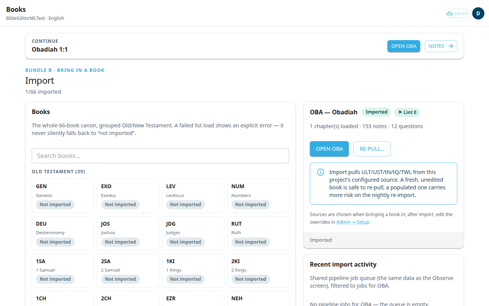

BPtranslate is a web app where your team translates scripture and the translation helps. You sign in with your Door43 account. This page covers signing in, the top bar, and the settings you reach from your account button.

## Sign in
1. Open the app. If you are not signed in, you see **Sign in to continue**.
2. Select **Sign in with Door43**.
3. Door43 asks you to approve the sign-in. After you approve, you come back to the app. The first screen is **Books**.

If you signed out earlier, the screen says **You're signed out**. Edits you had queued stay in your browser until you sign in again.

## If you are not allowed in
After you sign in, you may see **Not authorized**. It says your Door43 account is not on the editor list for this app (or for the organization's workspace). Ask an admin to add you. Then select **Sign in with a different Door43 account** if you used the wrong account. Door43 may remember the old account, so sign out of Door43 itself first.

Some people can only read. You then see a banner at the top: you are signed in as a member with read-only access, and edits will not be saved. Ask an admin to add you as an editor if you need to edit.

## The top bar
Every screen has one bar at the top. The screen name and a back arrow are on the left. On the right you see:

- A save status: **saved**, **saving**, **offline**, or **N unsaved**. See [Saving and working offline](#help:save-and-sync).
- A round button with the first letter of your user name. This is your account menu.
- A **?** button that opens this guide.

If a newer version of the app is available, a button **App update available — refresh** appears. Save your work first, then select it.

## Your account menu
Select the round button. The menu shows your user name and organization, and these items:

- **Start an AI run** (**Import from Door43** in a source project): on a phone only, and only for editors and admins, on a book's package and on the Scripture, Notes and Questions screens. It is first in the menu. On a wider screen it is an icon in the top bar instead. See [Translating scripture](#help:scripture).
- **Organization**: switch organization. It appears only if you belong to more than one. Switching reloads the app, and it is blocked while unsaved edits are still syncing.
- **Switch to dark mode**.
- **Interface language**: choose the language of menus and buttons. Arabic, Persian and Urdu switch the screen to right-to-left. This does not change the text you translate.
- **Reading text size**: make the text smaller or larger.
- **Classic editor**: see [Classic editor](#help:classic-editor).
- **Admin**: admins only.
- **Sign out**.

If your Door43 account belongs to several organizations, a **Choose your organization** window may open after sign-in. Pick one, or select **Continue** to stay where you are.

## Getting help
Select the **?** button in the top bar to open this guide. On a phone, open your account menu (the round button) and select **Help**; in the classic editor it is in the **More** menu. It opens on the page for the screen you are on. Type in **Search help** to find a topic.

If your admin has turned it on, the guide also has an **Ask AI** area at the bottom. Type a question and the app first shows up to three topics that may answer it under **Did one of these answer it?**. If none does, select **Ask AI**. The answer comes from this guide, and the topics it used appear under **From the guide:**. You can ask follow-up questions, or select **New question** to start over. Each person has a daily allowance, and the area shows how much is **left today**. When the allowance is used up, it says when it resets. Searching the guide always works.

## Next
Go to [Books](#help:books) to open a book.
