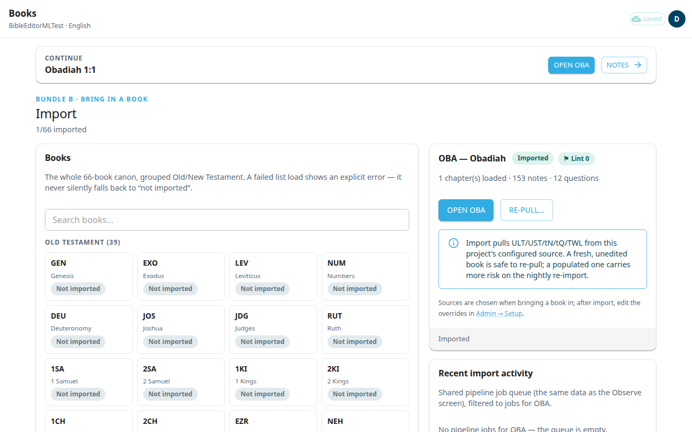
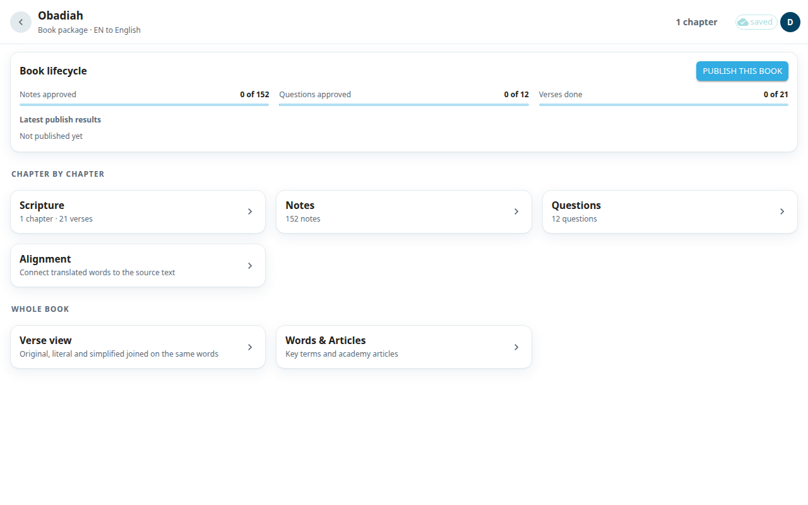

The **Books** screen is the first screen of the app. It lists all 66 books. Pick a book to open its package, which is the place that leads to every kind of work on that book.

## Open a book
1. Find the book. You can scroll the Old and New Testament lists, or type in **Search books…**.
2. Each book shows **Imported** or **Not imported**. Only imported books can be opened.
3. Select the book. The details appear next to the list (below it on a phone). They show how many chapters, notes and questions are loaded.
4. Select **Open OBA** (with your book's code). This opens the book package.

If a book is not imported, you see **Nothing to open yet — an administrator brings books into the editor.**

## Continue where you stopped
When you have worked before, a **CONTINUE** card at the top shows the last place you were, for example Obadiah 1:1. Select **Open OBA** to go to that book's package. Select **Notes** to jump to the notes for that verse.

## Bring in a book (admins)
Admins see an **Import** heading and an extra panel for each book.
1. Select a book that is **Not imported**.
2. Select **Bring in OBA…**.
3. Under **Intent**, choose **Translate a new book** (loads the English source text, notes and questions for you to translate) or **Load my existing work** (loads the book from your organization's own repository).
4. For most books, leave the sources on the default and select **Bring in OBA**.

A large book can take up to a minute. If you leave the screen, the import still runs. For a book that is already imported, **Re-pull…** fetches fresh content from Door43 without replacing rows that translators already edited. A forced re-import that throws away edits asks you to confirm first.

## The book package
After **Open**, you see the package for the book. The back arrow returns to **Books**.

- **Book lifecycle** shows progress: **Notes approved**, **Questions approved** and **Verses done**. Admins also see **Publish this book** and **Latest publish results**. Publishing sends approved content to Door43. Rows still waiting for review are held back.
- **Chapter by chapter**: **Scripture**, **Notes**, **Questions** and **Alignment**. Select a row to open its chapter list, then choose a chapter. A row with nothing in it (for example no notes) is greyed out.
- **Whole book**: **Verse view** and **Words & Articles**.

Related: [Scripture](#help:scripture), [Notes](#help:notes), [Questions](#help:questions), [Alignment](#help:alignment), [Verse view](#help:verse-view), [Words and articles](#help:words).
