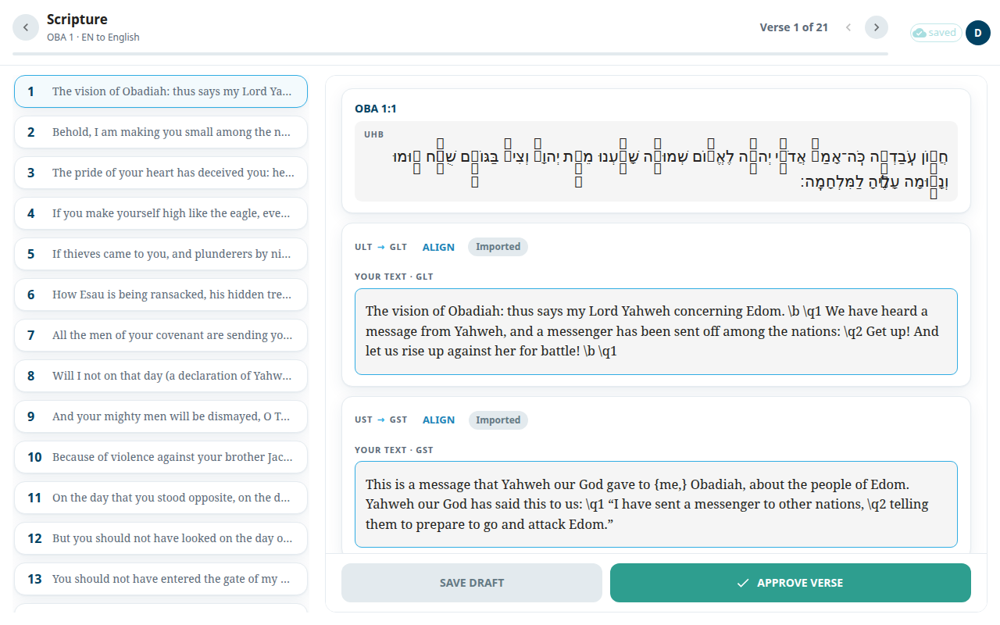
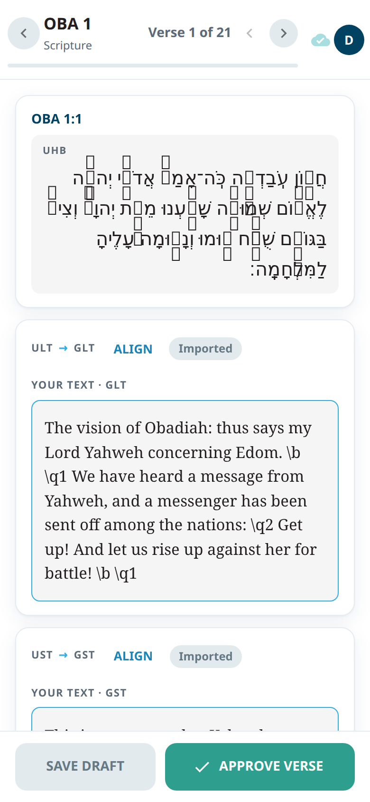

The **Scripture** screen is where you write and approve the verses of one chapter, one verse at a time. Each verse has two boxes, one for each of your project's two texts. They carry your project's own names, for example **GLT** and **GST**, or **AVD** and **NAV**. In unfoldingWord's English source these are the ULT (the literal text, which follows the original words closely) and the UST (the simplified text, which says the meaning in plain words). In a translation project, both boxes hold your own language.

## Open the screen
1. Open a book from [Books](#help:books).
2. In the package, select **Scripture**, then choose a chapter.

The title shows the book and chapter, for example `OBA 1`. Next to it you see **Verse 1 of 21** and the arrows **Previous verse** and **Next verse**. A thin bar shows how far you have come.

On a wide screen, the list of verses is on the left. Each verse can show a chip: **Approved** or **Draft saved**. On a phone you see one verse at a time. You can also swipe sideways to move to the next or previous verse (not when you start in a text box).

## Write a verse
1. Read the reference card. It shows the verse and the original-language text.
2. Click in the first of the two boxes (**Your text** followed by your project's first text name, for example **Your text · GLT**) and write or correct the verse. Do the same in the second box (for example **Your text · GST**).
3. Select **Save draft** to save both boxes without approving. A message **Draft saved** appears.
4. When the verse is finished, select **Approve verse**. It saves both boxes and marks the verse done.
5. Select **Next** to go to the next verse.

Each box has a chip: **Imported** (nobody changed it), **Edited**, or **Approved**.

## When you finish a chapter
After the last verse, you see **OBA 1 scripture complete** with the number of verses approved. Select **Continue to OBA 2** or **Review again**.

## Alignment
Alignment connects your words to the original words. Editing a verse keeps the alignment of the words you did not touch. If a save would remove the alignment of words you did not change, a window **This save would unalign words it didn't touch** lists them. Choose **Cancel** to go back, or **Save anyway**. Your typing is kept either way. Fix the unaligned words afterwards.

On a wide screen, each box has an **Align** button. **Align both** opens both texts side by side. Both open the [Alignment](#help:alignment) screen.

## Start an AI run
Editors and admins have one more icon in the top bar:
- In a translation project it is a sparkle icon, **Start an AI run**. Its menu has **Translate chapter** (the chapter's translation notes), **Translate questions** and **Import from Door43**. Admins also see **Pull Aquifer drafts** and **Re-source notes from English**. After you choose a run, a confirm window opens: type a chapter or a range under **Chapter or range** and press **Start**.
- In a source project, one that does not translate from another language (such as unfoldingWord's English), it is a download icon, **Import from Door43**. It opens the import straight away, with no menu.
- On a phone the icon is not in the top bar. It is the first item in your account menu, with the same name.

A run locks its chapter for editing until it finishes. Admins follow the runs in [AI studio](#help:admin-ai).

## Good to know
- If you only have view access, you see a notice and the boxes are read-only.
- While an AI run is rewriting the chapter, a save can be refused and dropped instead of overwriting. The screen then tells you the verse was not approved.
- If someone else changed the verse, a message tells you to resolve the conflict from the status bar. See [Saving and working offline](#help:save-and-sync).
