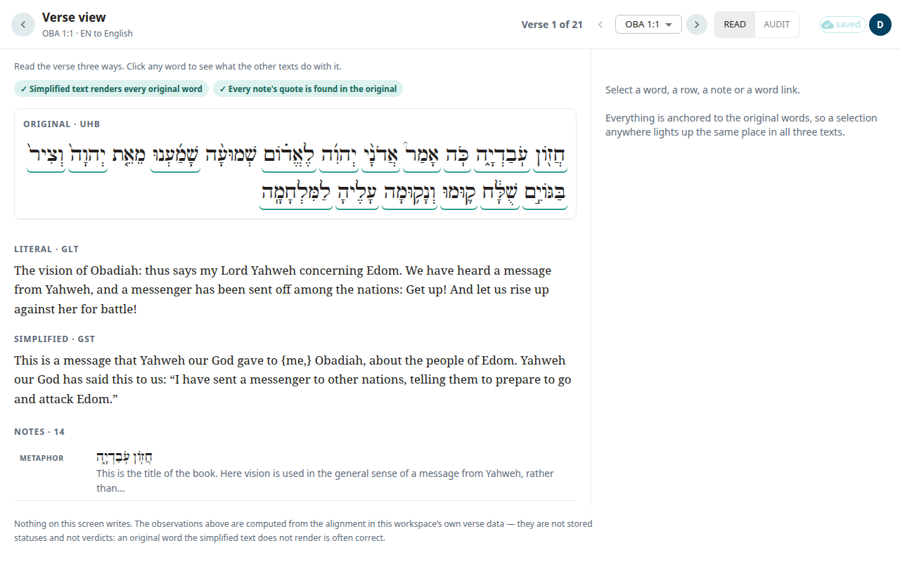

The **Verse view** helps you check one verse. It shows the original text (Hebrew or Greek), the literal text (ULT) and the simplified text (UST) joined on the same words. If you click a word in one text, the same place lights up in the other two. **Nothing on this screen changes your work.** It is for reading and checking.

## Open it
1. Open a book from [Books](#help:books).
2. In the package, under **Whole book**, select **Verse view**. It opens at the last verse you worked on in that book, or at 1:1.

The back arrow returns to the package.

## Move between verses
- Select **Previous verse** or **Next verse**. The arrow keys (← →) do the same.
- Use **Go to verse** to jump to a verse in the same chapter.
- The count, for example **Verse 1 of 21**, shows where you are.

## Read mode and Audit mode
At the top, choose **Read** or **Audit**.

- **Read** shows the verse three ways: **Original**, **Literal** and **Simplified**. Click any word to see what the other texts do with it.
- **Audit** shows one row for each original word. Each row shows what the literal text made of that word and what the simplified text made of it. A word that a text does not translate shows **not rendered**. This is often correct, so treat it as a question, not an error. Words added with no original word behind them are listed under the rows.

## The detail panel
Select a word, a row, a note or a word link. The panel (below the text on a narrow screen) shows:

- the original word with its grammar and its lexicon entry;
- the literal and simplified text for that word;
- the notes and word links that attach to it.

The resources of the verse are listed in groups: **Notes**, **Word links** and **Questions**, each with a count. Select one to see it in the panel. A note whose quote does not match the original text of this verse is marked **quote not anchored**.

## Read a helps article
When you select a note or a word link, the panel can show **Read the translationAcademy article →** or **Read the translationWords article →**. The article opens in place. Select **Back to the list** to return, or **Open in the article editor** to go to the full article. See [Words and articles](#help:words).

If a book has no original text loaded, the screen says so and still lists the resources.
