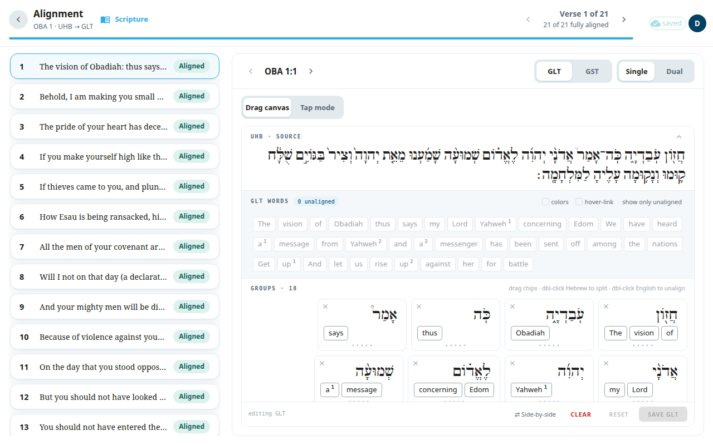
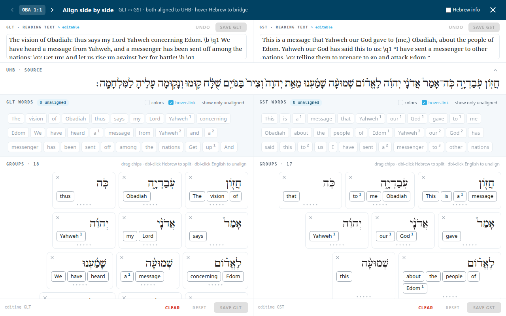

**What is word alignment?** Alignment links each word in your translation to the word or words in the original Hebrew or Greek that it translates. These links let the other tools show which note belongs to which words, and let a reader see where a word comes from. A word with no link is **unaligned**. Alignment is saved with the verse.

## Open the screen
- From the package, select **Alignment** and choose a chapter. Or:
- On the [Scripture](#help:scripture) screen, select **Align** (one text) or **Align both** (both texts).

The title is **Alignment**. Under it you see the book and chapter and an arrow from the original text to the text you are aligning, for example `OBA 1 · UHB → ULT`. The count **N of M fully aligned** shows the progress of the chapter. The verse list has a chip for each verse: **Aligned**, **N unaligned**, **Source gaps** (original words with nothing linked to them) or **Not drafted**.

## Single or dual
Two buttons choose the view:

- **Single** aligns one text at a time. Choose which one with the text picker next to it (ULT or UST).
- **Dual** puts the ULT and UST side by side in a full-screen window. Both are aligned to the same original words, so you can compare them. Dual is greyed out if the verse has no text to compare.

In Dual mode you can also correct the verse text. Save the alignment first, then edit. When you close with unsaved work, the window **Unsaved changes** offers **Cancel**, **Discard** or **Save**.

## Align the words (Single)
The screen offers two ways to work. On a large screen you can switch between **Drag canvas** and **Tap mode**. On a phone only Tap mode is available.

Drag canvas:
1. Drag a word chip from the word bank onto a card of original words (**drop English here**).
2. To split a joined original group, double-click the original word. To unalign a word, double-click it or drag it back to the word bank.
3. Select **Save ULT** (the button names the text you are aligning). **Reset** returns to the last saved version.

Tap mode:
1. Tap a card of original words, then tap the target words that belong to it. (Or tap target words first, then the card.)
2. If suggestions are shown, select **✓ Accept** or **✗ Skip** for each one.
3. Use **Unalign**, **Combine** or **Split** to fix a pairing.
4. Select **Save alignment**. You can see **N of M words aligned** and use **Jump to unaligned** to find what is left.

## Good to know
- If you have view-only access, alignment is read-only.
- Before you switch text or mode, save or reset your unsaved alignment. The switch is blocked until then.
- If a save would unalign words you did not touch, a window asks you to confirm.
