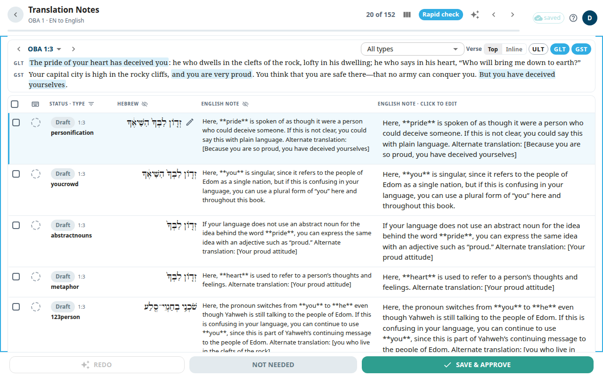

The **Translation Notes** screen is where you translate the notes (tN) of one chapter. A translation note explains a hard place in a verse. Each note has a quote from the original text, a link to a translationAcademy (tA) article, and the note text. You see the English note and write your own version next to it.

## Open the screen
1. Open a book from [Books](#help:books).
2. In the package, select **Notes**, then choose a chapter. Or select **Notes** on the **CONTINUE** card to jump to the note at your last verse.

The header shows the book and chapter. A count such as **1 of 5** shows where you are. Use the arrows or **Next** and **Previous** to move. On a wide screen the list of notes is on the left. Each row has a verse, a preview and a status chip: **Draft**, **Edited**, **Pending**, **Unsaved** or **Approved**. If the chapter has many kinds of notes, a menu with **All types** filters by tA article type.

## Translate one note
The note appears as a stack of cards:
1. The original-language quote the note is about.
2. The scripture card with the verse. The words of the quote are highlighted. When it is available, chips above the verse let you show the English ULT text and its alignment.
3. The **English note** (read-only).
4. Your draft, titled with your language, for example **Draft** or **draft · AI** when an AI wrote it.

To write your note:
1. Click the text of your draft. A box opens.
2. Type or correct the note.
3. Select **Save** to keep your text without approving it.
4. When it is right, select **Save & Approve** at the bottom. This saves and marks the note approved.

The other two buttons at the bottom:
- **Redo** asks the AI for a fresh draft. It works in the background and the new draft appears when ready. It needs a quote and a support reference on the note.
- **Not needed** sets the note aside when it does not need translating. It goes to the trash. Until the nightly publish you can bring it back in the [Review queue](#help:review-queue). After that it is deleted for good. If someone else changed the note and your screen does not show their change yet, it is not set aside: the app reloads it and tells you, so you can read their change first.

An icon next to the verse opens the verse view. See [Verse view](#help:verse-view).

## Rapid check
On a screen at least 1200 pixels wide, such as most laptops, the **Rapid check** button in the top bar switches to a compact list for checking many notes quickly. Select it again to go back to the cards. The app remembers your choice in this browser. On a smaller screen or a narrow window you always see the cards, and the button is hidden.

The verse stays at the top while you scroll, one short line per scripture text. Below it, each note of the verse is one row: its status, its tA type, the original-language quote, the **English note**, and your note. Choose a type under **All types**, on the verse's top line, to list every note of that type in the chapter instead, grouped by verse.

To hide notes by status, press **Filter by status** (the funnel beside **Status · type** in the column header). Untick a status to hide it, for example **Approved**, or press **Only** beside one status to see just those notes. The list then shows every matching note in the chapter, grouped by verse, and a line above the columns says what is hidden; **Show all** brings everything back. The note you have open stays in the list while it is open, so approving it does not make it jump away; it leaves the list when you move on. If a new choice hides the open note, the next shown note opens instead. The filter works together with a type filter and stays on when you change chapters.

**Verse: Top | Inline**, on the same line, chooses where the scripture lines show. With **Top** (the usual setting), the open note's verse stays at the top, as described above. With **Inline**, the top keeps only its buttons, and each verse's scripture lines sit right above that verse's notes and scroll with them. With a type filter, every verse group starts with its own scripture lines, with the quotes of the listed notes highlighted. The app remembers your choice in this browser, and **V** switches between the two. A text you hide with its short name is hidden in either place.

- Click your note in any row to edit it. Select **Save** to keep it, or **Save & Approve** at the bottom to save and approve it. Click anywhere else in a row to make it the current note without editing.
- In the editor, **Close** (or **Esc**) closes it and keeps what you typed as an unsaved draft. **Discard changes**, shown once you have changed the note, puts back the saved text and closes the editor.
- The circle after a row's checkbox approves that note. It fills in when the note is approved. A note with unsaved typing has to be opened and saved first.
- Click a filled circle to take the approval back. The note shows **Pending** again and a message says **Approval removed**. Click the circle again to approve it.
- The pencil next to the current note's quote opens the quote picker, where you choose which original-language words the note is about. When the original-language column is hidden, **Q** still opens the picker.
- To move to another verse, use the arrows on either side of the reference at the top, or select the reference to pick a verse from the list. The list shows only verses that have notes, with how many each has.
- The short names at the end of the verse's top line, such as **ULT** and **UST**, show or hide each scripture text. A name stays there while its text is hidden, so you can always bring it back.
- To make room for your note, hide the original-language column or the **English note** column with the crossed-out eye in its heading. A hidden column becomes a small **+** button at the end of the headings: select it to bring the column back.
- The app remembers which texts and columns you hid, in this browser, for every book.

Keys work once you click a blank part of the list or a note's type:
- **J** and **K** (or the arrow keys) move to the next and previous note.
- **[** and **]** move to the previous and next verse.
- **Enter** opens the editor. Inside it, **Ctrl+Enter** saves and approves, and **Esc** closes it. What you typed is kept.
- **A** approves the current note, saving it first if you changed it, and moves on.
- **E** shows or hides the English column. **U** shows or hides the English ULT, when the screen offers it.
- **Q** opens the quote picker for the current note. **Esc** closes it.
- **V** switches the verse between the top and inline.
- The keyboard button at the start of the column headings lists these keys.

### Check several notes at once
Each row starts with a checkbox. Checked notes get a bar at the bottom in place of the usual buttons:
- Click a checkbox to check one note. Hold **Shift** and click another to check every note in between. The checkbox above the list checks or clears every note shown.
- With the keyboard, **Space** or **X** checks the current note, and **Shift+J** or **Shift+K** checks the next or previous note too.
- **Approve** approves the checked notes. If the open note is checked and has a change, it is saved first.
- **Redo with AI** asks the AI for new drafts of the checked notes in one run, from the English notes, so it is offered only in a translation workspace. Those notes are read-only until it finishes.
- **Not needed** sets the checked notes aside. Select **Undo** in the message that appears, or press **Ctrl+Z**, to bring them back.

The app skips a note, and tells you how many it skipped and why, when it has unsaved typing, a change still saving, or someone else changed it since you loaded it. **Redo with AI** also skips approved notes. Skipped notes stay checked. Approving has no Undo.

### Ask the assistant
The **Assistant** button, under the list, opens a chat beside it. Ask in your own words for a change to the notes, for example to use one spelling of a name in the checked notes. It sees the notes of the chapter you have open, and which ones you checked. Ask about the checked notes to keep the answer small.

Nothing changes until you press **Apply**:
- The assistant answers, and may add a list of proposed changes. Each edit is shown as the note with the changed words marked. Words it would remove are struck through and words it would add are highlighted.
- Every proposed edit, approval and **Not needed** has a checkbox. Untick any you do not want, then press **Apply** with the number of changes left.
- Edited notes become **Edited** and still need your approval. The assistant can also propose approving or setting aside notes, but a note it edits is never approved in the same step.
- The app skips a note, and tells you how many it skipped and why, when it has unsaved typing, a change still saving, or someone else changed it since the assistant looked. Skipped notes are not changed.

Each person can use the assistant up to a daily dollar amount, shown under the box. When it is used up, it comes back the next day. A chat has a length limit, so start a **New chat** when it is full or you change topic. If the assistant says the request was too big, ask about fewer notes. A line under the reply says how many notes were not sent, either because they are too long or because the chapter has too many for one request; in the second case, check only the notes you mean so they are sent first. The Assistant button appears only when an admin has turned it on under **AI service**, and only for editors and admins.

## When you finish a chapter
You see **OBA 1 notes complete** with a count of approved, edited and not-needed notes. Select **Continue to chapter 2** or **Review again**.

## Start an AI run
Editors and admins have one more icon in the top bar.

In a translation project it is a sparkle icon, **Start an AI run**. It opens a menu:
- **Translate chapter**: the AI drafts the chapter's translation notes.
- **Translate questions**: the AI drafts the chapter's translation questions.
- **Import from Door43**: opens its own window. Type a chapter or a range under **Chapter or range**, tick what to bring in under **What to import:**, and press **Import**. Rows that translators already edited are skipped.
- **Pull Aquifer drafts** (admins only): starts at once for the whole book, with no confirm window. It adds Aquifer translation notes as drafts to review, and it marks the notes that are already translated as approved.
- **Re-source notes from English** (admins only): re-downloads the whole book from Door43: the scripture from your project's own Bible text (or from the English source if your project has none for this book), and the notes, questions and word links from the English source. Local edits to the book are lost. Press **Re-source** to confirm. If the book has local edits, a second window counts them and asks again: **Discard and re-source**.

After **Translate chapter** or **Translate questions**, a confirm window opens: type a chapter or a range under **Chapter or range** and press **Start**.

In a source project, one that does not translate from another language (such as unfoldingWord's English), the icon is a download icon, **Import from Door43**. It opens the import window straight away, with no menu.

On a phone the icon is not in the top bar. It is the first item in your account menu, with the same name.

While a **Translate chapter** run is starting, running or paused on a chapter, that chapter's notes can't be saved. During a **Translate questions** run you can still edit and remove existing notes, but you can't add one. A run that is still waiting in line locks nothing. Admins follow the runs in [AI studio](#help:admin-ai).

## Good to know
- Your text is kept in your browser while you type. The top bar shows **N unsaved** until you save. See [Saving and working offline](#help:save-and-sync).
- If another editor saved the same note first, a banner says your version was not saved. Select **Reload note** to see their version.
- Only approved notes are published to Door43. Draft and edited notes keep their last published text.
- If you only have view access, you can read but not edit.
