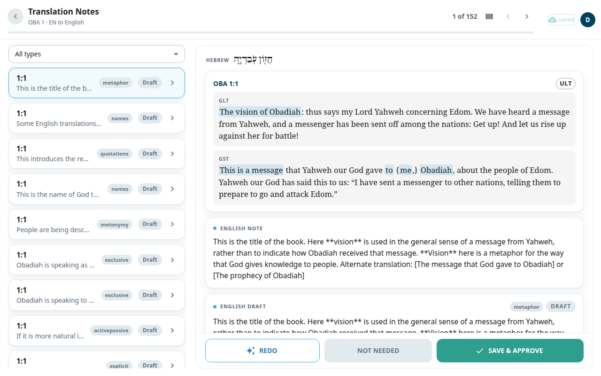

The **Translation Notes** screen is where you translate the notes (tN) of one chapter. A translation note explains a hard place in a verse. Each note has a quote from the original text, a link to a translationAcademy (tA) article, and the note text. You see the English note and write your own version next to it.

## Open the screen
1. Open a book from [Books](#help:books).
2. In the package, select **Notes**, then choose a chapter. Or select **Notes** on the **CONTINUE** card to jump to the note at your last verse.

The header shows the book and chapter. A count such as **1 of 5** shows where you are. Use the arrows or **Next** and **Previous** to move. On a wide screen the list of notes is on the left. Each row has a verse, a preview and a status chip: **Draft**, **Edited**, **Pending**, **Unsaved** or **Approved**. If the chapter has many kinds of notes, a menu with **All types** filters by tA article type.

## Translate one note
The note appears as a stack of cards:
1. The original-language quote the note is about.
2. The scripture card with the verse. The words of the quote are highlighted. When it is available, chips above the verse let you show the English ULT text and its alignment.
3. The **English note** (read-only).
4. Your draft, titled with your language, for example **Draft** or **draft · AI** when an AI wrote it.

To write your note:
1. Click the text of your draft. A box opens.
2. Type or correct the note.
3. Select **Save** to keep your text without approving it.
4. When it is right, select **Save & Approve** at the bottom. This saves and marks the note approved.

The other two buttons at the bottom:
- **Redo** asks the AI for a fresh draft. It works in the background and the new draft appears when ready. It needs a quote and a support reference on the note.
- **Not needed** sets the note aside when it does not need translating. It goes to the trash. Until the nightly publish you can bring it back in the [Review queue](#help:review-queue). After that it is deleted for good.

An icon next to the verse opens the verse view. See [Verse view](#help:verse-view).

## When you finish a chapter
You see **OBA 1 notes complete** with a count of approved, edited and not-needed notes. Select **Continue to chapter 2** or **Review again**.

## Good to know
- Your text is kept in your browser while you type. The top bar shows **N unsaved** until you save. See [Saving and working offline](#help:save-and-sync).
- If another editor saved the same note first, a banner says your version was not saved. Select **Reload note** to see their version.
- Only approved notes are published to Door43. Draft and edited notes keep their last published text.
- If you only have view access, you can read but not edit.
