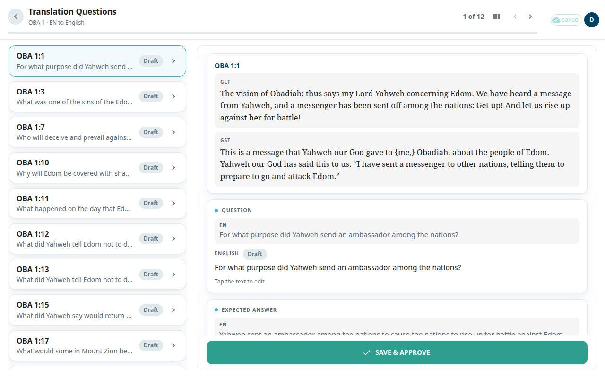

The **Translation Questions** screen is where you translate the questions (tQ) of one chapter. A translation question checks that the reader understood a verse. Each one has a **Question** and an **Expected answer**. You see the English text and write the same thing in your language.

## Open the screen
1. Open a book from [Books](#help:books).
2. In the package, select **Questions**, then choose a chapter. The row is greyed out if the book has no questions.

The header shows the book and chapter and a count such as **1 of 5**. Use the arrows or **Next** and **Previous** to move. On a wide screen the list of questions is on the left, with a verse, a preview and a status chip on each row.

## Translate one question
Each question is a stack of cards:
1. The reference and the verse in ULT and UST (the literal and the simplified text).
2. **Question**: the English question, then your box.
3. **Expected answer**: the English answer, then your box.

To write:
1. Click the text of your question. A box opens. Type or correct it.
2. Do the same for the **Expected answer**.
3. Select **Save** to keep your text without approving it.
4. When both are right, select **Save & Approve** at the bottom.

There is only one decision here: **Save & Approve**. Questions are changed, not skipped. If you do not like a question, edit it and approve your version. There is also no **Redo** button on this screen. A chip shows the state of the row: **Draft**, **Edited**, **Approved** or **Unsaved**.

If the English source for a question is not available, the screen says so. This can happen for a question that was added in this project and not translated from the published questions.

## When you finish a chapter
You see **OBA 1 questions reviewed**, with a count of questions **Approved as-is**, **Edited** and the **Total**. Select **Continue to chapter 2** or **Review again**.

## Start an AI run
Editors and admins have one more icon in the top bar.

In a translation project it is a sparkle icon, **Start an AI run**. It opens a menu:
- **Translate chapter**: the AI drafts the chapter's translation notes.
- **Translate questions**: the AI drafts the chapter's translation questions.
- **Import from Door43**: opens its own window. Type a chapter or a range under **Chapter or range**, tick what to bring in under **What to import:**, and press **Import**. Rows that translators already edited are skipped.
- **Pull Aquifer drafts** (admins only): starts at once for the whole book, with no confirm window. It adds Aquifer translation notes as drafts to review, and it marks the notes that are already translated as approved.
- **Re-source notes from English** (admins only): re-downloads the whole book from Door43: the scripture from your project's own Bible text (or from the English source if your project has none for this book), and the notes, questions and word links from the English source. Local edits to the book are lost. Press **Re-source** to confirm. If the book has local edits, a second window counts them and asks again: **Discard and re-source**.

After **Translate chapter** or **Translate questions**, a confirm window opens: type a chapter or a range under **Chapter or range** and press **Start**.

In a source project, one that does not translate from another language (such as unfoldingWord's English), the icon is a download icon, **Import from Door43**. It opens the import window straight away, with no menu.

On a phone the icon is not in the top bar. It is the first item in your account menu, with the same name.

While any AI run is starting, running or paused on a chapter, that chapter's questions can't be saved or approved. A run that is still waiting in line locks nothing. Admins follow the runs in [AI studio](#help:admin-ai).

## Good to know
- Your typing is kept in your browser until you select **Save**. The top bar shows **N unsaved**. See [Saving and working offline](#help:save-and-sync).
- If an AI run is rewriting the chapter, a save is refused. The screen says your edit was dropped. **Save & Approve** is refused too, and the screen says the questions can't be approved yet. Try again when the run ends.
- If another editor saved the question first, a banner says your version was not saved. Select **Reload question**.
- If you only have view access, you can read the questions but not edit them.
