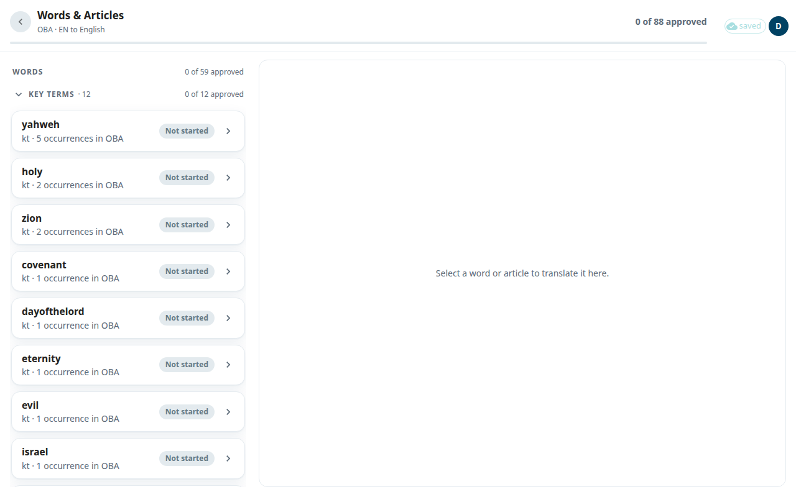
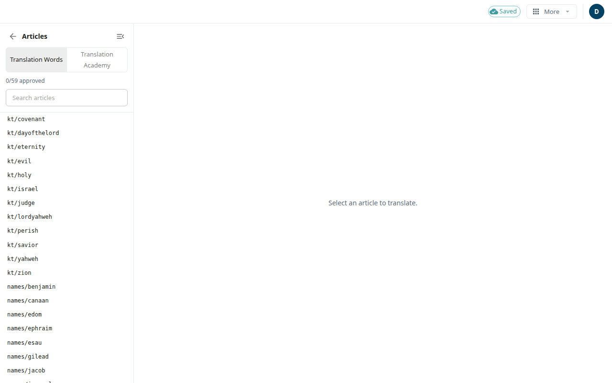

Two kinds of helps articles go with every book. **translationWords (tW)** explains key terms and names, such as "covenant". **translationAcademy (tA)** teaches translation principles, such as how to handle a metaphor. This guide covers two screens: **Words & Articles**, where you translate the articles a book uses, and the **Articles** screen, where you can read and edit any article.

Article translation is only for projects that translate from a gateway language. Other projects see a message that it does not apply.

## Words & Articles
1. Open a book from [Books](#help:books).
2. In the package, under **Whole book**, select **Words & Articles**.

The list has two parts: **Words** and **Academy articles**. The words are in groups: **Key terms**, **Names** and **Other**. Each group shows how many articles are approved, for example **3 of 10 approved**. Inside a group, the articles used most in this book come first. Each row shows how often it is used (**N occurrences in OBA**, or **linked from N notes in OBA**) and a chip: **Not started**, **AI draft**, **Edited** or **Approved**.

An article that says **source not populated in this workspace** has no text to translate yet. An admin can fill it from the Articles screen.

## Translate an article
1. Select an article. On a wide screen it opens beside the list. On a phone, **Back to the list** returns you.
2. Choose how to read it: **Source**, **Target** or **Both**.
3. Click the target text to edit. A tA article has three parts, **Title**, **Subtitle** and **Article**. Sections are shown in pairs for reading, but tapping a section edits that whole part, and the parts are saved together.
4. Select **Done** when you finish typing. Then select **Save**.
5. Select **Approve** to save and approve. It needs a draft first. **Redo** asks the AI for a new draft, which arrives in the background.

If someone else saved a part first, a message says your text is still there and that saving again will work.

## The Articles screen
This screen shows one article at a time with a list on the left. You get here from a link in a note (the support reference), from **Open in the article editor** in the [Verse view](#help:verse-view), or from the classic editor menu **More**, under **Articles**.

- Choose **Translation Words** or **Translation Academy**. Type in **Search articles** to find one. The list shows **N/M approved**.
- Select an article. Use **Edit** and **Preview** to switch between typing and a formatted view. Select **show source** to read the English.
- **Save** keeps your text. **Approve** approves it (**Un-approve** takes it back). **Translate** or **Re-run AI** asks the AI for a draft.
- A mark on a list item means unsaved changes.
- If the list is empty, **Populate from imported books** fills it with the articles that your books use.
- **Back to scripture** returns to where you were.

Your typing is kept in the browser until you save. See [Saving and working offline](#help:save-and-sync).
