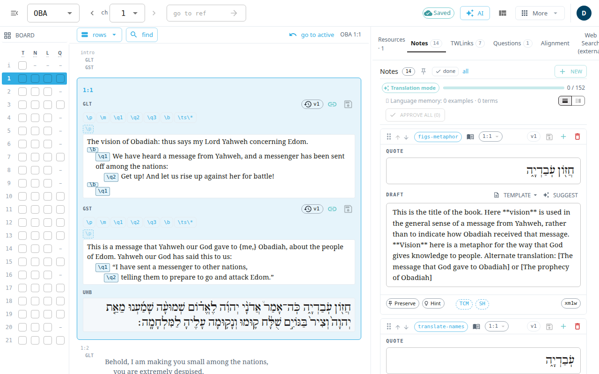

The **Classic editor** shows a whole chapter at once: the verses, and all the helps for the active verse, in three columns. Use it when you want to see scripture, notes, word links and questions together, or to edit word links (TWLinks), which are edited in this editor. For translating one note or one question at a time, the [Notes](#help:notes) and [Questions](#help:questions) screens are simpler.

## Open it
- Open your account menu (the round button in the top bar) and select **Classic editor**. It opens the book you were on, at your last verse.
- Or type the address `#/ZEC/6/1` (book, chapter, verse) after the app's address.

## The three columns
1. **Verse rail** (left). One tile per verse. Select a tile to make that verse active. **hide verse list** and **show verse list** in the top bar hide and show this rail. The tiles show a mark for each kind of work (text, notes, TWLinks, questions). The **Board** button above them opens the chapter checkoff board, where you mark which parts of each verse you have checked.
2. **Scripture** (middle). The text of the chapter in each version. A control for the scripture view mode switches between **rows** (verse by verse, the default), **columns** (a side-by-side view of the chapter) and **book** (the whole book, loaded as you scroll). Use **find** (Ctrl+F) to find and replace in the chapter. **go to active** scrolls back to the active verse.
3. **Resources** (right). Tabs for **Notes**, **Questions**, **TWLinks**, **Alignment** and **Web Search (external)**. The web search is a third-party tool, and what you type there leaves the app.

On a narrow screen the columns are shown one at a time.

## Edit a verse
1. Click in the verse text and type.
2. Select **save edits**. Nothing is saved until you do. **undo edits to this verse** reverts your unsaved change.
3. Use the version history button to view or restore an earlier save.

Notes work the same way: edit the note, then save it. A note card also has a button to discard unsaved edits. Your typing is kept in the browser until you save. See [Saving and working offline](#help:save-and-sync).

## The top bar
- A book picker, chapter arrows (**previous chapter**, **next chapter**) and a **go to ref** box. Type `5`, `5:5`, `zec 5:5` or `ps 1:4` and press Enter.
- The save status, the AI run menu and **Layouts**, which switch between arrangements of the three columns.
- **More**: **Import from Door43** and **Export USFM** under **Content**; **Articles** and **Note Templates** under **Resources**; text size and interface language under **View**.
- Your account menu.
