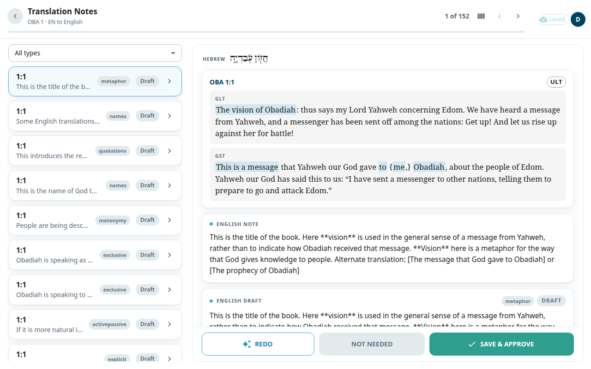

Your work is safe if you follow one rule: **notes, questions and articles save only when you select Save** (or **Save & Approve**). While you type, the text is also kept in your browser as a draft. This page explains where your work goes and what the status marks in the top bar mean.

## Where your work goes
1. You type. The text is kept in your browser right away.
2. You select **Save**. The edit goes into a queue in your browser, then to the app's database. This does not touch Door43.
3. Once a night, the app publishes the approved content to Door43. If that step fails, your edits stay safe in the app's database and the next night catches up.

## The status marks in the top bar
- **saved**: everything is on the server.
- **saving N**: N edits are being sent.
- **N unsaved**: you have text that you typed but did not save. Select the mark to see the list and jump to each one. You can also discard one there.
- **offline** or **reconnecting…**, with **N queued**: there is no connection. See below.
- **N conflicts** or **N failed**: something needs your attention. See below.

If you try to close the tab or reload with unsaved text, the browser warns you. Unsaved text comes back when you return to the same note, question or article.

## Work offline
You can keep working when the connection drops. Each time you select **Save**, the edit is added to the queue and the mark shows **N queued — offline**. When the connection comes back, the queue is sent in order, and nothing is lost if you close the tab meanwhile.

If your sign-in expires, a message says **Your session expired — sign in to keep saving**. Select **Sign in**. The queued edits are sent after you sign in. Do not clear your browser data while edits are queued.

## When two people edit the same thing
If someone else saved the same note or question before you, the server refuses your edit, so you do not overwrite their work.
- On the [Notes](#help:notes) and [Questions](#help:questions) screens, a banner says that your version was not saved. Select **Reload note** (or **Reload question**) to load their version, then redo your change.
- In the top bar, a conflict shows as **N conflicts**. A panel in the bottom corner has **resolve N conflict(s)**. It sends your edit again on top of the current server version, so your edit wins. Use it only when you are sure.
- In the [Review queue](#help:review-queue), a window **Someone else saved this note first** lets you choose **Keep mine** or **Keep theirs**.

## When a save fails
**N failed** means an edit could not be accepted. The panel in the bottom corner lists it. Select **retry this edit**. If it still fails, select **discard this edit**. The confirmation window has **copy edit**, so you can copy the text first. Discarding deletes the edit from your device for good.

## Publishing to Door43
The nightly publish sends **approved** notes and questions. Rows that are still drafts or edited but not approved are held back, and Door43 keeps their last published text. An admin can also publish one book at any time from its package. See [Books](#help:books).
