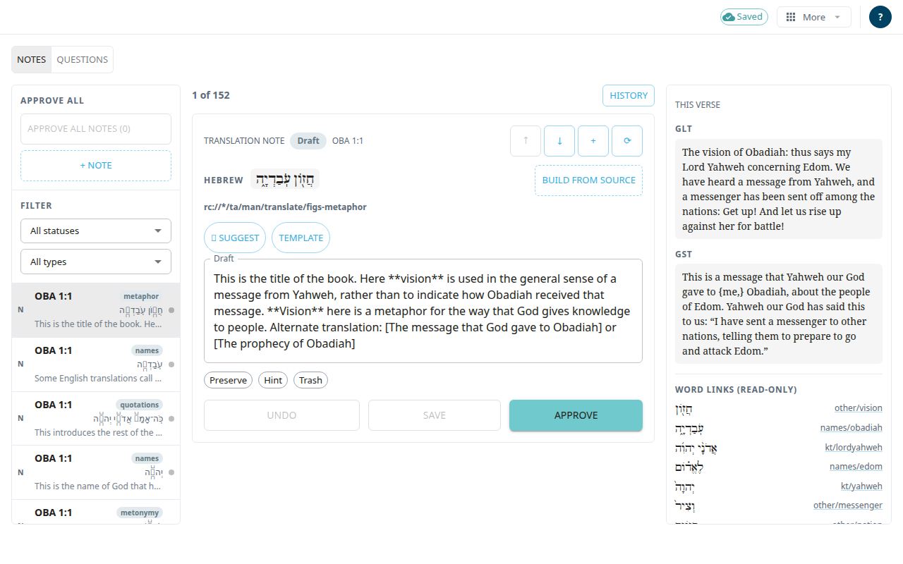

The **Review queue** is a work screen for the notes and questions of one chapter. You read each item, fix it, and approve it. It is also where you can add, move, trash and restore notes and see an item's history. Only approved items are published to Door43.

## Open it
This screen has no button in the menus yet. Open it by its address: add `#/review/OBA/1` (book and chapter) after the app's address.

The top bar of this screen has no book or chapter controls. To leave, use the **More** menu (**Import from Door43** goes to Books) or change the address.

## Find an item
1. Choose **Notes** or **Questions** at the top of the queue.
2. Use the **Filter** area: **All statuses**, **Pending**, **Approved**, or (for notes) **Trashed**. For notes you can also filter by type (**All types**).
3. Select an item in the rail. On a phone, use the arrows and the count to go from card to card.

Each item has a chip for its state.

## Review and approve one note
1. Edit the **Quote**, the support reference and the note text in the work card.
2. Select **Save** to keep your changes. Select **Approve** to approve the item. A note that has never had an AI draft cannot be approved yet.
3. To approve many at once, select **Approve all notes (N)** (or **Approve all questions (N)**) above the queue. If some fail, the message tells you which one failed first. Items approved this way are not used as AI examples, because nobody read them one by one. To make one count, approve it on its own.

More tools on a note card:
- **✨ Suggest** asks the AI for a draft. The draft goes into the editor. Select **Save** to keep it. It needs a quote and a support reference.
- **Template** inserts a curated template for the note's support reference.
- **Preserve** marks the note to survive future AI runs. **Hint** sends it to the next AI run as a hint.
- **Trash** moves a note to the trash. **Restore** brings it back, but only until the nightly publish: that night the trash is emptied and its notes are deleted for good. A note you set aside with **Not needed** on the Notes screen is in the trash too.
- **History** shows earlier versions of the item, and lets you restore one.
- **Retarget** moves the note to another verse of the chapter.
- **Move up**, **Move down** and **Insert note after this one** change the order. **+ Note** and **+ Question** add new ones.

Questions can be shown as cards (**Card view**) or in a table (**Grid view**). A question is deleted for good with **Delete**. There is no trash for questions.

## Look at the verse
The panel **This verse** is read-only context: the verse text and the word links. On a phone it opens as a sheet.

## Good to know
- If someone else saved the item first, a window offers **Keep mine** or **Keep theirs**. See [Saving and working offline](#help:save-and-sync).
- While an AI run holds the chapter, some changes are refused. The screen says which.
