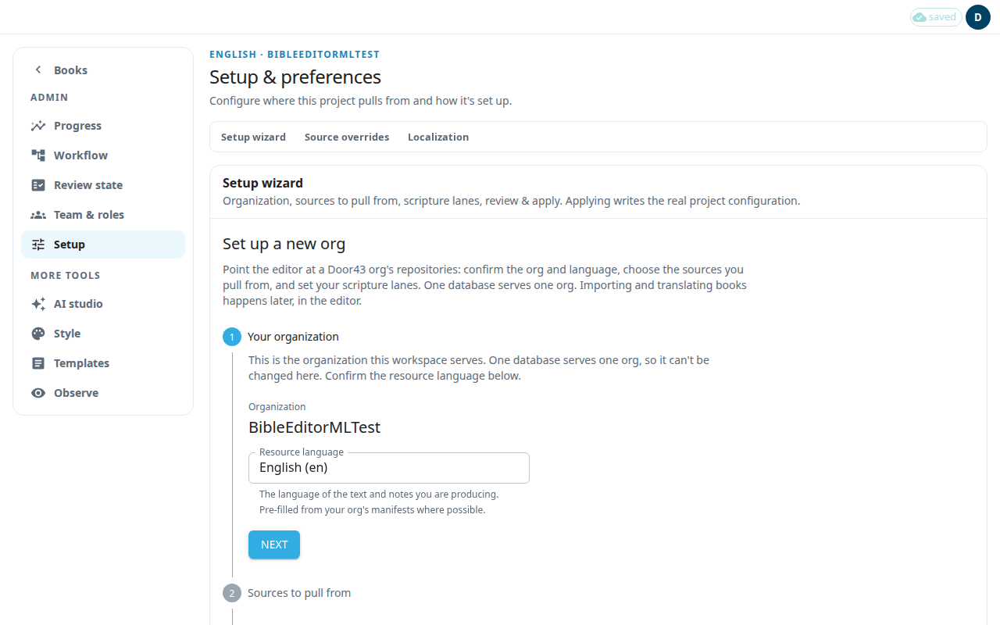

Setup tells the app where your project's text comes from and where your team's work is saved. Only an admin can open it. It has three parts: the **Setup wizard**, **Source overrides (advanced)**, and **Localization**. Door43 is the git server where unfoldingWord resources are published.

One database serves one organization. You cannot change the organization here. To use a different organization, press **Switch workspace…** at the bottom of the wizard panel. This switches the workspace and reloads the app.

## Run the setup wizard
1. Open **Setup** in the admin menu.
2. **Your organization:** check the organization and the **Resource language**. This is the language of the text and notes you produce. It is filled in from your organization's files when possible. Press **Next**.
3. **Sources to pull from:** set the **Default upstream org**. This is the organization you translate from. The default is unfoldingWord. Each resource is checked by default: **Literal text (GLT)**, **Simplified text (GST)**, translationNotes, translationQuestions, translationWords Links, translationWords and translationAcademy. Clear a check to choose **Leave blank** or **Use a different source**. For a different source, paste a **Door43 source URL**. Press **Next** when the sources are verified.
4. **Your scripture lanes:** a lane is one of your two scripture texts, literal or simplified. For each lane, confirm the **Target repository**. This is your organization's repository, and the editor saves your work there. Then answer **What are translators doing in this lane?** Choose **Editing the text** or **Aligning only**. Check **Upstream for this lane**. Press **Next**.
5. **Review & apply:** read the summary of where the app pulls from and where it saves. Fix any warning shown. Press **Apply configuration**.
6. **Done:** press **Go to Import** to bring in your first book (see [Books](#help:books)), or **Open the editor**.

## If the project already has text
The target repository of a lane is locked once the project holds text. To change the scripture source of such a lane, use **Change scripture source** in Preferences (see [Preferences](#help:preferences)). The wizard cannot do that.

## Source overrides (advanced)
An override makes one book take its notes or questions from a different Door43 repository. A book override wins over the project source.
1. Choose the **Book**.
2. Under **Add override**, choose the **Resource**: **Notes (tN)** or **Questions (tQ)**.
3. Choose the source, or choose **Other Door43 repo…** and paste a **Door43 repo URL**.
4. To limit the override to some chapters, fill **from ch** and **to ch**. Leave both empty for the whole book.
5. Press **Add override**. Use **Remove** to delete an override.

Set an override before the book's first import so it applies at once. A book that is already imported needs a full re-import to use a new override.

## Localization
This section edits the interface strings of your workspace.
