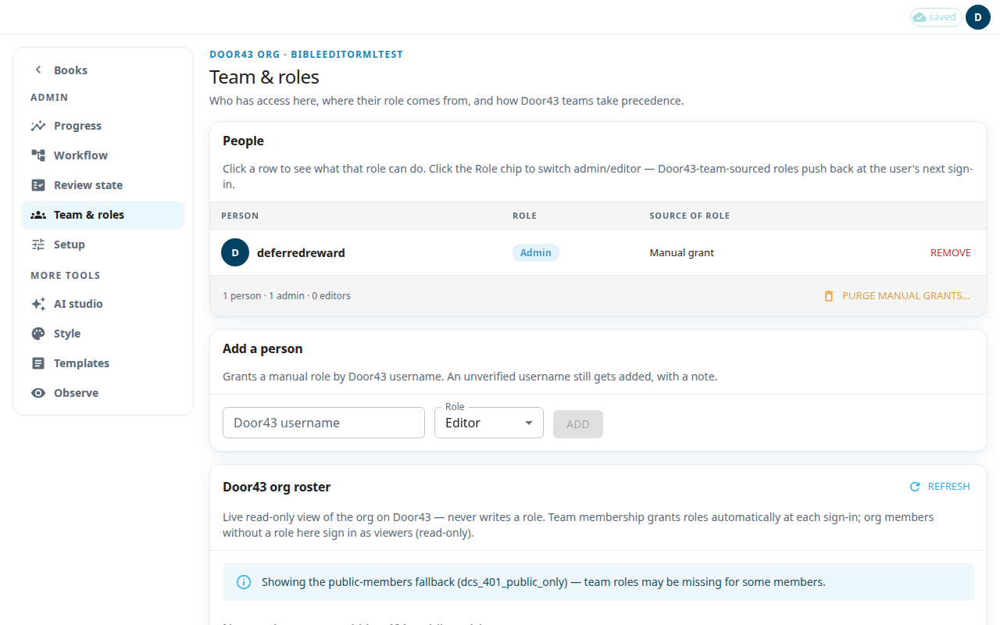

**Team & roles** shows who can use this workspace and what each person may do. Only an admin can open it.

There are three kinds of access:
- **Admin** can do everything an editor can. An admin can also open Setup and manage people.
- **Editor** can write content in the whole workspace: scripture, notes, words and questions. An editor cannot open Setup or manage people.
- **Viewer** can only read. Members of your Door43 organization who have no role here sign in as viewers.

Door43 is the git server where your organization's resources live. Its teams decide most roles: a person's Door43 team sets the role each time they sign in.

## See who has access
1. Open **Team & roles** in the admin menu.
2. Read the **People** table. Columns are **Person**, **Role**, **Source of role** and **Actions**.
3. **Source of role** is either **Door43 team** or **Manual grant**.
4. Click a row to see what that role can do.

## Add a person
1. In **Add a person**, type the **Door43 username**.
2. Choose the **Role**.
3. Press **Add**. If the username cannot be checked on Door43, the person is still added, with a note.

## Change a role or remove someone
1. Click the **Role** chip of a person to switch between admin and editor.
2. Press **Remove** to take away a manual role.
3. A change to a person whose role comes from a Door43 team lasts only until their next sign-in. Then the team sets the role again. To make it permanent, change their team on Door43.
4. The last admin cannot be demoted or removed. Someone must stay admin.

## Clear all manual roles
Press **Purge manual grants…** and confirm with **Purge**. This removes every manually granted role. Roles that come from a Door43 team are kept, and at least one admin always stays.

## Compare with Door43
**Door43 org roster** is a live, read-only list of the organization on Door43. It never changes a role. The **Access here** column shows what each member gets in this app. If Door43 cannot be read, the page says the list may be incomplete. An empty list then does not mean the organization has no members.
