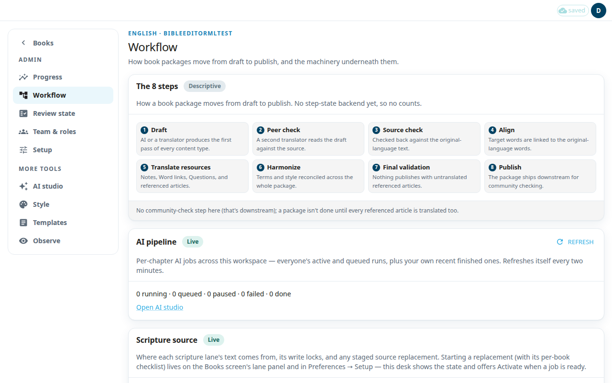

**Workflow** shows how a book moves from draft to publish and gives you controls for the scripture text and for publishing. Only an admin can open it.

The page has four panels.

## The 8 steps
This panel is a description only, marked **Descriptive**. It lists the steps: **Draft**, **Peer check**, **Source check**, **Align**, **Translate resources**, **Harmonize**, **Final validation**, **Publish**. The app does not track which step a book is on, so there are no counts.

## AI pipeline
A pipeline job is one AI run for one chapter. This panel counts the jobs of the whole workspace: running, queued, paused, failed and done. It refreshes by itself every two minutes. Press **Refresh** to update now. Press **Open AI studio** to start or manage runs (see [AI studio](#help:admin-ai)).

## Scripture source
There is one card for the literal lane and one for the simplified lane. Each card shows the **Current source** and the **Export target**. It has two switches:
- **Text read-only** blocks new edits to the lane's scripture text.
- **Alignment writable** lets translators keep aligning words while the text is locked.

Click a switch to turn it on or off. The app asks you to confirm. The switches are locked while a source replacement is in progress.

### Activate a staged source
Starting a replacement happens on the Books screen's lane panel and in Preferences (see [Preferences](#help:preferences)). When a staged replacement is ready, its card says so.
1. Press **Activate…**.
2. Read the warning. After this, the lane reads from the new source and backing out means another replacement.
3. Tick **I understand translators will start reading the new source.**
4. Press **Activate**.

## Publishing
The nightly export writes the database to files and commits them to a branch on Door43. If automatic exports are not enabled on this deployment, the panel says so. The table lists past exports with **State**, **Rows**, **Branch** and **Committed**.

### Run an export now
1. Press **Run export now…**.
2. Choose the **Export scope**: **All books** or one book. Choose the **Resource**. You can enter **Chapters (optional)**, for example 13-14, when you chose one book and a tn, tq or twl resource.
3. Choose the **Door43 write mode**. **Merge with Door43** pulls Door43's current state first and keeps hand edits made on Door43 to rows you did not touch. **Overwrite Door43** skips that pull and needs a chapter range.
4. Press **Run export**. In overwrite mode this button reads **Overwrite Door43**.
5. Press **Check status** to follow the run.

A manual export takes several minutes and commits real files.
