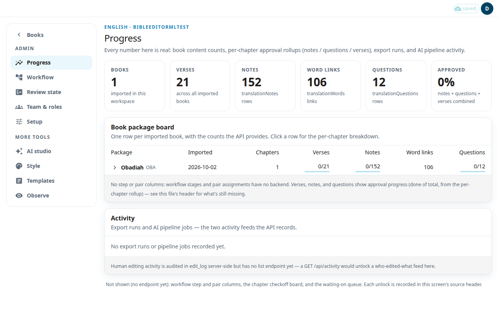
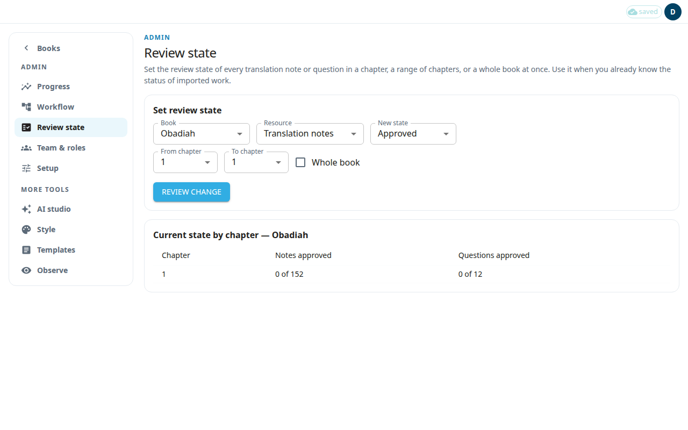

Four admin pages show and set how far the review has come. **Progress** shows the numbers. **Review state** changes the review state of many notes or questions at once. **Draft scorecard** shows how good the AI drafts of approved notes were. **Suggestion inbox** lists corrections editors keep making to those drafts. Only an admin can open them.

## Read the Progress page
1. Open **Progress** in the admin menu.
2. The tiles at the top count the imported **Books**, **Verses**, **Notes**, **Word links** and **Questions**. **Approved** shows the share of notes, questions and verses that are approved, all together.
3. In **Book package board**, each row is one imported book. Click a row to see the same numbers for each chapter.
4. **Activity** lists the latest export runs and AI jobs.

The page loads each book one by one, so the tiles may say they are still loading.

## Set the review state of many rows
Use this when you already know the status of imported work. For example, a book was checked before it came into the app, so its notes should count as approved. For normal reviewing, see [Review queue](#help:review-queue).

1. Open **Review state** in the admin menu.
2. Under **Set review state**, choose the **Book** and the **Resource**: **Translation notes** or **Translation questions**.
3. Choose the **New state**: **Approved** or **Needs review**. **Needs review** puts the rows back in the review queue.
4. Choose **From chapter** and **To chapter**. Tick **Whole book** to use every chapter.
5. Press **Review change**. Nothing is saved yet. The app counts the rows it would change.
6. In **Confirm review state change**, check the book, chapters, resource, new state and **Rows to update**.
7. Press **Apply**, or **Cancel** to stop.

The message after saving tells you how many rows changed. The table **Current state by chapter** shows how many notes and questions are approved in each chapter.

Good to know:
- Every row in the range changes, including rows a translator is still working on.
- The text of the notes does not change. The change is recorded in the history as an admin action.
- These rows are not used as AI examples.
- If the app says the change could not be confirmed, it may be partly or fully applied. Check the counts in the table before you try again.

## Check the quality of AI drafts
**Draft scorecard** compares each approved translation note with the last AI draft of it, chapter by chapter. Use it to see whether a change to the AI's guidance makes drafts better. It changes nothing.

1. Open **Draft scorecard** in the admin menu.
2. Choose the **Book**. The table shows one row per chapter, and **Whole book** at the bottom.
3. Read the columns:
   - **Approved notes**: approved translation notes in the chapter. Notes approved with **Approve all notes** or by a review-state change are left out, because nobody read them one by one.
   - **No draft logged**: notes with no AI draft on record. Edit history older than 180 days can be cleared.
   - **Draft was English**: the AI draft was the English note, not translated. These notes are left out of the columns to the right. A note that is the same as the English for a good reason, such as one that holds only links, is counted here too.
   - **Compared**: the notes the other columns are about.
   - **Approved unchanged**: the share approved exactly as the AI wrote them.
   - **Median similarity**: how much of a draft was kept, from 0 (all rewritten) to 1 (unchanged). When the changed part of a note is longer than 2,000 characters, only its first 2,000 characters are compared, so that note's similarity is approximate and the chapter's median is marked ≈. Point at the ≈ to see how many notes it covers.
   - **Period added after ]**: of the drafts that end with ] and no period, the share where the editor had to add the period.
   - **Context pack**: the version of the guidance the AI was given, with how many notes used it. Hover over it to see the full name. **Not pinned (latest pack at run time, if any)** means the run was not tied to one version: it used the latest guidance when it ran, or none if no guidance had been exported yet. **Run not on record** means the AI run has been cleared. Each draft is matched to its AI run by time, so in rare cases where runs overlapped a draft can be credited to the wrong run.

If the English notes cannot be read for some chapters, a message names those chapters and gives each reason. No draft in them is left out as English, and their counts are marked with *. On the **Whole book** row, * means only part of the book was checked.

## Turn repeated corrections into guidance
**Suggestion inbox** finds corrections editors made again and again to the AI's translation-note drafts, so you can fix them once. For example, editors may add a period after the final ] of almost every note, or delete a tag the AI keeps adding.

1. Open **Suggestion inbox** in the admin menu.
2. Choose the **Book**. The app works the cards out now, from that book's approved notes (the same notes as **Draft scorecard**). There is no nightly run, so a large book can take a few seconds.
3. Each card shows:
   - the change: the AI's words, then the approved words (**deleted** when the editors removed them). **at the end of the note** means the change was made only at the very end.
   - **Made in X of Y drafts that had it**: X notes had this change made. Y drafts contained the words it changes, including those X.
   - **Chapters**: where the change was made.
   - **Suggested home**: where the fix belongs. **House-style rule** is offered only for three kinds of change that are safe in every note: the period after a final ], deleting a tag in parentheses or brackets such as (مُكيَّف), and changing only the marks (vowels, tanween) on one word. The rule is tried on every draft of the book: the card says "the rule would change N drafts in this book; it matches the editor's change in M (P%)". It is offered only when it changes at least 10 drafts and gives exactly the approved text in at least 8 of every 10 (9 of 10 for marks). It must also give exactly the approved text on each of the card's examples; when it does not, the card says "the rule doesn't reproduce the editor's change on every example". In a large book some drafts may take too long to check. Then the card says how many could not be checked, and when the drafts that were checked would pass, it says the rule "could not be fully checked in time". The rule is not offered while any draft is unchecked. The card also says what kind of rule it would create. **Note template** is for words that come from a template. **Term** is for a change of one to three words. Everything else is a **Common issues line**.
   - three examples: the AI draft and the approved note around the change.
4. Choose what to do:
   - **Approve** on a house-style card asks you to confirm, then adds the rule to [Style: House style](#help:admin-style), switched on. It changes every AI draft that arrives after that, in every book, for notes and for questions and answers. Its examples there are real lines from the drafts.
   - **Approve** on any other card copies a line for you. The term, template and Common issues editors cannot be filled in from here, so open the editor with the button and paste the line.
   - **Reject** hides the card for good, in every book.

A card appears only when the same change was made in at least 10 notes across at least 3 chapters. Spaces and line breaks are ignored, and changes inside a bold Scripture quote and rewrites longer than a few words are left out. A change is not shown when a house-style rule already makes it (even a rule that is switched off), a term already gives the approved words, a template already contains them, or the Common issues text already lists them. A card you sent to another editor goes away once that editor's text covers it. If it still shows after your edit, reject it.
