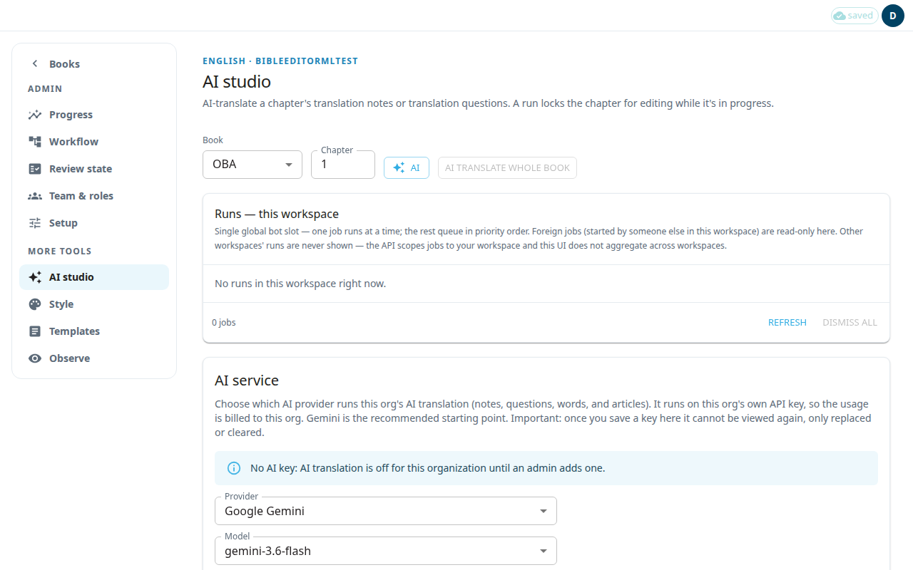

**AI studio** is where you have AI translate a chapter's translation notes or translation questions, and where you save the AI provider key of your organization. A **Translate chapter** or **Translate questions** run locks parts of its chapter while it is starting, running or paused, but a run still waiting in line locks nothing, and neither do **Import from Door43**, **Pull Aquifer drafts** and **Re-source notes from English**. The [Scripture](#help:scripture), [Notes](#help:notes) and [Questions](#help:questions) articles say exactly what is locked on each screen.

## Start an AI run
1. Open **AI studio** in the admin menu.
2. Choose the **Book** and type the **Chapter**.
3. Press **AI** and choose **Translate chapter** (the chapter's translation notes) or **Translate questions** (its translation questions). These two appear only in a translation project, one that translates from a source language.
4. In the confirm window, choose a chapter or a range and press **Start**.

Only one job runs at a time. The other jobs wait in line. When AI drafts are ready, a banner on the page tells you to review them.

A run on a whole chapter does not redraft notes or questions that are already approved. It keeps them as they are, and when the run ends a banner lists them. To get a new AI draft for one approved note or question, run the AI on that one alone (for a note, **Redo** on the note). If the AI returns a note unchanged from the English, that draft is not applied: the note keeps its text, and a banner lists it.

The same **AI** menu also has **Import from Door43**. Admins on a translation project also see **Pull Aquifer drafts** and **Re-source notes from English**. Re-sourcing replaces the book from Door43 and discards local edits, so the app asks you to confirm.

AI runs are only for translation projects. In a source project, one that does not translate from another language (such as unfoldingWord's English), the page says so under its title, and the button reads **Import** instead of **AI**. Choose a **Book**, then press **Import**: it opens **Import from Door43** straight away, with no menu. The **Book** list holds only books already in the project, and this import updates chapters of that book from Door43. To bring in a new book, use **Bring in OBA…** (with your book's code) on the **Books** screen; see [Books and the book package](#help:books). The same import is on a book's package and on the Scripture, Notes and Questions screens, as the download icon in their top bar. On a phone those screens move it into your account menu, as the item **Import from Door43**.

## Follow the runs
The table **Runs — this workspace** shows **Type**, **Scope**, **State**, **Progress**, **Started** and **Requested by**. Runs started by other people are read-only. For your own runs you can press **Cancel** while a run is still queued. A failed **Translate** run shows **Retry** greyed out, because it cannot be retried here: start a new run instead. Runs of the older AI actions, such as **Write translation notes**, stay in the list under their names, but those actions are no longer offered and their runs have no **Retry**. Press **Dismiss** to hide a failed, cancelled or finished run, or **Dismiss all** to hide them all. **Refresh** updates the list.

If the page says **AI not configured**, the AI connection is not set up for this workspace. A technical administrator must set the BT_API_TOKEN setting on the server. Until then retrying is not available.

## Save your own AI key
The section **AI service** sets which AI provider runs your pipeline jobs.
1. Choose the **Provider**: Google Gemini, xAI Grok, Claude (API) or OpenAI.
2. Choose the **Model**.
3. Type your **API key**.
4. Press **Save**.

Once saved, the key is stored encrypted and is never shown again. You see **Configured** with the last characters of the key. Press **Replace** to enter a new key, or **Clear** to remove it. If a red or yellow notice says bringing your own key is not enabled on this deployment, a technical administrator must enable it first.

## Let the team ask the AI help assistant
Under the key settings, the switch **Let team members ask the AI help assistant** turns on the **Ask AI** area in the Help panel for everyone in your organization. It is off until you turn it on. The assistant uses your organization's AI key, so it only answers once an API key is saved. Each person can use up to a daily dollar amount, shown under the switch. Turn the switch off at any time to hide **Ask AI** again.

## Let editors ask the assistant for bulk edits
Next to that switch, **Let editors ask an AI assistant to propose bulk edits** turns on the **Assistant** chat on the Rapid check notes screen, for editors and admins. It is off until you turn it on. It uses your organization's AI key and only answers once an API key is saved. It proposes changes, and nothing is saved until the person presses **Apply**. Each person can use up to a daily dollar amount, shown under the switch.
