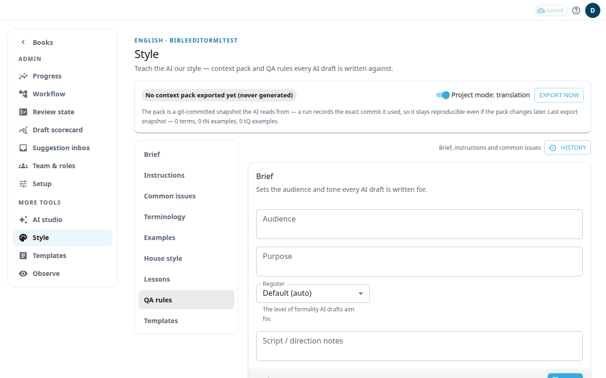

**Style** holds what the AI is told before it drafts anything for your project: who the readers are, how to write, which terms to use. Together this is the context pack. Every AI draft is written against it. Only an admin can save changes.

The bar at the top shows the state of the context pack, for example **Context pack ready**, with counts of terms and examples. **Export now** builds a new pack. The switch **Project mode** shows whether the project is in translation or authoring mode. The sections below apply to translation projects only. In other projects the page says so.

## Fill in the sections
Use the list on the left to jump to a section. After you change a section, press **Save**.

- **Brief:** fill in **Audience**, **Purpose**, **Register** and **Script / direction notes**. Register is how formal the drafts should be: **Default (auto)**, **Formal** or **Informal**.
- **Instructions:** free text (Markdown) added to every AI drafting and checking request. Use **Preview** to see how it looks.
- **Common issues:** free text about problems that reviewers flag again and again.
- **Terminology:** your decisions about terms. You can give a preferred rendering, mark a term as forbidden with what to use instead, or mark it do-not-translate. This section can also import and export a CSV file. Deleting a term shows **Term deleted** with **Undo** for a few seconds; click **Undo** to bring the same term back. If the project has since gained the same term, or someone changed it, the term stays deleted and a message says why. If the server could not be reached, the message says **Try again** and **Undo** stays available.
- **Examples:** notes and questions that were approved in the editor one at a time, or checked and approved in **Rapid check**. The AI sees them as models of good work. Items approved with **Approve all notes** or **Approve all questions**, or by an admin's review-state change, are not examples. Switch between **Notes** and **Questions**. Press **Revoke** to remove an example. Revoking returns the item to the edited state.
- **QA rules** and **Templates:** QA rules are listed with **Coming soon**. **Templates** shows how many note templates are translated. Press **Open template curation →** to work on them (see [Note templates](#help:admin-templates)).

## House style: fixes made to AI drafts
**House style** lists small fixes the app makes to every AI translation draft when the draft arrives, so editors do not have to make the same correction on every note. They apply to notes and to questions and their answers. For example, a rule can add the closing period after an alternate translation in brackets, or delete a tag the AI keeps adding.

- Each rule shows what it fixes (**Before** and **After**) and what it leaves alone.
- Every rule the development team adds is **Off** until an admin switches it **On**. Switch a rule on only after the language's editor has confirmed it. A rule made by approving a card in the [suggestion inbox](#help:admin-progress) starts **On**.
- A rule changes drafts that arrive after you switch it on. Drafts already in the project stay as they are.
- Scripture quotes in bold and the Quote column are never changed.
- The closing-period rule adds nothing when the words inside the final brackets already end with a punctuation mark (… ؟ . ! ? or ؛, so ... too), so the rule never adds a second mark.
- The AI's original wording is saved with each draft's record, so the fixes can be checked later.
- If a draft still contains the English phrase "If it would be helpful in your language", the app notes this in the draft's record for later review. It does not rewrite the phrase, and nothing on screen shows this yet.

You cannot add or edit rules on this page. New rules are added by the development team, or by approving a card in the suggestion inbox.

## See who changed the preferences, and undo a change
Every save of **Brief**, **Instructions** and **Common issues** is kept, whether it was made here or by the chat assistant. Press **History** above the Brief section to see the list, newest first.
- Each version shows who saved it and when, and whether it came from the **Web app** or the **Chat assistant**.
- Under each version you see every field that changed, with its text **Before** and **After**.
- Press **Load older changes** to see further back.

To put an earlier version back:
1. Press **History**.
2. Find the version you want and press **Restore**.
3. Read the message and press **Restore** again. Text you have typed on the page but not saved is replaced.

The restore is saved as a new version, so you can undo it the same way. The list starts from the day this history was turned on. Saves made before then are not listed. If the preferences were already saved before that day, the end of the list (once you have loaded all of it) offers the version **As it was before the earliest recorded change**.

## Update the context pack
The AI reads the last exported pack, not your live text. After you change terms or instructions:
1. Press **Save** in each section you changed.
2. Press **Export now** in the bar at the top.
3. Wait until the bar says **Context pack ready**.

If the export is refused because it would remove content, an **Export (force)** button appears. Use it only when you are sure.

If you see **Save failed**, check your connection and try again. If you see **Someone else saved first**, your text is kept. Press **Save** again.
