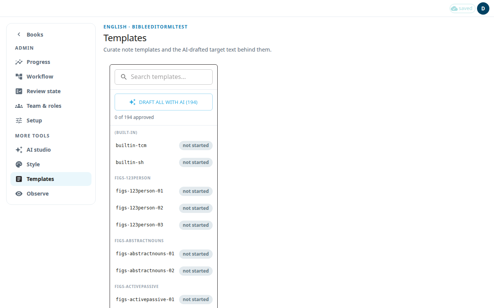

A note template is the standard wording for one kind of translation note (tN, translationNotes). Translators reuse it when they write notes of that kind. You translate each English template into your language, then approve it.

Templates exist in two places. The admin page **Templates** (`#/admin/curate`) is the main one. The older **Note Templates** workspace (`#/templates`) does the same job with a simpler layout. Both work only on gateway-language projects. Gateway languages are the major languages that other, smaller languages translate from.

## Curate templates on the admin page
1. Open **Templates** in the admin menu, under **More tools**.
2. Use **Search templates…** to find one. The list shows the state of each template: **not started**, **AI draft**, **edited** or **validated**. The line **N of M approved** shows your progress.
3. Click a template. The editor shows **Source (English, read-only)** and **Target (translated template)**.
4. Write the translation in the target box. Use **Preview** to see the formatted text and **Edit** to go back.
5. Press **Save**.
6. When the translation is correct, press **Approve**. Approve needs a saved translation. If you have unsaved changes, save first.

To undo an approval, press **Un-approve**. An approved template cannot be re-drafted until you un-approve it.

## Let the AI make a first draft
- **Draft with AI** drafts the open template. Review the draft against the English source before you approve it.
- **Draft all with AI (N)** drafts every template that can be drafted. A counter shows the progress, and **Cancel** stops it. The run also stops by itself after repeated failures.
- If the page says AI is not configured, drafting is not available. Editing and approving still work.

## Draft missing templates from approved notes
Admins see the button **Draft missing templates from approved notes** above the template list, on both template pages. It writes templates from notes your editors have already approved, so the template uses the wording they prefer.

- It works on note types (SupportReference) that have at least 20 approved notes, no approved template yet, and a template that is not started or holds an older AI draft. The line under the button says how many note types are ready.
- Each press drafts up to 6 note types and says how many are still to draft. Press it again to continue.
- Only one run can draft at a time. If another run is still going, or one stopped in the last few minutes (for example because its page was closed), the page says so. Try again in a few minutes.
- If a note type fails, the page says why. The next press tries the other note types first, and the press after that tries it again. Keep the page open until the run finishes.
- It uses your organization's own AI key (see **AI service**), with Claude or Gemini. With no key, or with another provider, the line under the button says so and nothing is sent.
- It never changes a template that is approved or that someone has edited. It replaces an older AI draft nobody has worked on, but not a draft it wrote itself.
- The AI reads the 30 most recent approved notes of each type. Each draft shows how many it was written from, out of how many the type has. A draft is not used to guide the AI until an editor approves it.

## Other things to know
- A template marked **Stale source** has an English source that changed after the draft. Review its translation again.
- **Unsaved edit** marks a template with changes you have not saved. Unsaved text is kept on this device if you leave.
- **Version history** shows earlier versions of a template.
- If someone else saved the same template first, the app keeps your text. Press **Save** again to apply it on top.

## The older workspace
The older workspace is titled **Note Templates**. Open it from the **More** menu of the classic editor (see [Classic editor](#help:classic-editor)). It has the same actions: a search box, **Preview** and **Edit**, **Save**, **Approve**, **History**, **Draft with AI** and **Draft all with AI**. Use **Back to scripture** to leave it.
