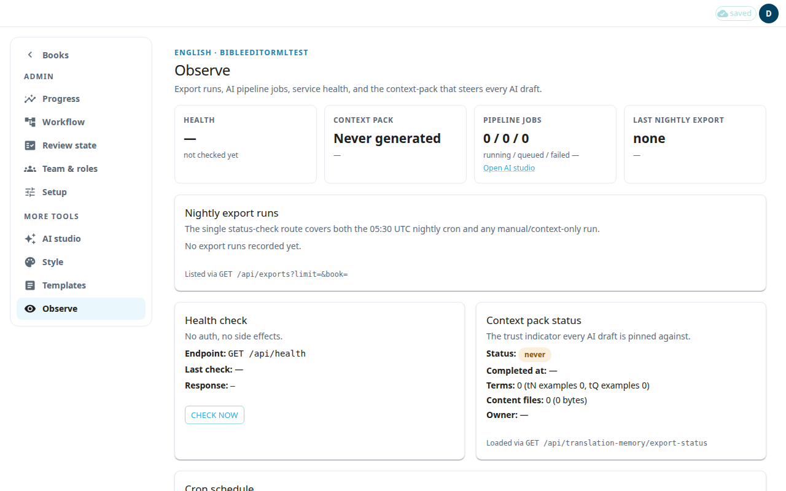

**Observe** is a read-only dashboard for the technical side of the project: nightly exports, AI jobs, service health and the context pack. Only an admin can open it. Use it to check that things are working. It does not change your translation.

## The tiles at the top
- **Health** shows **OK** or **DOWN** after you check, or **not checked yet**.
- **Context pack** shows if the pack the AI reads from is ready.
- **Pipeline jobs** counts running, queued and failed AI jobs. Press **Open AI studio** to manage them (see [AI studio](#help:admin-ai)).
- **Last nightly export** shows the latest export and how many rows it wrote.

## Check that the service is up
1. Find the **Health check** panel.
2. Press **Check now**.
3. Read **Response** and **Last check**. The check needs no sign-in and changes nothing.

## Check the exports
**Nightly export runs** lists recent exports. A row marked **needs attention** failed. A row marked **committed** reached Door43, the git server where your files are published. Each row shows the number of rows exported and the branch. To start an export yourself, use **Run export now…** on the Workflow page (see [Workflow](#help:admin-workflow)).

## Read the context pack status
**Context pack status** shows whether the pack is ready, when it finished, and how many terms and examples it holds. If it says **Last run failed** or **Never generated**, open Style and export it again (see [Style](#help:admin-style)).

## Cron schedule
**Cron schedule** lists the automatic jobs, such as the nightly export and the AI job check. You cannot start or stop them here. They are shown for information, from the server configuration.

If automatic nightly exports are not enabled on this deployment, the page says so. Then use **Run export now** to publish.

## Spare workspace pool
This panel is for a super-admin only. Other admins see a note that the data is not visible to them.
