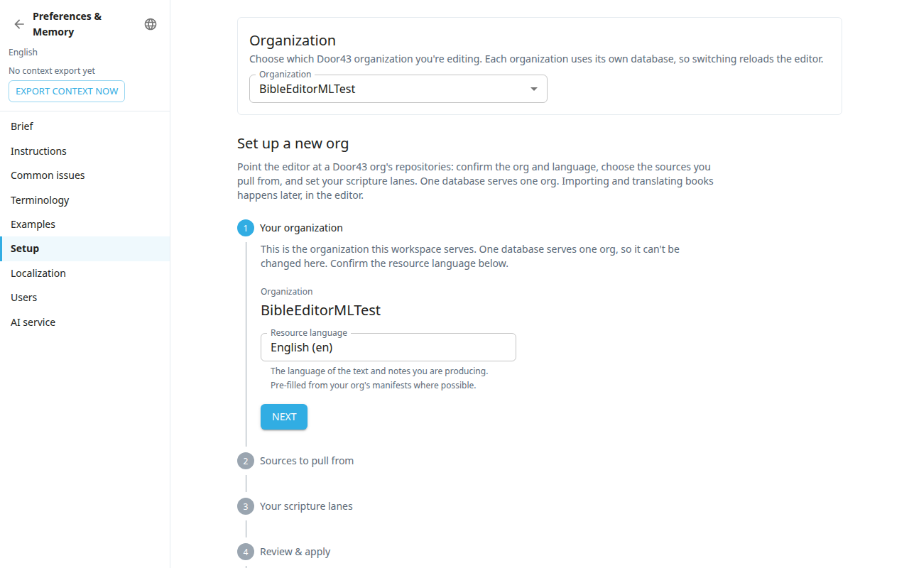

**Preferences & Memory** (`#/preferences`) is the classic settings page. Almost all of it also lives in the admin desk, which is the newer place for these settings. Use whichever you prefer.

Open it from the account menu in the top bar, with **Preferences & Memory**. Use the back arrow at the top of the left list (its tip says **Back to scripture**) to leave. The sections appear in the left list. The admin sections show only to admins.

| Section in Preferences | Where it is in the admin desk |
|---|---|
| **Brief**, **Instructions**, **Common issues**, **Terminology**, **Examples** | [Style](#help:admin-style) |
| **Setup** (the setup wizard) | [Setup](#help:admin-setup) |
| **Localization** | [Setup](#help:admin-setup) |
| **Users** | [Team & roles](#help:admin-team) |
| **AI service** | [AI studio](#help:admin-ai) |

The five Style sections need a translation project and an account that is not read-only. Otherwise the page says you need editor or admin access, or that the panel is for translation projects only.

## Change the scripture source
This job exists only here and in the Books lane panel. Use it when the project already has text and you want a lane to read from a different Door43 repository. The setup wizard cannot do it.
1. Open **Preferences & Memory** and choose **Setup**. Scroll to **Change scripture source**.
2. In the card of the lane, paste the **New source URL (Door43)** and press **Change source**. The app checks that the repository exists and has book files.
3. In the window **Replace … scripture source**, choose which books to replace. Books you leave unselected keep their current text. Books you edited start unselected so your work is kept. **Replace all** and **Keep all** select every book or none.
4. Tick the confirmation and press **Start replacement**.
5. Wait while the books are staged. The card shows **Books staged**.
6. When staging is done, press **Activate**. To stop, press **Cancel & revert**. This keeps the current source and drops the staged text.

The same card has the switches **Text read-only** and **Alignment writable**. They are also on the Workflow page (see [Workflow](#help:admin-workflow)).

## Other things on this page
- The context pack bar at the top left shows the pack state. **Export context now** builds a new pack. See [Style](#help:admin-style).
- Admins see a **History** button above the Brief section. It lists every save of the brief, instructions and common issues and can restore an earlier version. See [Style](#help:admin-style).
